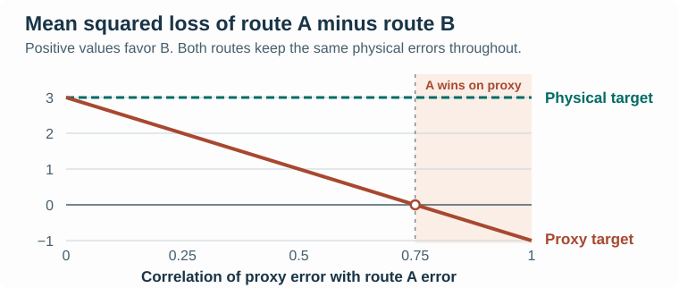
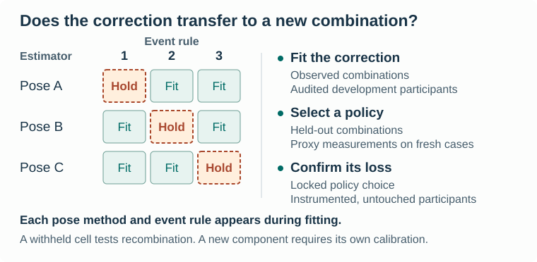

# When does agreement with a reference reward the worse tool?

**Research question.** With a fixed budget of independent measurements, does knowing which processing steps a tool shares with its reference help select a more accurate policy for a new combination of tools?

Consider an agent that dates foot contact from video. One route uses the same pose estimator as the software that supplies its reference timestamps. Both may place an occluded foot on the ground early. A second route may measure contact more accurately and still score worse against that reference. A force plate offers a way to discover the reversal. The proposed contribution is to learn when this agreement is misleading and test whether that lesson carries over to a new combination of familiar tools.

## What the loss tells us

Let $a$ and $b$ be the two timestamps, $r$ the software reference and $y$ the target. Define $D_t=(a-t)^2-(b-t)^2$. A positive value favors route B. Expansion gives

$$
D_y-D_r=2(r-y)(a-b).
$$

Reference bias averaged over all clips can be zero while the mean preference is wrong. The relevant quantity is the product of the reference error and the routes' disagreement. For a controlled example, give routes A and B errors $2Z$ and $W$, and give the reference error $\rho Z+\sqrt{1-\rho^2}\,U$, where $Z,W,U$ are independent standard normal variables. The expected physical loss gap is 3. The expected proxy gap is $3-4\rho$. Above $\rho=0.75$, the proxy selects A even though B still has one quarter of A's physical mean squared error.

*Figure 1. The curves follow from the constructed example. Only the dependence changes. On a real recording, occlusion can also change the accuracy of each route.*

## What can be learned

**Hypothesis.** At a fixed audit budget, a correction that pools information across shared pose estimators and event rules will select better policies on unseen combinations than a correction fitted to whole pipelines. It can fail when a filter interacts differently with each pose estimator or when apparent sharing is merely a marker of task difficulty.

Start with offline policy selection. Freeze a small library of policies, each choosing a route using only inexpensive evidence available before execution, such as camera geometry or motion speed estimated from preview frames. On development cases, run the policies to obtain candidate timestamps and a common software reference. These outputs are available to the policy *evaluator*. The deployed policy pays for its chosen route. An audit reveals one independent contact time for the case and thereby labels comparisons among all routes run on it.

For each route output $a$, predict its audited loss correction $(a-y)^2-(a-r)^2$. Fit a regularized regression with shared coefficients for the pose estimator and event rule, indicators of overlap with the reference and interactions with visible occlusion. Shrink interaction terms more strongly than main effects. Subtracting the corrected scores of two routes produces consistent rankings across the library. Varma et al. recovered dependencies among discrete labeling sources under structural assumptions. Here software ancestry is recorded and its relationship to error is learned from audits. [Varma et al., ICML 2019](https://proceedings.mlr.press/v97/varma19a.html)

**Why ordinary denoising could suffice.** Given all candidate outputs and evaluator features, the conditional mean of $y$ determines every expected squared-loss comparison. Moreover, replacing $y$ by a prediction $h$ yields comparison error $D_h-D_y=2(y-h)(a-b)$. Squaring this error gives ordinary label regression weighted by $4(a-b)^2$. Fit that weighted denoiser using the same component information, features and tuning budget. A tie would support the simpler denoising explanation. A gain over unweighted regression alone could come entirely from emphasizing cases where the decision matters.

Prediction-powered inference already estimates a target using many proxy measurements and a smaller paired audit. SureSim demonstrated why the *variance* of paired real and simulated discrepancies matters for estimating a fixed robot policy's mean. PPAI adjusts for adaptive arm selection and can downweight uninformative predictions. Hara et al. went further by choosing labels to reduce uncertainty about differences between candidates' losses. These results motivate two separate tests of transfer. [Angelopoulos et al., Science 2023](https://arxiv.org/abs/2301.09633) · [Badithela et al., SureSim, §§4–5](https://arxiv.org/abs/2510.04354) · [Sargent et al., ICML 2026](https://proceedings.mlr.press/v306/sargent26a.html) · [Hara et al., Machine Learning 2024, §§3–5](https://doi.org/10.1007/s10994-024-06603-1)

## Experiment and decision

1. **Establish the mechanism.** Reproduce the analytic crossing in Figure 1 with independently generated samples. Add movement-dependent errors and interactions. Include zero shared error, unrecorded shared error and deliberately permuted component histories. On real clips, rerun one reference component at a time with candidate outputs held fixed. Measure whether the independent preference is stable while proxy rankings move.
2. **Build an instrumented pilot.** Request BioCV, which recorded 15 healthy participants. For primary walking and running trials, use force-derived contact times (RON/LON). Check missing frames and synchronization flags, then vary force thresholds and plausible clock offsets. Freeze a matching rule and squared-time penalty per missed or extra contact before comparing policies. Score every eligible recording and report detection errors separately. The identity above applies to matched timestamps. The all-event comparison uses the full scored loss. StaBLE offers further development cases if recordings and independent anchors are available. Extension to joint angles requires a separate assessment of shared calibration and body models. [Evans et al., Scientific Data 2024, Methods and Technical Validation](https://doi.org/10.1038/s41597-024-04077-3) · [University of Bath access conditions](https://researchdata.bath.ac.uk/1258/)
3. **Transfer without target audits.** Cross pose estimators with foot-height, velocity and combined event rules. Withhold entire combinations on *every* fitting participant, including those combinations' numerical outputs as features. A single audited timestamp would otherwise label every held route that had run on the clip. Fit on the observed cells. On new development participants, rank policies built from the withheld combinations using proxy scores alone or model-based corrections. Compare an audit-only selector trained on the source combinations, a transported mean correction, a flexible regressor with the same inputs and the disagreement-weighted denoiser. Match source audits, execution cost and tuning access. Rotate held cells. Shuffling ancestry while preserving component frequencies tests whether its particular structure matters.
4. **Transfer with target audits.** Hold the source audit budget fixed and allow each method the same additional target budget. Randomly reveal a subset of target participants with known positive probabilities. For each policy, predict every participant's mean loss, then add $N^{-1}\sum_{i:A_i=1}(L_i-m_i)/p_i$ to the average prediction. Here $N$ counts eligible participants, $A_i$ records audit selection, $p_i$ is its logged probability, and $L_i-m_i$ is measured minus predicted participant loss. Freeze these predictions before the audit draw. Compare uniform allocation with a pilot-fitted rule that prioritizes uncertain loss *differences* between candidates. This separates what transfers before any new labels from how quickly fresh evidence resolves remaining uncertainty. Introduce new components in a separate recalibration test.

*Figure 2. Primary transfer test with zero target audits. All three pose estimators and all three rules are familiar. The withheld combinations alone are new.*

**Decision.** Lock each selected policy, then compare its loss with the strongest prespecified selector's on the same untouched participants. Average over participants, construct a paired interval and report the curve versus target audits. Treat excess loss over the best policy *on this finite confirmation panel* as descriptive. Also report acceptance of harmful changes, signed timing error in low-visibility clips, and the number of independently instrumented people behind each estimate. Use pilot variability and instrument precision to set the confirmation size and minimum useful gain before enrollment. HAIC H100s can batch one pose extraction per view and implementation. Cache its outputs across rules and report GPU-hours and audit minutes separately.

A gain exceeding that margin with uncertainty resolved on both new people and new compositions would support transfer. A tie between direct correction and denoising would narrow the contribution to how component sharing predicts error. If neither improves on ordinary rectification, report the ranking reversals and the audits needed to resolve them. If synchronization uncertainty can reverse the conclusion, real-data evidence remains inconclusive. A real-data gain measures agreement with the specified instrument.
