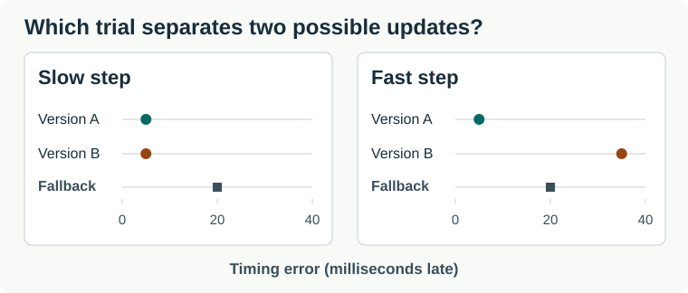
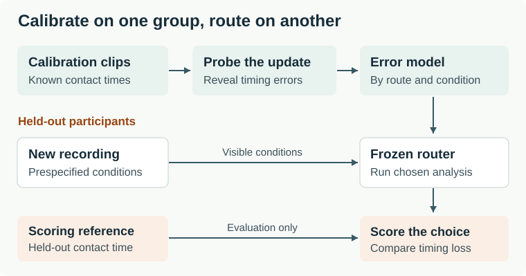

# Which calibration trials reveal when to switch measurement tools?

**Research question.** When a component of a measurement pipeline changes, can a few trials with known answers reveal which recordings now need a different analysis route? A lab estimating foot contact from video might replace its pose estimator while keeping the same event detector. The replacement could agree with the old pipeline on ordinary walking and shift contact estimates during fast steps. Measuring average error on more ordinary walks would give the lab little reason to switch.

**Hypothesis.** If errors recur when the same detector, frame sampling, or filter appears in different pipelines, a model that shares those effects across routes can learn where a downstream decision will change with fewer independently timed examples. The prediction concerns new *combinations* of familiar components. A detector with a genuinely unfamiliar failure mode provides a separate test of where transfer breaks down.

## What calibration can identify

Imagine a detector update with two equally likely versions. Both return contact 5 ms late on slow steps. On fast steps one remains 5 ms late and the other becomes 35 ms late. An alternative route is 20 ms late in both versions. Under absolute timing loss and equal processing costs, the best route on fast steps reverses. If the version is hidden and the agent can probe only slow steps, even unlimited slow-step trials leave the versions indistinguishable. Any routing rule then incurs 7.5 ms expected excess error on fast steps. One independently timed fast step distinguishes the versions in this noiseless example. With noisy reference times, the number of such trials becomes an empirical question.

*Figure 1. Constructed timing errors illustrate why an informative calibration trial depends on the alternative route as well as the tool being tested.*

**What prior studies establish.** ToolMaster learned to try unfamiliar APIs using teacher trials, supervised training and outcome reinforcement. Its StableToolBench and TMDB evaluations scored solved requests. ToolShield distilled simulated tests into written guidance and evaluated safe tool use. PEARL inferred a latent task from an unordered set of transitions. VariBAD conditioned actions on uncertainty inferred from trajectory prefixes. Their control experiments motivate a comparison against agents that infer task context from trials. [Gao et al., ToolMaster (2026)](https://arxiv.org/abs/2601.12762), [Li et al., ToolShield (v2, 2026)](https://arxiv.org/abs/2602.13379v2), [Rakelly et al., ICML 2019](https://proceedings.mlr.press/v97/rakelly19a.html), [Zintgraf et al., ICLR 2020](https://arxiv.org/abs/1910.08348v2).

A closer precedent is Oboe. It estimates a new dataset's row in a model-error matrix by running informative, inexpensive configurations. Liang and colleagues learned which exploration actions best improve later physical tasks, including pouring and dragging. Our proposed advance is the transfer of **conditional timing-error distributions across pipeline compositions**. The decisive comparison is whether that structure adds anything to budgeted experimental design and unstructured adaptation with the same observations. [Yang et al., Oboe, KDD 2019](https://web.stanford.edu/~udell/doc/yang2019_oboe.pdf), [Liang et al., RSS 2020](https://roboticsproceedings.org/rss16/p085.html).

## Learning from calibration trials

A calibration trial runs one route on a library clip and reveals the signed error in its estimate of first foot contact, or a missing detection. Declare the foot, step and force threshold in advance. In simulation the contact time is known. In real clips a synchronized force plate provides the reference. Resampling a time-stamped clip or changing the view of the same physical step preserves the target. Two tools that agree on an unlabeled clip can still share an offset.

Learn from past updates by hiding some route outputs during training and predicting them from the remaining probes. A set encoder summarizes the revealed errors without depending on their order. Its decoder predicts detection probability and a distribution of signed error for each route, conditional on predecision features such as sampling rate and walking condition. Pool effects for pose estimator, event rule and filter, with regularized interactions for detector by speed and filter by sampling. An ensemble fitted on development participants supplies candidate response models. Choose the affordable route with lowest expected loss across these models.

Score each potential probe by its expected reduction in routing loss on a fixed mix of future conditions, per incremental cost. Charge once for each clip reference, then charge for each tool execution. Expose the remaining budget and the availability of paid labels. Freeze model weights at deployment. New probes update the inferred response. Flag recording conditions poorly covered by calibration and test those flags on held-out conditions.

*Figure 2. The upper row uses calibration participants to characterize a replacement. The fitted router chooses and runs one route on each evaluation participant. Only the scorer sees that participant's force measurement.*

## The experiment that could rule this out

1. **Build a crossed panel.** Begin with known-time simulated steps spanning speed, visibility and frame rate. BioCV supplies a real pilot with 15 people, multiple camera views and force-derived left and right contact events. Check the synchronization record, missing frames and eligible foot strikes before analysis. Cross at least two independently implemented pose estimators with two contact rules, such as a foot-position extremum and a velocity threshold. Four cells can test these named replacements. Rotate several held-out cells while retaining each constituent component in training. Generalizing to a population of software updates requires additional, independently held-out implementations. Keep the people used to train or tune the model, populate the deployment calibration library, and score the final routing decisions disjoint. [Evans et al., BioCV, Scientific Data 2024](https://doi.org/10.1038/s41597-024-04077-3), [Bath archive and access terms](https://researchdata.bath.ac.uk/1258/).
2. **Separate names from behavior.** Cross unchanged versus replaced computation with original versus renamed interface. Exact renaming must preserve values, evidence and cost. Give every method the same schema mapping and component-sharing metadata. Use opaque IDs for replacements, with no version strings that reveal a known error profile. Compare retaining the previous route, documentation-only routing after canonicalization, a trial-history agent, and a policy trained to predict the winning route directly.
3. **Isolate the claimed transfer.** Adapt Oboe by completing a matrix with updates as rows and route-by-condition tests as columns. Give this baseline the same probe library and cost-constrained design. For the closest comparisons, cross three response models (a conventional mixed-effects regression, a generic set encoder and the component-sharing decoder) with three ways of choosing probes (fixed stratified trials, reduction in overall predictive uncertainty and reduction in routing loss). Match observations, descriptors, development labels and tuning effort. A win over random probing alone cannot distinguish better experimental design from better use of component structure.
4. **Evaluate the router.** For every eligible step require one route. Match a single detected event to the specified foot and window. Penalize missing or ambiguous detections at a registered cap in milliseconds and cap absolute timing loss at the same value. Report uncapped error on valid events and failure rates separately. Compare feasible routers by their participant-weighted paired loss difference. Report each held-out composition and fast-step stratum, interval coverage for timing errors at matched interval width, and accuracy on flagged versus supported conditions. Running every route offline gives a hindsight lower bound on loss at the same per-recording budget. Use it to report selection regret.

**Decision rule.** On development data choose a meaningful improvement larger than clock uncertainty, one primary joint budget for distinct references and compute, and a confirmation cohort size from the variation in paired gains across participants. Report the full budget curve, including zero probes. Record one-time bank construction and model fitting separately from incremental reference acquisitions and GPU time per update. Repeat calibration-library draws to show sensitivity to the few people used for probing. Support for the narrow claim requires paired lower confidence bounds above the registered margin against both the conventional and the generic active router on the prespecified real panel. An interval spanning meaningful gains and losses is inconclusive. A precise tie favors simpler calibration. A gain confined to simulated faults limits the finding to those faults.

**Feasibility.** BioCV access is by request. Cache pose outputs on Stanford HAIC H100s, then replay candidate calibration decisions on the cached panel. The independent timing and diversity of real replacements determine how much transfer can be tested. As a second acquisition setting, Uhlrich et al. released consented OpenCap validation videos. Their analysis aligned the measurement systems after acquisition, so establish alignment independently of the candidate tool before using millisecond errors. StaBLE can supply movement scenarios. Extend to joint angles only with a common angle definition and a separate kinematic reference. [Uhlrich et al., OpenCap, PLOS Computational Biology 2023](https://doi.org/10.1371/journal.pcbi.1011462).
