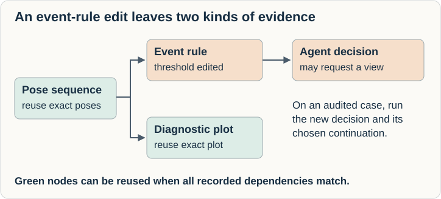
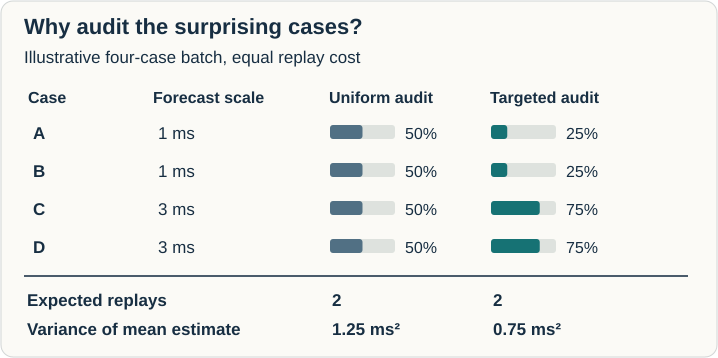

# Which recordings need another run after an agent changes?

**Research question.** When an edit changes a measurement pipeline, can the old execution trace predict where the effect of that edit will be hardest to estimate, well enough to select a better update under a replay budget?

A *harness* controls what an agent sees, which tools it calls and when it stops. Consider lowering the threshold for declaring foot contact. On a clear recording the reported time may move by one frame. On an ambiguous recording the same change may trigger a second camera view and a different final answer. A list of affected software components looks identical in both cases. The hypothesis is that the interaction between the edit and evidence in the old trace predicts this difference, even for an edit family withheld during training.

## What can survive an edit?

Reuse a deterministic result only if its dependencies are fully known and match, including inputs, code, calibration, model state and randomness where relevant. Run a cheap edited node first. If its entire downstream input and execution state are identical to the cached ones, reuse the continuation. Compare this early equality check with replay from the original input when a checkpoint cannot be restored. A change in model-visible context can change the next action. Follow the edited agent's actual continuation on an audited run. An old action sequence can serve as input to a forecast.

*Figure 1. Both branches use the same poses. Only the upper branch consumes the changed event rule. A plot that used the new event time would also need reprocessing.*

**Closest precedent.** CHILL-Harness learns workflow effects from paired interventions at restorable checkpoints and freezes the effect model for online orchestration. Wu, Nair and Candès use historical model-by-question results, factor modeling and active queries to estimate performance on a finite benchmark. Their primary outcome is binary success. The open question concerns incremental information. Once the selector has past outcomes, how much does access to the edit and its location in each old trace improve evaluation of continuous measurement loss on unfamiliar changes? [Fu et al., CHILL-Harness, Appendix A](https://arxiv.org/abs/2607.25825) · [Wu et al., Efficient Evaluation of LLM Performance with Statistical Guarantees, §§2–4](https://arxiv.org/abs/2601.20251v4)

## Predict the effect, then audit the prediction

Freeze an edit, an evaluator and a batch of $N$ recordings. For recording $i$, let $D_i$ be old minus new absolute contact-time error in milliseconds. A positive value favors the edit. The independent event reference and scoring convention are identical across versions. Pin a seed per case in the first study so that a complete paired run defines a finite table of outcomes. Repeat the study with new seeds to measure execution variability.

Fit two models on earlier edits and development participants. To predict improvement $m_i$, summarize the recorded features of nodes downstream of the edit, marking which supplied the next decision and including the old distance to the event threshold. Fit a small regularized model on these summaries. Compare with boosting on a flat encoding of the same fields. Estimate all features, including expected replay cost, before the audit. The second model estimates the mean *squared residual* of that prediction on out-of-fold development runs. A large but entirely predictable change needs little auditing.

Independently draw an audit indicator $A_i$ with preassigned, logged probability $p_i>0$ for each uncertain case. For a case whose final effect can be computed exactly, insert that value directly. For uncertain cases use the following contribution to the batch mean.

$$
\widehat D_i=m_i+\frac{A_i}{p_i}(D_i-m_i).
$$

Conditional on the fixed finite table and pre-audit predictions, this contribution has expectation $D_i$. Its variance is $(1/p_i-1)(D_i-m_i)^2$. Under an *expected* cost constraint, set $p_i$ proportional to the predicted root mean squared residual divided by the square root of replay cost, subject to a floor and a cap of one. This allocation follows by minimizing the sum of independent audit variances with a linear cost constraint. The learning question concerns whether old traces forecast those residuals more accurately than historical scores alone. [Zrnic and Candès, Active Statistical Inference, ICML 2024](https://proceedings.mlr.press/v235/zrnic24a.html) · [Liu et al., regression-assisted off-policy evaluation, AISTATS 2023](https://proceedings.mlr.press/v206/liu23d.html)

*Figure 2. In this worked example the residual magnitudes equal the forecast scales. The variance of the four-case mean is the sum of its audit variances divided by 16. Reversing the forecasts wastes budget. Actual replay counts fluctuate.*

## Experiment and decision

1. **Build an exhaustively scored test bed.** Start with synchronized walking trials and clean force-plate contacts from BioCV, subject to research access and timing checks. Use released force-derived events. Freeze a penalty for missing detections and report their frequency. Cross event-rule edits, numerical adapter edits, context changes and pose-model replacements with recording conditions. Include a harmless edit, an edit with broad effects and one whose damage concentrates in low-visibility recordings. Define recording-level loss as the average over prespecified contact windows so fast walkers do not receive extra votes. Report real software substitutions and implanted stress tests separately. Hide full paired runs for every candidate, case and seed from selectors. [Evans et al., BioCV data descriptor](https://doi.org/10.1038/s41597-024-04077-3) · [University of Bath access record](https://researchdata.bath.ac.uk/1258/)
2. **Match information and cost.** Apply caching and the cheap equality check for every method. Compare uniform audits, graph reachability, a change-and-test failure ranker adapted from predictive regression testing, a historical edit-by-case factor model for continuous losses, and the flat regressor. Develop on earlier edit families. Reserve entire edit families and participants for evaluation, with separate single-holdout and joint-holdout results. Test familiar benchmark recordings first. On new people *and* new edits, give all methods the same cheap baseline measurements and initial audit allowance. Count initial audits at their exact contributions. Conditional on these observations, freeze the updated forecasts and independently sample the remaining cases. Charge both waves to the same budget. Cross generic versus dependency-structured prediction with uniform versus residual-guided sampling. Shuffle edit locations while preserving graph size to test whether localization matters. Include a mixture with uniform sampling when uncertainty forecasts are poor. Full replay supplies the reference and cost ceiling. [Machalica et al., Predictive Test Selection](https://arxiv.org/abs/1810.05286) · [Regression Test Selection at Scale, Google Research](https://research.google/pubs/regression-test-selection-at-scale-4/) · [Li et al., Robust Sampling for Active Statistical Inference, NeurIPS 2025](https://proceedings.nips.cc/paper_files/paper/2025/hash/6389470564214983604d1ac81631c2c5-Abstract-Conference.html)
3. **Test the choice between candidates.** Freeze candidate menus on development data. Begin with two challengers and the option to keep the old harness. Under one design, split the expected budget evenly between challengers and audit independently. Under a second, audit both on the same selected recordings. Fit the residual scale of their *difference* on earlier edits, then allocate matched replays using the combined cost after caching. Sharing a costly pose calculation can change the preferred design. Compare both with uniform matched audits. Rank by estimated gain and measure regret against full replay and frequency of adopting a harmful change. If uncertainty about a single candidate falls but regret persists, narrow the claim to evaluation.
4. **Make acceptance falsifiable.** Cap absolute timing loss at a prespecified recording-window bound $B$, use the same cap for a missing event and clip predicted improvements to $[-B,B]$. Compare each challenger with the incumbent using simultaneous 95% bounds for the fixed menu. A conservative implementation applies Hoeffding's inequality across independent case draws with contribution range at most $2B/p_i$, then a Bonferroni adjustment across the registered comparisons. Include the registered low-visibility stratum with its own positive sampling floor and adjustment. Among challengers whose aggregate lower bound exceeds zero and whose subgroup bound rules out the prespecified harmful decrease, choose the one with highest estimated gain. If none qualifies, keep the incumbent. Report interval width, coverage, indecision and actual cost overruns across repeated masks of the exhaustive outcome table. Overly wide bounds can make this design impractical even when coverage is correct. Test the locked choice on unused people and fresh seeds for any population claim. [Zhao et al., Beyond Prompts, §§3–4](https://arxiv.org/abs/2609.05736)

**Feasibility and verdict.** Time pose inference on one HAIC H100 and time CPU reconstruction and disk reads separately. Cache per-view poses and batch identical model calls. Start with two real changes per feasible edit family before increasing the menu. Reference cost scales with eligible recordings × edits × seeds, less exact reuse. Time the slowest branch before fixing this grid. Report the research expense separately from the cost a lab would pay per future update, including predictor training amortized over a stated number of edits. At a prespecified budget, the hypothesis predicts lower held-out selection regret than both the historical-factor and equally informed generic predictors, with calibrated intervals. If simple caching absorbs the savings, or shuffled edit locations work equally well, the study bounds the value of learning edit locality. An aggregate estimate can guide selection even when an unaudited individual's measurement remains uncertain.
