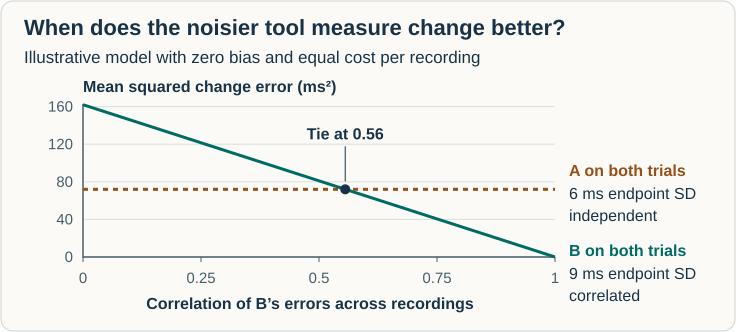
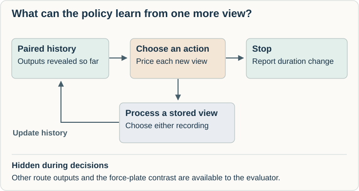

# When should two recordings be measured together?

**Research question.** When can a policy learn which measurement errors cancel across recordings and use that knowledge to estimate an individual's change more accurately at the same cost? The first target is the change in right-foot stance duration, in milliseconds, between two walking trials by the same person. This matters when a lab cares whether stance shortened even though either trial's absolute duration is uncertain.

## What makes this a learning problem?

For route errors $e_0$ and $e_1$ on the first and second recording, the error in the reported change is $e_1-e_0$. For a proposed pair of routes, before both outputs are observed, write $b_t$ and $v_t$ for the corresponding conditional bias and variance, and $c$ for the conditional covariance. The expected squared error follows directly from the variance of a difference.

$$
R=(b_1-b_0)^2+v_1+v_0-2c.
$$

Suppose tool A has 6 ms of random error at each trial (standard deviation) and its errors are independent. Tool B has 9 ms of error per trial and sometimes marks heel strike late by a similar amount twice while finding toe-off accurately. With zero bias, B measures change better once its error correlation exceeds $5/9$. A change of camera angle could alter that correlation. This calculation applies before the route outputs are observed. Once all candidate outputs are visible, every candidate contrast is a known number, and the remaining uncertainty is about the person's actual change. The scientific hypothesis is that a small panel of referenced pairs reveals *where* this dependence recurs across new combinations of cameras and event detectors. A competing explanation is that choosing one fixed route for both recordings captures essentially all the gain.

Dean et al. study before-and-after surrogate predictions for an **average treatment effect**. Their synthetic experiment varies how well the surrogate captures the affected latent variable independently of another predictor of outcomes. Their ECG study finds different agreement across cancer therapies before adjustment. Cowen-Breen et al. use pilot covariances and subset costs to allocate predictions and labels for a **population mean**. Borrow the first study's separation of contrast fidelity from endpoint prediction, and the second's covariance shrinkage on a small pilot. Both estimands differ from the error on an individual pair. [Dean et al., 2026, §§3, 6](https://arxiv.org/abs/2609.27180) · [Cowen-Breen et al., ICLR 2026, §§4–6](https://proceedings.iclr.cc/paper_files/paper/2026/hash/d79ead018586772763ee1e486bd12b3a-Abstract-Conference.html)

## Choosing which recording needs another view

A route maps a camera stream, pose estimator, and contact-event rule to a stance duration. For example, it might identify heel strike from a minimum in heel height and toe-off from foot velocity. Run several routes on each training recording and measure its force-plate duration independently. Predict the conditional mean of each route error and represent their covariance through a few shared factors. Each route has a weight on each factor, predicted from component identities, view geometry and tracking quality visible so far. The dot product of two routes' weights gives their modeled covariance, with an additional variance term specific to each route. Matching components offer a prediction of dependence that can be contradicted by data. Endpoint references and multiple route outputs on the *same pairs* make that test possible. Training on difference labels alone permits direct risk prediction but does not identify the separate variance and covariance terms. Even endpoint labels include instrument error. Repeat annotation and test plausible cross-trial reference correlations before attributing fitted dependence to the video routes.

Begin with one inexpensive estimate on each trial. A shared terminal predictor estimates change from the purchased outputs. A policy can report that estimate now or pay to process another stored view on either trial. Fit a common distribution for the pair's true durations given visible trial descriptors. Start with a bivariate Gaussian fit to the instrumented panel. Conditional on durations and descriptors, fit a detection probability for each route and a Gaussian factor model for the errors of successful detections. Given the evidence already bought, draw a possible duration pair, detection outcome and next-view measurement. Check sensitivity to heavy tails and joint detection failures by resampling whole development pairs' residuals and failure indicators. Cross-trial covariance enters this forecast *before* the view is bought. Simulate at most two extra views, choosing the action with the smallest expected final squared error plus a price per GPU-second. Tune that price on development participants to meet a declared mean workload. Freeze the terminal predictor for the acquisition comparison, then allow separate terminal fits as an ablation. Reverse each pair to check that the estimated change changes sign under symmetric costs and availability.

EDDI already chooses the next observation using estimated information gain given the available features. Li and Oliva train a policy with a generative model, intermediate rewards and a stop action, and ablate fixed acquisition order and stopping. Adapt both to the paired target. Compare a strong unrestricted controller with the same history, metadata, action space, terminal estimator options, training panels and costs. Any transfer gain then tests the proposed error structure. [Ma et al., ICML 2019, §§3–4](https://proceedings.mlr.press/v97/ma19c.html) · [Li and Oliva, ICML 2021, §§2, 5](https://proceedings.mlr.press/v139/li21p.html)

## Experiments and decisions

1. **Is dependence sufficient to change the decision?** Generate pairs with known durations, positive, negative and zero changes, and route errors with fixed endpoint marginals. Vary only their cross-trial correlation, independently of the true change. Manipulate whether changing cameras signals a loss of error correlation. Compare with the decision of a budget-matched oracle that knows the generating distribution and sees the same history. An identification control can make the ambiguity exact. Let two routes disagree by $2d$ ms on a candidate contrast, with identical recordings and tool outputs in two equally likely worlds. Define the hidden target in each world to equal a different route's estimate. Even the midpoint estimate has expected squared error $d^2$, whereas an oracle told the world has zero error. More unlabelled copies of those outputs cannot decide which route is right.
2. **Does it recur in real measurements?** The Bath BioCV archive requires a data-access request. Its 15 healthy participants each performed repeated walks in one session, recorded from nine synchronized 200 Hz views with force plates. In primary trials with a complete right-foot plate strike, derive stance duration from the force-derived RON and ROFF entries in `markers.events.time`. Mask all reference events and unpurchased outputs from the controller. Audit sync flags, missing recordings and multiple contacts before pairing. Select held-out people *before* making pairs, and withhold a detector × view configuration whose component levels were observed separately. Report eligible people and pairs and retain failures of the video routes. For missing or unresolved multiple events, charge a prespecified loss equivalent to a large duration error, set from development data, and report failure rates separately. StaBLE's cross-sectional balance scores cannot validate this endpoint. [Evans et al., Scientific Data 2024, Methods and Data Records](https://doi.org/10.1038/s41597-024-04077-3) · [Bath archive and access terms](https://doi.org/10.15125/BATH-01258) · [StaBLE, 2026 preprint](https://doi.org/10.64898/2026.09.16.750744)
3. **Which decision earns its cost?** Compare independent endpoint routing, a common route across trials, direct regression of change, static covariance-aware selection, fixed full-budget acquisition, and the adaptive baselines above. Use full-budget acquisition as an upper-cost reference. For a matched baseline, randomize between two fixed spending levels, with the mixing probability set on development cases. Compare at overlapping *achieved* mean costs, including initial estimates. Cross a route-factorized versus unrestricted error model with static versus sequential acquisition. Also set cross-trial covariance to zero while keeping estimated endpoint means and variances fixed. Cache per-recording outputs once on HAIC H100s and enumerate low-cost action sequences from them. Charge measured inference time for every revealed view and route, and report panel-generation and training costs separately. Extra views in this experiment were already recorded.
4. **What would justify another cohort?** At a prespecified budget compare participant-weighted root mean squared change error in ms, including failure penalties. Report paired uncertainty by resampling whole people, signed change bias, endpoint errors and performance on small changes of each sign. Set each direction-call threshold on development recordings to a common false-change rate across different views of the same performance. On held-out pairs, measure sensitivity to changes larger than reference uncertainty and realized false calls on these known nulls. Distinct performances can differ biologically. Vary plate timing thresholds where raw signals are available, propagate reference uncertainty, and report agreement with that reference. A separate, newly instrumented cohort with replicated reference measurements is needed for between-visit transfer or claims about clinical change.

Before evaluating a new cohort, register a useful RMSE improvement in ms above development reference uncertainty. Support for transfer requires the lower paired confidence bound on gain over the strongest unrestricted controller to exceed it on withheld real compositions at matched cost. A wide interval leaves transfer unresolved. If static joint selection matches it, the data support paired scoring alone. If only endpoint error improves, the experiment has supplied no evidence for learning cross-trial dependence. Fifteen people constitute a feasibility study, even when their recordings produce thousands of route pairs.
