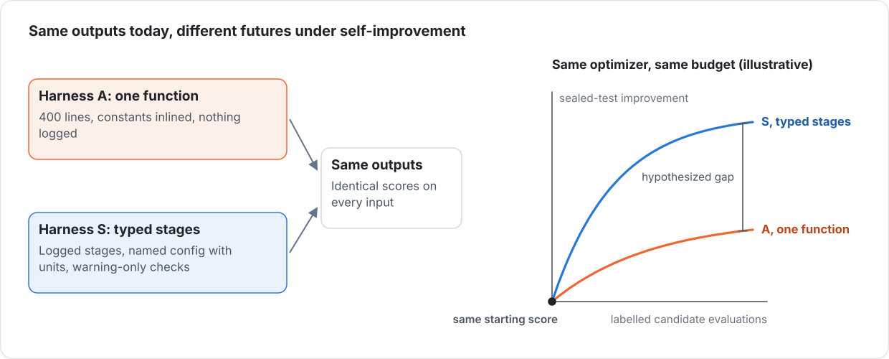
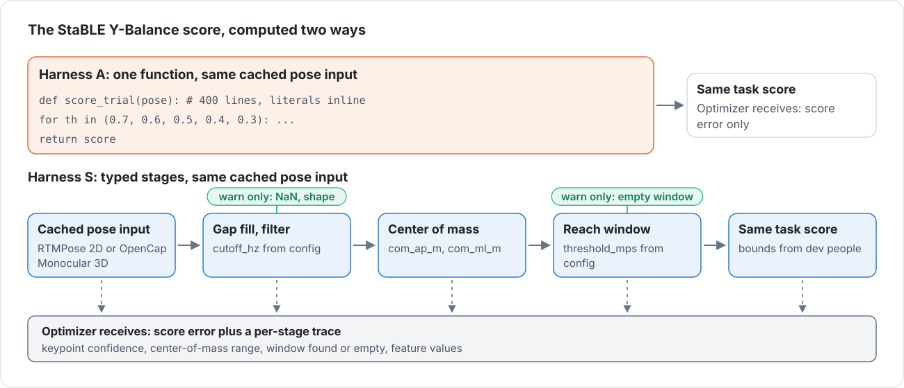
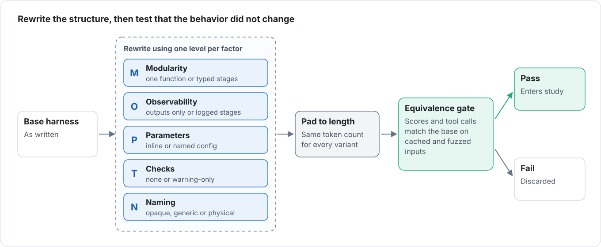
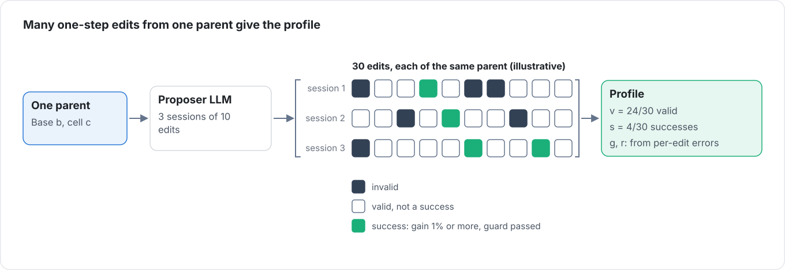
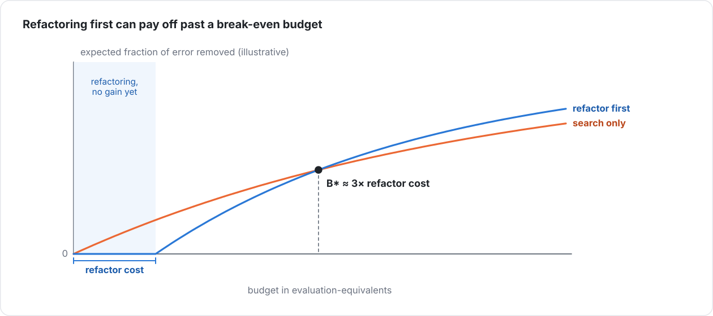
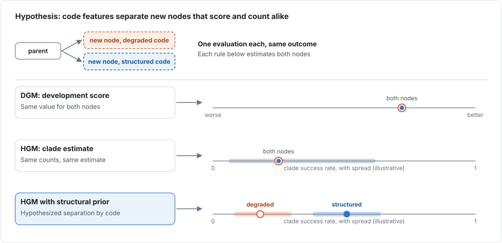
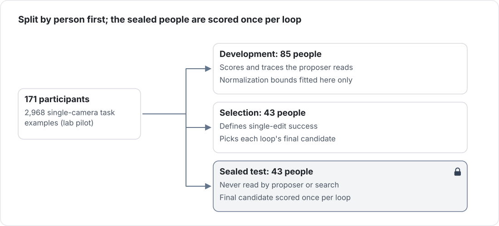
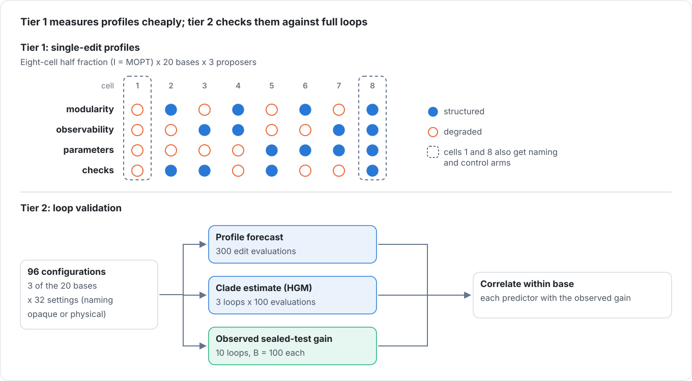

# What makes an agent harness easier to improve?

> **Research question.** When two harnesses return identical outputs on every input, does the way their code is written change how far a self-improvement loop improves them at a fixed budget, and can a cheap one-step measurement predict it?
>
> **Why it matters.** Self-improving systems pick parents by score or descendant record, and harness-evolution systems assume, untested, that modular, logged code is easier to improve. If so, loops should restructure before searching and rank newborn candidates by code.
>
> **ML contribution.** The decisive experiment rewrites 20 balance-scoring harnesses without changing outputs, measures one-step edits from three LLM proposers across five code properties, and checks them against 960 loops. It yields causal effects, a one-step forecast of loop gain, a code-based parent prior and a break-even budget for refactoring.
>
> **What would prove it wrong.** At matched length, neither structure's effect on one-step success (H1) nor observability's on the loops' sealed-test gain (H1b) reaches the smallest effect of interest, or one-step profiles forecast loop gain no better than descendant counts at equal evaluations (H3).

## The problem, in one concrete case

StaBLE [1](#ref-1) is a battery of 18 balance tasks recorded in 180 people with three smartphones and reconstructed with OpenCap, a markerless motion-capture system that estimates movement from two or more phone videos [2](#ref-2). Each task score averages min-max normalized features such as reach distance, extracted by public code [3](#ref-3). A lab pilot (internal and unpublished) applied the same rules to single-phone reconstructions from OpenCap Monocular [4](#ref-4). On 43 held-out people its task-averaged mean absolute error (MAE) was 0.146, worse than the 0.120 of a constant guess at each task's training mean. Only 567 of 729 task scores were valid, and Y-Balance, which alone explains 63% of the variance of the overall StaBLE score [1](#ref-1), got none. The reference script finds the reach window from a reversal in toe velocity, sweeping the threshold from 0.7 to 0.3 m/s, and no threshold found a window.

Now hand this harness to a self-improvement loop, in which a proposer LLM edits the code and better candidates are kept. Version A is one 400-line function with constants inline, so the loop's only evidence about Y-Balance is a missing score. Version S computes the same function in typed stages: pose input (2D keypoints from RTMPose [5](#ref-5) or OpenCap Monocular kinematics), filtering, center of mass, reach window and score. It logs each stage's summary to a trace file, keeps `threshold_mps` and `cutoff_hz` in a configuration file with units, and warns when a reach window is empty (Figure 2). Both return bit-identical scores, yet only S's trace shows that every monocular window was empty and where the toe speeds fell relative to the sweep. Errors in such a harness are silent (a doubled filter cutoff gives plausible scores with larger error), so code form may determine how much evidence a loop can use (Figure 1). If so, can a cheap early measurement predict the difference, and can a loop raise its own improvability by restructuring first?

Coding agents raise the same question. The Darwin Goedel Machine (DGM) evolves agents that rewrite their own Python code; it raised the Aider Polyglot pass rate from 14.2% to 30.7% along paths that often crossed lower-scoring nodes [6](#ref-6). Work on the Huxley-Goedel Machine (HGM) found that an agent's own score predicts poorly how much its descendants improve [7](#ref-7). Neither asks which properties of an agent's code make it a productive ancestor. Unit tests print failures while a wrong balance score looks like any other number, so if structure helps by exposing evidence, logging should help more in the measurement harness (H7).



*Figure 1. A and S return the same score on every input, so any gap between their curves comes from code form, including the trace it writes. Each point is an expected sealed-test improvement (illustrative).*



*Figure 2. S computes A's Y-Balance score in five typed stages with configured thresholds and two warning-only checks, and returns a per-stage trace with the score error.*

## Key ideas in plain terms

**Harness.** The code around a model or tool that turns inputs into outputs: here, the program mapping a recording's cached pose and kinematics to a task score; in a coding agent, its prompts, tools and control loop.

**Trace.** A text record a harness writes while it runs, beyond its outputs, such as per-stage keypoint-confidence quantiles or whether a reach window was found.

**Self-improvement loop and proposer.** A loop repeatedly proposes, evaluates and keeps changes to a harness; it is recursive when the changed code includes the procedure making the changes, as in the Self-Improving Coding Agent (SICA) [8](#ref-8), DGM and HGM. The proposer is the LLM that turns a parent's code, scores and trace into an edit. It acts as a mutation operator conditioned on the code's text, so names, comments or layout alone can change its edits.

**Behavior-preserving transformation (BPT).** A rewrite that leaves every output unchanged, such as splitting a function into stages, adding a log line, moving a literal into a configuration file or renaming identifiers (`v` becomes `toe_speed_mps`). The *equivalence gate* checks this by running both programs on the same inputs and comparing outputs.

**Improvability.** Let $J_{dev}$, $J_{sel}$ and $J_{test}$ be a harness's task-averaged MAE on the development, selection and sealed people defined below, with $J=J_{test}$. An optimizer (proposer plus search loop) run from harness $h$ with $B$ labelled candidate evaluations and seed $\omega$ returns a candidate $\hat h_B(h,\omega)$. The improvability of $h$ is

$$E_B(h)=\mathbb{E}_\omega\left[J(h)-J\big(\hat h_B(h,\omega)\big)\right].$$

Harnesses computing the same function have equal $J$, so any difference in their improvability comes from code form. Biologists call the analogous property evolvability and expect modular, low-pleiotropy maps (one change affecting few traits) to adapt faster [9](#ref-9), [10](#ref-10).

**Metaproductivity and the clade estimate.** Metaproductivity, HGM's term for the same idea, is how much a candidate's descendants improve. HGM estimates it for agent $a$ by pooling its clade (the agent and all its descendants) into $n_s$ successes and $n_f$ failures, a success being a solved benchmark task, and taking $n_s/(n_s+n_f)$ [7](#ref-7), so 3 successes and 1 failure give 0.75. Thompson sampling then draws a value per node from a Beta distribution with these counts and expands the largest draw. A newborn node has only its own evaluations, so its estimate is broad.

**Success events and the profile.** A *selection success* is a valid edit that lowers $J_{sel}$ by at least $\delta=1\%$ of the parent's value and passes a guard against shrinkage toward task means. A *development success* is the same event with gain and guard computed on development people. Loops accept only development successes, so the loop model, both forecasts and the clade counts use this event. The *single-edit success profile* summarizes many one-step edits from one parent and proposer (valid rate, success rate, mean gain, regression share); its selection success rate $s$ is the primary outcome.

**Equivalence test.** Two one-sided tests (TOST) show that an effect lies inside a pre-registered margin: with margin 0.025, two success rates are equivalent only if the 90% interval of their difference lies within ±0.025.

**The design in brief.** A *base* is one independently written harness for one StaBLE task family; there are 20. A *variant* rewrites a base, without changing any output, along five factors with a degraded and a structured level: modularity (M), observability (O), named parameters (P), warning-only checks (T) and naming (N, which also has a generic middle level). A *cell* is one combination of M, O, P and T levels in an eight-cell half fraction; cell 1 has all four degraded and cell 8 all four structured. *Development* people supply errors and traces to the proposer, *selection* people define edit success and pick each loop's final candidate, and *sealed* people, read by no search or selection step, score each loop's final candidate once. *Tier 1* profiles every cell, base and proposer (30B and 480B open models and a frontier API model). *Tier 2* runs loops with the 30B proposer on 96 *configurations*: three bases times all 32 settings of the five factors.

## What is known and what is missing

Harness-evolution systems such as Agentic Harness Engineering (AHE) [11](#ref-11) build on decomposition and observability without removing either, and evidence that code form matters to LLMs is mixed.

| Work | What it showed | What it leaves open here |
|---|---|---|
| DGM [6](#ref-6) | Self-rewriting coding agents whose lineages pass through lower-scoring nodes | Why some low scorers are good ancestors |
| HGM [7](#ref-7) | Clade estimate of metaproductivity, with Thompson sampling | No code features, so little data at birth |
| AHE [11](#ref-11) | Evolving a decomposed, observable harness lifts the first-attempt pass rate on Terminal-Bench 2 from 69.7% to 77.0% | Ablations add single evolved components; none removes the decomposition or an observability pillar |
| Code for Machines [12](#ref-12) | Medium open models break healthier code less when refactoring (Qwen: 19.3% against 27.8%); Sonnet 4.5's 13.2% against 16.0% is not significant | Observational; no optimizer or budget |
| Predict Before You Modify [13](#ref-13) | Forecasting a diff's outcome before evaluation gives up to 46% higher average performance than HyperAgents | No structural features |
| Meta-Harness [14](#ref-14) | A proposer reading prior code, scores and raw traces beats hand-built harnesses; scores alone or with summaries trail raw traces (median 34.6 and 34.9 against 50.0) | Never varies how the trace-writing harness is coded |
| When Names Disappear [15](#ref-15); Evaluating AGENTS.md [16](#ref-16) | Names change LLM outputs; context files do not raise success | No improvement loop |

No study we found randomizes behavior-preserving rewrites of a harness and measures how far an LLM optimizer then improves it at a fixed budget, and budget-allocation work ignores restructuring [17](#ref-17). Missing are a causal estimate of each structural property's effect with behavior and length fixed, its dependence on proposer capability, and a cheap predictor of it. Also untested is whether structure can rank newborn parents, where HGM has almost no data, or justify a refactoring phase with no immediate gain, which Predict Before You Modify leaves open [13](#ref-13). Since Meta-Harness shows that what the proposer reads matters, the O question is narrower: does it matter that the harness's own code fills a trace channel of fixed format and length?

## Hypotheses

1. **H1, structure raises one-step success.** For the 30B proposer at matched length, cell 8's selection success rate exceeds cell 1's.
2. **H1b, observability raises loop gain.** In tier-2 loops, O raises the final candidate's sealed-test MAE reduction.
3. **H2, the effect shrinks with capability.** The composite effect (cell 8 minus cell 1) declines from the 30B to the 480B to the frontier proposer. For the frontier proposer each M, O, P and T main effect lies within 0.025 of zero.
4. **H3, profiles forecast loops.** Within each base, the forecast $\hat F$ from a 300-edit profile correlates at least 0.6 with the mean sealed-test gain of its five single-incumbent loops (an estimate of $E_{100}$), more strongly than HGM's estimate from the same 300 evaluations.
5. **H4, structured cells get smaller, better-aimed edits.** Their successful edits touch fewer lines and break fewer correct examples, and fewer of their edits are invalid. Under O, edits citing a logged quantity succeed more often, and seeded defects are repaired in fewer evaluations.
6. **H5, a structural prior helps at birth.** At 0 and 5 descendant evaluations, code features raise the clade estimate's rank correlation with later metaproductivity and lower the regret of expanding its top node (that node's shortfall from the best). They do not hurt the correlation at 20.
7. **H6, refactoring first pays off past a predicted budget.** From the as-written and the degraded form, refactoring first overtakes search alone at the break-even budget $B^{\star}$ predicted from development-success profiles.
8. **H7 (exploratory), the O effect depends on the domain.** It is larger in the balance harness, whose errors are silent, than in the coding agent, whose tests print failures.

The table gives each hypothesis's primary test, which for H2 and H4 has more than one leg; every other test is secondary.

| | Experiment | Primary measurement and test | Falsified if |
|---|---|---|---|
| H1 | 1 | Cell 8 minus cell 1, 1,200 edits per cell; logistic mixed model | Upper end of the 95% interval below 0.05 |
| H1b | 3 | O main effect on sealed-test gain, 480 against 480 loops; paired mixed model | Upper end of the 95% interval below $0.25\sigma_{loop}$ |
| H2 | 1 | One-sided linear trend of the composite over proposers; TOST on each frontier main effect | Trend flat or rising, or a frontier main effect fails TOST |
| H3 | 3 | Raw within-base Pearson correlation; paired bootstrap of its difference from the clade estimate's | Point estimate below 0.6, or the difference's interval includes zero |
| H4 | 1, 2 | Share of the O effect mediated by lines touched and by regressions; hazard of repair; Holm across the three | Neither share excludes zero and O does not shorten repair |
| H5 | 4 | Spearman correlation and regret on 100 archive nodes | No gain at 0 and 5 descendants, or a loss at 20 |
| H6 | 5 | First checkpoint after which refactor-first stays ahead | Crossover outside the prediction's 95% interval, or none by 200 |
| H7 | 1 and second domain | Domain-by-O interaction on the log-odds scale | Reported as an estimate only |

## Method

The gate makes variants, the profile measures them (H1, H2, H4), a loop model turns profiles into forecasts and a break-even budget (H3, H6), and a code-feature prior adapts parent selection (H5).

### Structural factors

Every base is rewritten to both levels of each factor, so even a well-written base gets a degraded copy.

- **M:** one inlined function, or one typed function per stage, with array shapes and units annotated.
- **O:** outputs and exceptions only, or each stage also writes an aggregated summary of its intermediate values to the trace.
- **P:** constants inline, or a typed configuration with names, units and plausible ranges (`cutoff_hz: 6.0`, range 2 to 12).
- **T:** none, or generic assertions on shapes, units, ranges, monotonic time stamps and non-empty event windows; a violation writes a warning and never changes an output.
- **N:** opaque (`v17`), generic (`threshold`) or physical (`toe_speed_mps`).

Scripted syntax-tree transformations apply M, O, P and T, so they compose, after a person marks stage boundaries and constants once per base (Figure 3). An LLM that sees only the code does the renaming. Comments may not contain results, and a reviewer blind to the data audits 10% of variants for smuggled hints; a flagged variant is dropped from every arm of its base.



*Figure 3. Each variant takes one level per factor, is padded to a common token count, and enters only if it reproduces the base's scores and tool calls on cached and fuzzed inputs.*

### Equivalence gate

A variant passes three checks against its base:

1. bit-identical task scores on every cached development and selection input (float64, pinned library build; no labels are read);
2. identical scores on 10,000 fuzzed inputs per stage from the Hypothesis property-based testing library;
3. an identical sequence of tool calls, which here are reads of cached tool outputs (tool, recording, frame range); loop edits may change them, variants may not.

For new trace lines and warnings, the gate checks only that writing them never changes a score. A base enters a contrast only if every cell the contrast needs passes. The gate never runs on sealed inputs, because the refactor-first phase uses it inside search. After all loops end, one audit replays every frozen variant on them, and a mismatch voids every contrast that uses the variant. Before outcomes are examined, an audit reports each base's pass rate, branch coverage and starting $J_{sel}$, with the share charged to unscored trials.

Every variant of base $b$ is padded with neutral comments at function boundaries to a common length $L_b$, set for each proposer's tokenizer to the longest variant's token count plus 2%. Every arm gets one feedback channel of fixed format and length (the code, per-task development errors and the parent's aggregated development trace, with at most five per-trial excerpts), and O and T change only the trace's content.

### The single-edit success profile

For parent $h$ and proposer $q$, draw $n$ one-step edits in sessions of ten (Figure 4), giving children $h_1,\dots,h_n$ with

$$V_i,\;G_i\in\lbrace 0,1\rbrace,\qquad \Delta_i=\frac{J_{sel}(h)-J_{sel}(h_i)}{J_{sel}(h)},\qquad Z_i=V_iG_i\mathbf{1}\lbrace \Delta_i\ge\delta\rbrace,\quad \delta=0.01.$$

- **Valid.** $V_i=1$ when the child runs on all development and selection inputs within the time limit, raises no exception and leaves frozen files untouched.
- **Scoring rule.** Error uses a frozen list of eligible examples per split (those with a reference score), with one denominator for every candidate. A missing, non-finite or out-of-range score is charged $\max(y,1-y)$ for reference $y$ in $[0,1]$, the worst error an in-range score could have, so a missing score whose reference is 0.8 costs 0.8. Declining to score then never beats a guess, so repairing the unscored Y-Balance task registers as a gain. Coverage is reported separately, and a parent with zero selection error is not profiled.
- **Shrinkage guard.** Since a constant guess beats the pilot harness, pulling outputs toward task means can lower error without measuring anyone better. The guard sets $G_i=0$ when the mean within-task Spearman correlation with reference scores on selection people falls, counting a task with missing or constant outputs as 0. It also sets $G_i=0$ when some task's outputs become constant or lose over half their standard deviation. Such edits are reported separately.
- **Profile.** $(v,s,g,r)$: the means of $V_i$ and of the success indicator $Z_i$, the mean gain of successes, and their mean share of development examples whose error rises by more than 0.02, a pleiotropy proxy. The same rules on development people give the development variant $(s_{dev},g_{dev})$.

A session is ten fresh continuations from one proposer context and seed, each shown one-line summaries of earlier edits but never selection outcomes; seeds are shared across a base's cells, so contrasts are paired.



*Figure 4. Thirty one-step edits of one parent in three sessions of ten, scored on selection people (illustrative); $g$ and $r$ need per-edit errors the squares do not show.*

### A loop model and a break-even budget

Treat a loop as accept-if-better search in which each proposal succeeds independently with probability $s$ and each success removes a fraction $g$ of the remaining error. With $K\sim\mathrm{Binomial}(B,s)$ successes in $B$ proposals, the expected fraction of error removed is

$$F(B)=1-\mathbb{E}\left[(1-g)^{K}\right]=1-(1-sg)^{B}.$$

The Meta-Harness-style loop accepts only development successes, so the profile measures its acceptance event and forecasts use $(s_{dev},g_{dev})$. They need only $sg$, estimated as the mean development gain per edit with non-successes counted as zero, so it is finite when none succeeds. H3's forecast is $\hat F=F(100)$. A refactor-first phase of fixed cost $C_R$ evaluation-equivalents (the proposer tokens of one search step) moves the profile to $(s',g')$. It is ahead at budget $B$ when $(1-s'g')^{B-C_R}$ falls below $(1-sg)^{B}$, which gives the break-even budget (Figure 5)

$$B^{\star}=C_R \frac{\ln(1-s'g')}{\ln(1-s'g')-\ln(1-sg)}\approx C_R \frac{s'g'}{s'g'-sg}.$$

Raising $sg$ from 0.010 to 0.015 gives $B^{\star}\approx 3C_R$, and if $s'g'\le sg$ the model predicts no crossover. It describes the single-incumbent Meta-Harness-style loop, with OpenEvolve as a secondary check, and ignores the error floor and the decline of $s$ as easy fixes run out; tier 2 tests whether it still ranks configurations and predicts the crossover.



*Figure 5. Illustrative loop-model curves with $sg$ raised from 0.010 to 0.015: refactoring first gains nothing while it spends the refactor cost $C_R$, then overtakes search alone at $B^{\star}\approx 3C_R$.*

### A structural prior for parent selection

Let $x_a$ be static features of agent $a$'s code: function count and lengths, logged quantities, named parameters and the share with units, assertions, identifiers that are words or carry unit suffixes, and token length. With $p_a=\sigma(w^\top x_a)$, the estimated clade metaproductivity (CMP) and its Thompson draw replace HGM's flat prior (Figure 6):

$$\widehat{\mathrm{CMP}}(a)=\frac{n_s+\kappa p_a}{n_s+n_f+\kappa},\qquad \mu_a\sim\mathrm{Beta}\big(\tau(n_s+\kappa p_a),\;\tau(n_f+\kappa(1-p_a))\big),$$

where $\sigma$ is the logistic function, $\tau$ is HGM's temperature schedule, kept unchanged, and $n_s$ and $n_f$ pool the clade. Each evaluated node except the root adds one count per task: a success if it is valid, passes the guard and lowers that task's development MAE by 1% relative to its own parent, else a failure. HGM's estimates in H3 and H5 use the same counts. Weights $w$ and pseudo-count $\kappa$ are fit by beta-binomial maximum likelihood, which makes the observed counts most probable when each node's rate is drawn from a Beta distribution centered on $p_a$. With $\kappa=10$ and $p_a=0.2$, one success in 4 task counts gives $(1+2)/(4+10)=0.21$, and HGM's Thompson draw is the case $\kappa=2$, $p_a=0.5$. The estimate starts at $p_a$ and converges to HGM's as descendants accumulate. For a node of base $b$, the prior is fit on per-task development outcomes of the other bases' tier-1 children and of archive nodes from the other two tier-2 bases, so training includes LLM-evolved code. Each feature's shift between training and test nodes is reported.



*Figure 6. The hypothesis H5 tests: two new nodes with degraded and structured code, one evaluation each and the same outcome. DGM's score and HGM's counts cannot tell them apart; the structural prior separates them from code features alone. Positions and spreads are illustrative.*

### Refactor-first phase

The proposer receives the transformation catalogue and outputs restructuring edits, each kept only if it passes the gate, so the phase spends tokens and CPU time but no labelled evaluations. It runs once per base, starting form and arm, and every loop of that arm continues from its frozen output. It makes the loop recursive, since it restructures the code it will later optimize. Proposer tokens are fixed, so this arm gets $C_R$ fewer labelled evaluations; an unverified-refactor arm skips the gate.

### Optimizers and proposers

OpenEvolve [18](#ref-18) keeps an island archive (sub-populations that evolve separately and exchange candidates) and edits only between evolve markers, comments that here enclose the whole harness body. A Meta-Harness-style loop [14](#ref-14) shows the proposer the incumbent's code and aggregated trace plus a 5,000-token table of the most recent and best earlier candidates (diff summary and scores), and accepts only development successes. Both optimizers are fixed across arms and use one prompt template, temperature 0.8, top-p 0.95, 4,000 output tokens and a 64,000-token context. The proposers are Qwen3-Coder-30B-A3B-Instruct (3.3B of 30.5B parameters active) [19](#ref-19) served with vLLM [20](#ref-20) on one H100, Qwen3-Coder-480B-A35B-Instruct [21](#ref-21) on an eight-H100 node, and one frontier API model pinned to a dated version at registration.

```
# Tier 1
for base b in bases:                          # 20 independently written harnesses
    for cell c in cells + other_cells + naming_arms + control_arms:   # other_cells: frontier only
        h = pad(apply_bpts(b, c), L_b)
        if not equivalence_gate(h, b): drop_from_contrasts(b, c); continue
        trace = aggregate(run(h, dev_people))  # fixed format and length
        for q in proposers_for(c):             # 30B, 480B, frontier
            for k in range(sessions(q, c)):    # 3 by default; 6 for 30B on cells 1 and 8; 4 for frontier
                for i in range(10):
                    diff = q.propose(h.code, dev_errors(h), trace,
                                     earlier=summaries(b, c, q, k), seed=(b, k, i))
                    child = apply(diff, h)
                    for split in (selection_people, dev_people):   # selection and development events
                        record(split, valid(child), rel_gain(child, split), guard(child, split))
                    record(regressions(child, dev_people), lines_touched(diff),
                           cites_logged_quantity(diff.rationale))
```

## Experiments

### Data and splits

The lab's single-camera StaBLE recordings cover 171 participants and 2,968 usable task examples (lab pilot counts). Before any cache, profile or prior is built, they are split by person into 85 development, 43 selection and 43 sealed people (Figure 7). The sealed people are the pilot's test split; no base author sees per-person outputs on them, and the Y-Balance failure is confirmed on development people before any base is written. Normalization bounds are refit on development people; the published ones span all 180 people [1](#ref-1). Loops use at least five seeds, because runs are noisy and order-sensitive [22](#ref-22) and selected candidates inherit a winner's curse [23](#ref-23); intervals are clustered by person.



*Figure 7. The three person-level splits and what each supplies; only development people inform the proposer and the normalization bounds.*

### Base harnesses

Twenty bases cover five StaBLE task families (standing, reaching including Y-Balance, sit-to-stand, single-leg, and jump or gait) with four implementations each: a port of the public `get_features` logic [3](#ref-3), two written by different people from the preprint, and one by an LLM outside the proposer families. Tier 2, the defect probe and the refactor experiment use three bases from different families and authors; three others are reserved for parent selection.

### Baselines

DGM's score-based parent selection [6](#ref-6); HGM's clade estimate with Thompson sampling [7](#ref-7); its budget-efficient variant HGM-Dual [24](#ref-24); a forecaster in the style of the Improvement Dynamics Model (IDM) of Predict Before You Modify [13](#ref-13), which predicts the outcomes of 300 proposed edits without evaluating them; uniform selection; search alone; and unverified refactoring.

### Metrics

The primary tier-1 outcome is $s$; secondary outcomes are $v$, $g$, $r$, coverage, guard failures, lines touched and the share of rationales citing a logged quantity. For loops the primary outcome is the final candidate's sealed-test MAE reduction, with the area under the best-so-far curve and within-task Spearman correlation secondary. The defect probe reports evaluations to repair, localization (whether the edit touches the defective stage) and diagnosis accuracy.

### Core experiments

1. **Tier-1 profiles (H1, H2, H4).** A $2^{4-1}$ fractional factorial (Figure 8) over M, O, P and T with defining relation $I=MOPT$ and N generic. In this resolution IV design a main effect is confounded only with a three-way interaction, and two-way interactions are confounded in pairs, such as MO with PT; cell 2, for example, has only M and T structured. Each variant gets 30 edits per proposer, except that the 30B proposer gets 60 on cells 1 and 8 (for H1) and the frontier proposer 40 on all 16 M, O, P and T combinations, so its main effects are unconfounded (for H2). This gives 23,600 factorial edits; opaque and physical naming of cells 1 and 8 add 7,200 and the controls 10,200, for 41,000.
2. **Seeded defects (H4).** Four defects are planted identically in all eight cells of three bases, so defective variants stay mutually equivalent: a doubled filter cutoff, swapped anterior-posterior and medial-lateral axes, 30 frames per second assumed for 60, and centimetres read as metres. This gives 480 repair loops (30B proposer, at most 30 evaluations, five seeds). Each proposer output must begin with a stated cause, scored against the defect by an LLM judge outside the proposer set and checked on 10% by two blind raters.
3. **Tier-2 loops (H1b, H3).** For three bases, all 32 combinations of the five binary factors (N opaque or physical) give 96 configurations, each run for ten loops (two optimizers, five seeds) at $B=100$, so each main effect compares 480 against 480 loops. H3 uses the five Meta-Harness-style loops, which the loop model describes. Each configuration also gets a 300-edit profile, whose forecast is frozen before loops are scored, and three extra 100-evaluation loops whose pooled per-task development counts give HGM's estimate from as many evaluations.
4. **Parent selection (H5).** One hundred nodes from tier-2 archives, where behavior varies, each get five continuation loops of 20 evaluations. The first feeds the estimators at 0, 5 and 20 descendants; the other four measure empirical metaproductivity as the mean selection gain of each loop's best descendant. As a secondary test, uniform, DGM, HGM, HGM-Dual and HGM with the prior run on the three reserved bases with ten seeds at $B=150$.
5. **Refactor first (H6).** Three bases, each started from the as-written form and from cell 1.
    - *Arms:* $C_R=0$, 10 and 25 with the gate, and 25 without, each crossed with two optimizers and five seeds and run to 200 evaluation-equivalents (240 loops).
    - *Prediction:* $B^{\star}$ from 300-edit development-success profiles of the six starting forms and the twelve frozen refactored variants (5,400 edits).
    - *Crossover:* in the Meta-Harness-style loop, each checkpoint's incumbent (every 25 evaluation-equivalents) is fixed by development error alone and then scored on selection people. The crossover is the first checkpoint after which the refactor arm's selection error stays below that of search alone, compared with the prediction rounded to the same grid.



*Figure 8. Tier 1 (top) profiles every cell for 20 bases and three proposers, with naming and control arms on the dashed cells 1 and 8; the frontier proposer also gets the other eight. Tier 2 (bottom) correlates, within base, two predictors built from 300 evaluations each with observed sealed-test gain (for H3, of the five single-incumbent loops).*

### Ablations and controls

Each control rules out one explanation; all but the last use every proposer on 20 bases at 30 edits per variant.

- **Length.** Padded cell 1 is the length-matched placebo for cell 8, and unpadded copies of cells 1 and 8 measure what padding itself does.
- **Vocabulary.** A synonym-renamed cell 8 separates changed names from more informative ones.
- **Trace source.** An external tracer gives cell 1 O's per-stage summaries while its code stays as written; if this matches the O main effect, the emitting harness adds nothing beyond the information. Because the check uses one cell, O effects are reported as the joint effect of instrumented code and its trace.
- **Trace format.** A raw-trace cell 8 receives its per-trial trace files in place of the summary under the same token budget, separating a null for O from a null for aggregated O.
- **Label noise.** Cells 1 and 8 are rerun with the 30B proposer and development labels permuted across people. Any fall in permuted-label development error is fitting noise, so a larger fall for cell 8 means the richer trace helps the loop fit noise. A selection advantage that survives permutation comes from label-free repairs, such as finding an empty reach window.

The optimizer may not edit the evaluator or the checks, and the StaBLE bases and coding variants are new, so no proposer saw them in pretraining.

### Statistical analysis

The primary model is a logistic mixed model on tier-1 edits,

$$\mathrm{logit}~P(Z_e=1)=\beta_0+\sum_f\beta_f c_{fe}+\gamma_{q(e)}+\sum_f\theta_{f,q(e)}c_{fe}+u^{base}_{b(e)}+u^{cell}_{b(e)c(e)}+u^{sess}_{k(e)},$$

with $c_{fe}\in\lbrace -1,1\rbrace$ the level of factor $f$ for edit $e$, proposer effects $\gamma_q$, factor-by-proposer interactions $\theta_{f,q}$, and random intercepts for base, base by cell, and session. Effects are average marginal effects (the mean change in predicted success probability when a factor moves from degraded to structured), with bootstrap intervals over bases, sessions and selection people. The smallest effect of interest is 0.05 (0.10 against 0.15), and the equivalence margin is 0.025. Secondary main-effect tests use Holm correction across five contrasts: the four factorial main effects and physical against generic naming, pooled over cells 1 and 8.

Power comes from simulation and closed-form checks. Edits in a session are correlated, inflating variance by the design effect $1+(m-1)\rho$ for session size $m$ and intraclass correlation $\rho$; at an assumed $\rho=0.05$, ten-edit sessions give 1.45, and detecting 0.10 against 0.15 at 80% power takes about 995 edits per arm. Twenty bases give power 0.99, 0.95 and 0.72 for base-by-arm heterogeneity of 0, 0.2 and 0.4 on the logit scale, and three bases at most 0.38.

For H1, 1,200 edits per cell give a standard error of 0.016 and two-sided power 0.87 (0.81 at heterogeneity 0.2). A TOST with margin 0.025 passes only if the estimate lies within 0.025 minus 1.645 standard errors of zero, so the default 2,400 edits per factor level would pass a true null for all four factors with probability 0.09. The frontier proposer's 6,400 edits per level give a standard error of 0.0064, per-factor power 0.98 (0.96 at heterogeneity 0.2) and joint power 0.91 (0.86). Equivalence is claimed factor by factor, and a blanket null needs all four.

With loops paired by base, the minimum detectable effect (MDE) at 80% power is

$$\mathrm{MDE}=2.80\,\sigma_{loop}\sqrt{2/n_{loop}}$$

for seed-to-seed spread $\sigma_{loop}$ of sealed-test gain and $n_{loop}$ loops per arm. Tier-2 main effects (H1b) detect $0.18\sigma_{loop}$, below the smallest effect of interest, $0.25\sigma_{loop}$; refactor and parent-selection arms of 30 loops detect only $0.72\sigma_{loop}$, so H5's primary test uses archive nodes. For H3, 96 configurations detect a positive correlation with power near 1. The comparison with the clade estimate uses one statistic, the mean over bases of the within-base difference between the two correlations, with a bootstrap that resamples sealed people jointly across configurations and seeds within configuration. Simulated with independent configurations and five loops each, its power is 0.80 when the true correlations are 0.7 and 0.3 but 0.35 at 0.6 and 0.4; shared people lower both, so it is powered only for gaps above 0.4.

Mediation (H4) uses the interventional approach of Imai and colleagues with a sensitivity analysis [25](#ref-25), since mediators are not randomized, and repair times use a discrete-time hazard model censored at 30. For H7 the minimum detectable difference between the domains' O effects is about 0.054, above the effect of interest, so H7 is exploratory.

### Second domain: a self-improving coding agent

The replication uses Aider Polyglot, 225 Exercism problems in six languages [26](#ref-26), with the DGM [6](#ref-6) and SICA [8](#ref-8) seed agents as bases. Problems are split by exercise name (100 development, 50 selection, 75 sealed), so an exercise in several languages stays in one split. The 30B model is both the frozen task model and the proposer. A $2\times2$ design over M and O plus an opaque-naming arm gives five length-matched variants per base with 250 edits each, so each main effect compares 1,000 against 1,000 edits. An edit succeeds when the selection pass count rises by more than the 95th percentile of rerun-to-rerun changes of the unchanged parent. Parent selection is replicated with HGM's 800-evaluation protocol [7](#ref-7) for DGM, HGM, HGM-Dual and HGM with a refit prior, with five seeds each.

## How to read the results

| Outcome | What it would mean | What we would do next |
|---|---|---|
| H1, H1b and H3 hold | Code has a measurable improvability that score hides | Release the profile tool and prior |
| H1 and H1b fail, and frontier main effects pass TOST | Structure does not matter at these budgets, against AHE's premise | Publish the equivalence result |
| Padded cell 1 matches cell 8, or the external trace matches O | Length or delivered information drives the effect | Study length or feedback directly |
| Raw-trace cell 8 beats cell 8 while O is null | Aggregation limits what the trace delivers | Repeat O with raw traces |
| Profile correlation below 0.6, or no better than the clade estimate | One-step and long-run improvability diverge | Profile two-edit chains |
| Prior no better than HGM's at 0 and 5 descendants | Code features carry no metaproductivity signal | Drop the prior, keep the profile |
| Refactoring first never wins, or misses its crossover | The loop model is too crude, or refactors do not raise $sg$ | Add diminishing returns |

## Compute, data and scope

The 30B model is assumed to process 5,000 tokens per second on one H100, and the 480B model 2,500 per second on an eight-H100 node. A tier-1 edit uses about 16,500 tokens (15,000 input, mostly padded code and trace, and 1,500 output) and a loop step about 22,000. Tool CPU is bounded by the pilot's 1.5 s per example, and a task family has about 300 development and 150 selection examples, so an edit costs at most 11 CPU-minutes and a loop step 7.4. Scoring an accepted candidate on selection people costs 3.75, budgeted for 40% of the 219,700 loop steps below.

| Item | Units | Tokens | H100-hours | CPU-hours |
|---|---|---|---|---|
| Cache OpenCap Monocular outputs (if needed) | 2,968 clips at 3.8 min | none | 188 | small |
| Tier 1, 30B proposer | 12,600 edits | 208M | 12 | 2,310 |
| Tier 1, 480B proposer | 10,200 edits | 168M | 150 | 1,870 |
| Tier 1, frontier API proposer | 18,200 edits | 300M | none | 3,340 |
| Seeded-defect probe | 14,400 steps | 317M | 18 | 1,780 |
| Tier-2 loops | 96,000 steps | 2.1B | 117 | 11,840 |
| Tier-2 profiles | 28,800 edits | 475M | 26 | 5,280 |
| Tier-2 clade-estimate loops | 28,800 steps | 634M | 35 | 3,550 |
| Archive nodes | 10,000 steps | 220M | 12 | 1,230 |
| Parent selection | 22,500 steps | 495M | 28 | 2,780 |
| Refactor first | 48,000 steps | 1.06B | 59 | 5,500 |
| Refactor profiles and gates | 5,400 edits, 210 gated refactors | 89M | 5 | 1,030 |
| Selection scoring of accepted candidates | 87,900 candidates | none | none | 5,490 |
| Second domain | 2,500 edits on 50 problems each, plus replication | 4.5B | 250 | 4,900 |

For example, tier-2 loops are 96,000 steps (96 configurations, ten loops, 100 steps); at 22,000 tokens each that is 2.1 billion tokens, or 117 H100-hours at 5,000 tokens per second. A 200-step pilot checks these token and CPU figures first. The second-domain row assumes 30,000 tokens per Polyglot attempt, so scoring 2,500 edits on 50 problems each takes about 3.8 billion tokens, and reruns, the replication and sealed scoring add 0.7 billion. Its 148,000 attempts are assumed at 2 CPU-minutes each.

The total is about 710 H100-hours on Stanford HAIC (900 if OpenCap Monocular must be rerun), 10.3 billion open-model tokens and 50,900 CPU-hours. The frontier proposer's 300 million tokens cost about 410 to 1,230 USD at assumed prices of 1 to 3 USD per million input and 5 to 15 USD per million output tokens. StaBLE videos require lab access; features, scores and code are public [1](#ref-1), [3](#ref-3), as are Aider Polyglot and both seed agents. No model is trained.

## Risks and limitations

- **Successes could be shrinkage.** Mild shrinkage that keeps ranks and over half the spread passes the guard, so guard failures and Spearman correlations are reported beside every success rate.
- **Bases are a sample.** Claims cover harnesses like these 20; tier-2 claims are conditional on three bases and the 30B proposer.
- **The sealed people are not new.** They were scored once in the pilot, the only cohort available, so a confirmatory claim would need a fresh cohort.
- **The clade event is adapted.** HGM counts solved tasks, so H5 in biomechanics tests an adaptation to per-task error improvements, and the coding replication tests HGM's own counts.

## Where to learn more

1. **Stanford CS329Z, Assignment 1, "Building an Agent Harness"** ([repository](https://github.com/cs329z/assignment1-harness)): builds the kind of harness rewritten here.
2. **CS329Z, Lecture 9, "Optimization"** ([slides](https://web.stanford.edu/class/cs329z/slides/lecture09.pdf)): GEPA and MIPRO, two prompt optimizers that read traces.
3. **Stanford CS329A, Mon Oct 13, "Open-Ended Evolution of Self-Improving Agents"** ([schedule](https://cs329a.stanford.edu/#schedule)): the DGM archive and its parent selection.

## References

<a id="ref-1"></a>1. Heigold H, Ruth PS, Muccini J, et al. StaBLE: digital metrics capture balance performance across a wide spectrum of balance tasks and abilities. bioRxiv, 2026. https://doi.org/10.64898/2026.09.16.750744

<a id="ref-2"></a>2. Uhlrich SD, Falisse A, Kidzinski L, et al. OpenCap: Human movement dynamics from smartphone videos. PLOS Computational Biology 19(10): e1011462, 2023. https://doi.org/10.1371/journal.pcbi.1011462

<a id="ref-3"></a>3. Stanford Neuromuscular Biomechanics Lab. stable-analysis (feature extraction and scoring code, MIT license). GitHub, 2026. https://github.com/stanfordnmbl/stable-analysis

<a id="ref-4"></a>4. Gilon S, Miller EY, Uhlrich SD. OpenCap Monocular: 3D Human Kinematics and Musculoskeletal Dynamics from a Single Smartphone Video. arXiv:2603.24733, 2026. https://arxiv.org/abs/2603.24733

<a id="ref-5"></a>5. Jiang T, Lu P, Zhang L, et al. RTMPose: Real-Time Multi-Person Pose Estimation based on MMPose. arXiv:2303.07399, 2023. https://arxiv.org/abs/2303.07399

<a id="ref-6"></a>6. Zhang J, Hu S, Lu C, Lange R, Clune J. Darwin Goedel Machine: Open-Ended Evolution of Self-Improving Agents. arXiv:2505.22954, 2025. https://arxiv.org/abs/2505.22954

<a id="ref-7"></a>7. Wang W, Piekos P, Nanbo L, et al. Huxley-Goedel Machine: Human-Level Coding Agent Development by an Approximation of the Optimal Self-Improving Machine. ICLR 2026; arXiv:2510.21614. https://arxiv.org/abs/2510.21614

<a id="ref-8"></a>8. Robeyns M, Szummer M, Aitchison L. A Self-Improving Coding Agent. arXiv:2504.15228, 2025. https://arxiv.org/abs/2504.15228

<a id="ref-9"></a>9. Wagner GP, Altenberg L. Perspective: Complex Adaptations and the Evolution of Evolvability. Evolution 50(3):967 to 976, 1996. https://dynamics.org/~altenber/PAPERS/CAEE/

<a id="ref-10"></a>10. Clune J, Mouret J-B, Lipson H. The evolutionary origins of modularity. Proc. R. Soc. B 280:20122863, 2013; arXiv:1207.2743. https://arxiv.org/abs/1207.2743

<a id="ref-11"></a>11. Lin J, Liu S, Pan C, et al. Agentic Harness Engineering: Observability-Driven Automatic Evolution of Coding-Agent Harnesses. arXiv:2604.25850, 2026. https://arxiv.org/abs/2604.25850

<a id="ref-12"></a>12. Borg M, Hagatulah N, Tornhill A, Soederberg E. Code for Machines, Not Just Humans: Quantifying AI-Friendliness with Code Health Metrics. FORGE 2026; arXiv:2601.02200. https://arxiv.org/abs/2601.02200

<a id="ref-13"></a>13. Xie Z, Xu C, Jiang Y, Zhao L. Predict Before You Modify: Learning Improvement Dynamics for Self-Evolving Agents. arXiv:2610.13991, 2026. https://arxiv.org/abs/2610.13991

<a id="ref-14"></a>14. Lee Y, Nair R, Zhang Q, et al. Meta-Harness: End-to-End Optimization of Model Harnesses. arXiv:2603.28052, 2026. https://arxiv.org/abs/2603.28052

<a id="ref-15"></a>15. Le CC, Pham MVT, Van CD, et al. When Names Disappear: Revealing What LLMs Actually Understand About Code. arXiv:2510.03178, 2025. https://arxiv.org/abs/2510.03178

<a id="ref-16"></a>16. Gloaguen T, Muendler-Sasahara N, Mueller MN, et al. Evaluating AGENTS.md: Are Repository-Level Context Files Helpful for Coding Agents? arXiv:2602.11988, 2026. https://arxiv.org/abs/2602.11988

<a id="ref-17"></a>17. Luo S, Huang Y, Li M, et al. Where Should the Evaluation Budget Go in LLM-Driven Agent Scaffold Evolution? arXiv:2610.37276, 2026. https://arxiv.org/abs/2610.37276

<a id="ref-18"></a>18. Sharma A. OpenEvolve: an open-source evolutionary coding agent. GitHub, 2025. https://github.com/algorithmicsuperintelligence/openevolve

<a id="ref-19"></a>19. Qwen Team. Qwen3-Coder-30B-A3B-Instruct (model card). Hugging Face, 2025. https://huggingface.co/Qwen/Qwen3-Coder-30B-A3B-Instruct

<a id="ref-20"></a>20. Kwon W, Li Z, Zhuang S, et al. Efficient Memory Management for Large Language Model Serving with PagedAttention. SOSP 2023; arXiv:2309.06180. https://arxiv.org/abs/2309.06180

<a id="ref-21"></a>21. Qwen Team. Qwen3-Coder: Agentic Coding in the World (release blog). 2025. https://qwenlm.github.io/blog/qwen3-coder/

<a id="ref-22"></a>22. Ye Q, Li Y, Pruksachatkun Y, et al. On the Fragility of Self-Improving Agents: Variance, Task Order, and Underspecification. arXiv:2608.18066, 2026. https://arxiv.org/abs/2608.18066

<a id="ref-23"></a>23. Hu L, Tang Y. The Winner's Curse in LLM Self-Improvement Loops. arXiv:2610.09239, 2026. https://arxiv.org/abs/2610.09239

<a id="ref-24"></a>24. Paul S, Quan P, Kumar A, et al. HGM-Dual: Lineage-Aware Guided Agent Harness Optimization for Long-Horizon Planning. arXiv:2610.30042, 2026. https://arxiv.org/abs/2610.30042

<a id="ref-25"></a>25. Imai K, Keele L, Yamamoto T. Identification, Inference and Sensitivity Analysis for Causal Mediation Effects. Statistical Science 25(1):51 to 71, 2010; arXiv:1011.1079. https://arxiv.org/abs/1011.1079

<a id="ref-26"></a>26. Aider project. Aider polyglot benchmark. 2024. https://aider.chat/2024/12/21/polyglot.html
