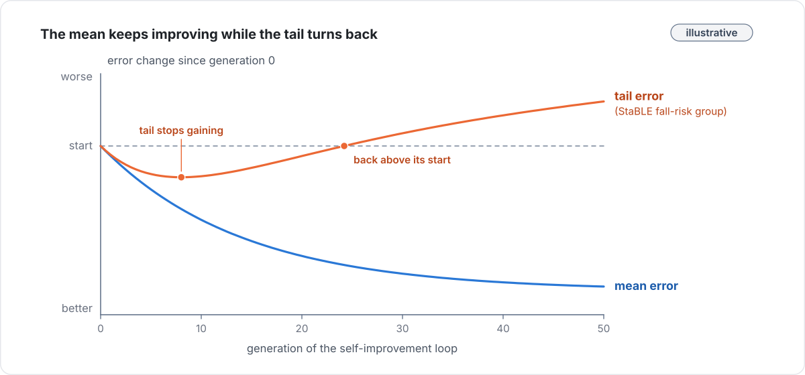
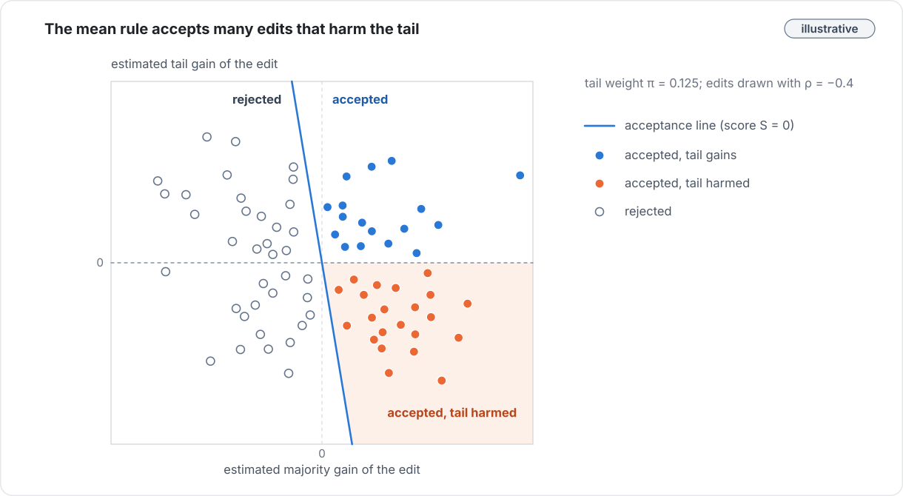
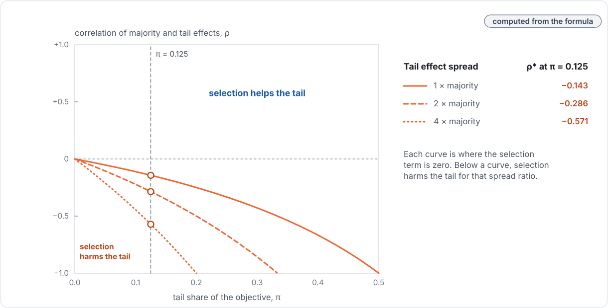
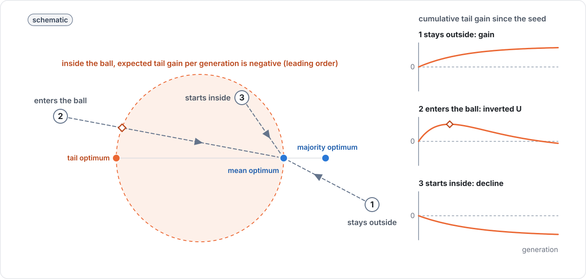
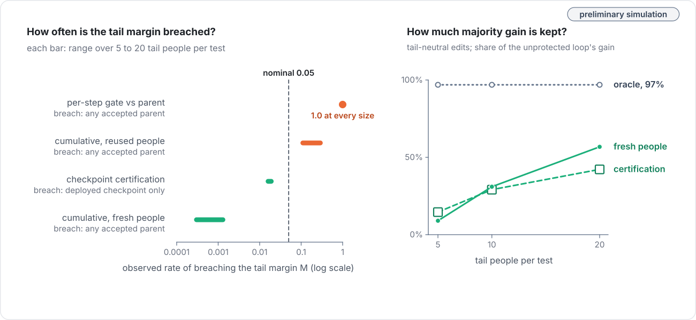
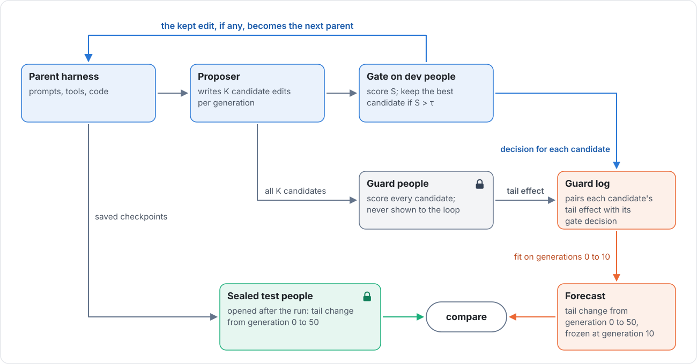
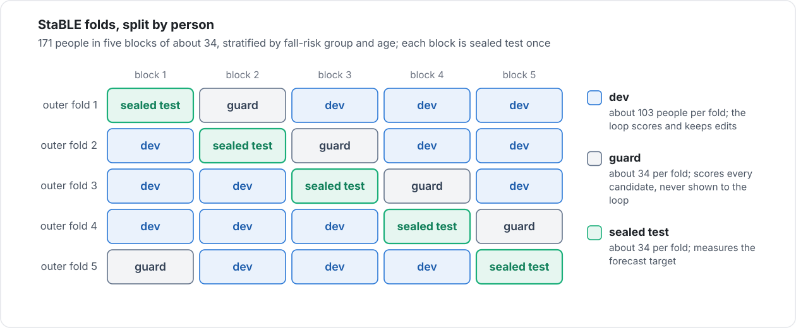
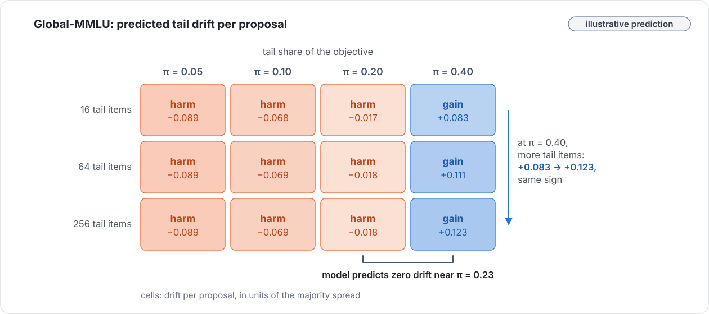

# Who does self-improvement leave behind?

> **Research question.** When a self-improving agent keeps only edits that lower its average error, how does a small group fixed in advance (people at risk of falling) fare, and can the loop forecast this early from the candidates it scores?
>
> **Why it matters.** Balance tools exist to find people who balance poorly, about one in seven in StaBLE, yet GEPA, Meta-Harness and the Darwin Gödel Machine select edits on scores the majority dominates. No published study tracks a subgroup's held-out error across such a loop's generations.
>
> **ML contribution.** A held-out estimate of the covariance between an edit's effect on the group and the score that selects it, which sets the group's fate, with a forecast and a dose-response test built on it and a sample-size rule for protective gates.
>
> **What would prove it wrong.** A generation-10 forecast of the generation-50 change no better than extrapolating the group's own curve, or Global-MMLU tail drift that does not change sign where that covariance crosses zero.

## The problem, in one concrete case

In the StaBLE "rise to toes" task a participant rises onto the toes, holds and comes down while phones record it. The task score averages features such as peak upward center-of-mass speed and peak ankle angle, each rescaled to 0 to 1 between cohort bounds. StaBLE covers 180 people aged 18 to 87 on 18 tasks [1](#ref-1), [2](#ref-2). Consider an agent built on Qwen3-VL-8B, an 8-billion-parameter vision-language model [3](#ref-3), that receives one phone's video (Cam0), calls RTMPose for 2D keypoints [4](#ref-4) or OpenCap Monocular for 3D kinematics [5](#ref-5), computes the features in code and returns a score. A reflective optimizer such as GEPA [6](#ref-6) rewrites the agent's prompts, tool routes and code, keeping each rewrite that lowers mean absolute error on development people (those the loop scores while it edits).

Most development people are healthy adults who rise steadily, and edits that help them can hurt the rest. A stronger low-pass filter tuned to quiet standing may flatten the large excursions that define poor balance. A clamp toward typical feature values biases the extremes clinicians care about most, and the faster RTMPose route may lose track during a protective step (a step taken to stop a fall). These are hypotheses; a five-person perturbed-walking study of older adults found more missed gait events, though not significantly [7](#ref-7). If people at fall risk are one in eight, the acceptance test (the gate) passes an edit that raises each of their errors by 0.07 task-score units whenever it lowers everyone else's by just over 0.01. After 50 generations (rounds of propose, score and keep), the mean can have fallen at every step while their error climbed (Figure 1). We call such a group, fixed before the loop starts, the tail. A lab pilot (internal account) points to a second cause, shrinkage toward the mean, which H4 separates from selection.



*Figure 1.* Illustrative trajectories under the mean gate: mean error (blue) falls throughout, while fall-risk-group error (orange) bottoms out at the first marker and passes its starting value at the second.

The same structure appears in a tool-using question-answering agent on Global-MMLU, which poses MMLU questions in 42 languages [8](#ref-8). If the development set mirrors usage, high-resource languages (those with abundant web text) dominate it. An edit that routes every question through an English translation tool may then raise average accuracy while lowering it in languages the translator handles poorly, again a hypothesis.

The question is whether a loop can predict how its tail will fare on sealed test people from candidates it already scores on a held-out guard set, and which acceptance rule protects the tail most cheaply. It is open because published work tracks items or averages.

## Key ideas in plain terms

**Harness, loop and child.** The harness is everything around the base model: prompts, tools and their parameters, and the code that combines outputs. In a self-improvement loop a proposer model edits the current harness (the parent); each edited copy is a child, or candidate, and the loop keeps some as new parents.

**Gate.** The gate is the test a candidate must pass to be kept. The mean gate keeps a child whose average development score beats its parent's; best-of-$K$ keeps the best of $K$ candidates if it passes. The Darwin Gödel Machine (DGM) instead samples parents from an archive of all candidates [9](#ref-9).

**Tail.** Here a tail is a group of people fixed before the loop starts, by recorded covariates (the fall-risk group, age 70 and above) or by outcome (the bottom score decile). Outcome-defined tails suffer regression to the mean (people picked for an extreme score move toward average when remeasured, whatever the edit), so the primary tail uses covariates.

**People sets.** The loop selects on development people. Guard people score every candidate but stay hidden from the proposer and the gate, and sealed test people evaluate finished checkpoints only.

**Guard log, panel and drift.** The guard log records each candidate's guard-measured tail effect next to the gate's decision. A panel is a batch of single-step edits of one parent, all scored. Tail drift is the expected tail gain one round of selection produces.

**Correlated-response law.** When selection acts on one trait, a correlated trait moves by its regression on the selected trait times the shift selection produced [10](#ref-10), [11](#ref-11). Here the selected trait is the gate's score $S$ and the correlated trait is an edit's true tail gain $b$. The tail's expected change per accepted edit is then its average edit effect plus a term proportional to $C$, the covariance of $b$ with $S$. When $C$ is negative, the harder the gate selects, the more the tail loses (Figure 2). Price's equation writes the same response as a covariance between trait and selection weight, with no Gaussian model, and so also covers DGM-style parent sampling [11](#ref-11).

**Winner's curse and shrinkage.** The best of several noisy scores overstates its value because it was picked partly for its noise [13](#ref-13), [14](#ref-14). Shrinkage, pulling predictions toward the mean, lowers average error without selection and raises it for people far from the mean.

**Non-inferiority and bio-creep.** A non-inferiority test asks whether a new version is at most a margin $M$ worse than a reference. Comparing each version only with its predecessor lets permitted losses accumulate (bio-creep, a drug-development term Feng and colleagues applied to medical-device software [16](#ref-16)), which comparing every candidate with the seed $h_0$ prevents.

**Alpha-spending and fixed-sequence testing.** Alpha-spending splits one error budget $\alpha$ over many tests [17](#ref-17); fixed-sequence testing tests hypotheses in a preset order at full $\alpha$, stopping at the first failure, which controls false rejections under any dependence.



*Figure 2.* Illustrative edits by estimated majority and tail gain, drawn with a correlation of $-0.4$. At tail weight 0.125 the acceptance line is nearly vertical, so many accepted edits harm the tail (orange).

## What is known and what is missing

Agent studies show aggregate gains hiding item and capability losses [18](#ref-18), [19](#ref-19), [20](#ref-20) and keep-if-better acting as selection under noise [14](#ref-14); elsewhere, mean-driven training widens disparities [21](#ref-21), [22](#ref-22), [23](#ref-23) and hides clinical failures on rare subsets [24](#ref-24). Tail-protective selection [25](#ref-25), [26](#ref-26), [27](#ref-27), [16](#ref-16) and the correlated response [12](#ref-12), [10](#ref-10), [11](#ref-11) are established, so no new formula is claimed.

| Work | What it showed | What it leaves open for this question |
|---|---|---|
| Mitra and Mahmud 2026 [18](#ref-18) | Item-level churn exceeded the net change at least fivefold in five of nine configurations | Measures items; no human subgroups, rule or forecast |
| SAGE 2026 [19](#ref-19) | A per-item paired test cut regressions in 19 of 20 settings | A small group can lose on every edit while wins elsewhere pass the test |
| Hu and Tang 2026 [14](#ref-14) | Keep-if-better is selection under noise; fresh rescoring removes the mean bias; instrumented runs score every candidate on held-out items | Only the mean; no joint distribution of gains across groups, no long-horizon forecast |
| Wei and colleagues 2026 [28](#ref-28) | Retention bounds and fresh-data admission for harness evolution | No subgroup guarantee stated |
| CVaR-RMD 2026 [25](#ref-25) | Selection on CVaR (conditional value at risk, the mean loss of the worst fraction) in LLM-driven program evolution helps tails | Tails over test conditions; no groups of people, mechanism or guarantee |
| Cooper and Lenski 2000; Blanquart 2014 [29](#ref-29), [30](#ref-30) | Early trade-offs in evolving *E. coli*; conflicting effects near an optimum in Fisher's model | Which timing holds for agent edits |

No study we found tracks a pre-defined human subgroup's sealed-test error across an accept-if-better agent loop's generations, forecasts it from the loop's records, or sizes the tail sample a protective gate needs. Hu and Tang score every candidate on held-out items and model each generation's winner's inflation [14](#ref-14). The contribution therefore rests on $C$: a guard set estimates it from candidates the loop already produces, and the law turns it into a drift forecast and a prediction of which rules fail.

## Hypotheses

Two tests carry the proposal: H2 in E4's rescoring arm, where frozen edits are re-selected at four tail weights so only selection changes, and H1 in E3, where a forecast frozen at generation 10 must beat extrapolation at generation 50 (table opening Experiments).

**H1, forecast.** A forecast of the sealed-test change in tail error from generation 0 to 50, fitted to the guard log of generations 0 to 10 and frozen there, beats two comparators in paired absolute error across loops: linear extrapolation of the tail's guard-measured curve, and the same forecast fitted on accepted candidates alone. Its 90% interval covers the realized change in at least 80% of loops.

**H2, dose-response.** In Global-MMLU, raising the tail weight $\pi$ moves the selection term (defined in Method) from negative to positive within one grid step of the $\pi$ at which $C$, estimated on held-out edits, crosses zero. Changing the number of tail items scored, $n_B$, rescales the term without flipping its sign, first on frozen candidates and then in full loops.

**H3, timing.** Two rivals are registered: drift is negative from generation 0, as Cooper and Lenski found in *E. coli* [29](#ref-29) (H3a), or positive and then negative, as Fisher's geometric model (Method) predicts for a seed beyond the tail optimum [30](#ref-30) (H3b). The sign of drift predicted before a run must match the sign in its later panels.

**H4, mechanism.** If the mean gate harms the StaBLE tail, part of that harm survives a shrinkage-neutral criterion, error after a per-fold affine recalibration fitted on development people.

**H5, price and validity.** (a) The cumulative per-group gate with fresh gate items breaches the margin $M$ in at most 5% of loops. (b) At each $n_B$ it keeps a share of majority gain within the interval from rerunning simulation A4 (Method) with E1's moments. (c) When $C<0$, the rules order by tail drift as Baselines predicts.

## Method

The law says when selection on the mean harms the tail and the timing model when that sign turns; the guard log and forecast measure the law's inputs in a running loop, and the gate, its sample-size rule and its validity conditions decide which rule protects the tail most cheaply. Preliminary simulations check each part: A1 the closed form, A2 best-of-$K$, A3 the geometric model, guard estimator and forecast, and A4 the protective gates.

### Notation and the correlated-response law

Harnesses are $h$, with seed $h_0$, and generations are $t$. A candidate edit's effects are its true reductions in mean loss relative to its parent, $a$ on the majority and $b$ on the tail, jointly Gaussian over the proposer's edits with means $\mu_a,\mu_b$, spreads $\sigma_a,\sigma_b$ and correlation $\rho$. Gains are positive when error falls; harms are positive when tail error rises. The tail's weight in the objective, $\pi$, defaults to its population share (about 0.14 for StaBLE's fall-risk group) and is set by design in Global-MMLU.

The numbers of people scored, $n_A$ and $n_B$, are kept separate from $\pi$, so oversampling tail people cuts noise without changing the objective. With per-person variance $v$ of the child-minus-parent loss, the loop's estimates $\hat a$ and $\hat b$ carry independent noise of variance $s_a^2=v/n_A$ and $s_b^2=v/n_B$. The gate accepts when the score $S=(1-\pi)\hat a+\pi\hat b$ exceeds a threshold $\tau$ ($\tau=0$ for the plain mean gate).

Because $(b,S)$ is bivariate Gaussian with $C=\mathrm{Cov}(b,S)$, regressing $b$ on $S$ gives, for any selection that depends on $S$ alone,

$$\mathbb{E}[b\mid\text{selected}]=\mu_b+\frac{C}{\sigma_S^2}\Big(\mathbb{E}[S\mid\text{selected}]-\mu_S\Big),\qquad C=(1-\pi)\rho\sigma_a\sigma_b+\pi\sigma_b^2,$$

$$\mu_S=(1-\pi)\mu_a+\pi\mu_b,\qquad \sigma_S^2=(1-\pi)^2(\sigma_a^2+s_a^2)+\pi^2(\sigma_b^2+s_b^2)+2\pi(1-\pi)\rho\sigma_a\sigma_b .$$

For the plain mean gate, with $z=\mu_S/\sigma_S$ and the inverse Mills ratio $\lambda(z)=\phi(z)/\Phi(z)$ (normal density over distribution function, Heckman's selection correction [12](#ref-12)),

$$\mathbb{E}[b\mid S>0]=\mu_b+\frac{C}{\sigma_S}\,\lambda(z),\qquad D=\mathbb{E}\big[b\,\mathbf{1}\{S>0\}\big]=\mu_b\,\Phi(z)+\frac{C}{\sigma_S}\,\phi(z).$$

The drift per proposal $D$, the expected tail gain from one candidate facing the gate alone, is the tail's average edit effect times the acceptance rate plus a selection term $(C/\sigma_S)\phi(z)$. The selection term is the covariance of an edit's tail effect with the gate's decision, $\mathrm{Cov}(b,\mathbf{1}\{S>0\})$, which the guard log estimates directly. Its sign is that of $C$, and noise enters it only through $\sigma_S$, so more tail evaluation rescales the selection term but cannot flip it. Total $D$ can still flip with noise when $\mu_b$ and $C$ differ in sign, because noise also moves the acceptance rate.

With $\mu_b\le0$ the tail loses on every accepted edit in expectation whenever $\rho$ is below the correlation at which $C=0$,

$$\rho^*=-\frac{\pi\,\sigma_b}{(1-\pi)\,\sigma_a}.$$

At $\pi=0.125$, $\rho^*$ is $-0.143$ for equal spreads and $-0.571$ when the tail's spread is four times larger (Figure 3). A1 confirmed the closed form in 1,344 cells. Best-of-$K$ replaces $\lambda(z)$ with $m_K(c)$, the mean of the largest of $K$ standard normals given that it exceeds $c=(\tau-\mu_S)/\sigma_S$, which grows roughly like $\sqrt{2\ln K}$ and amplifies the selection term in the direction of $C$ (5.6-fold from $K=1$ to 50 in A2).



*Figure 3.* Computed from the law: the threshold correlation $\rho^*$ against the tail's share $\pi$ for three ratios of tail to majority spread; below a curve, the selection term harms the tail. The vertical line marks one tail person in eight.

### When the sign changes

In Fisher's geometric model from evolutionary biology [30](#ref-30), the harness is a point $x$, each group's loss is the squared distance to its optimum ($x_A$ or $x_B$), and an edit is a random step with covariance $\Sigma_\delta$. With the mean optimum at $x_w=(1-\pi)x_A+\pi x_B$, to leading order in step size

$$C\approx 4\,(x-x_B)^\top\Sigma_\delta\,(x-x_w),$$

which is negative when the tail and mean gradients conflict once weighted by the covariance of proposed steps. For isotropic edits this happens, to the same order, inside the ball whose diameter joins $x_B$ and $x_w$. The seed's position relative to the ball sets one of three regimes (Figure 4).

A3 reproduced the three regimes in ten dimensions. Its inverted U peaked while $\rho$ was still above $\rho^*$, because random steps cost the tail on average ($\mu_b<0$), so the turn comes where $D$ changes sign, slightly before ball entry, and E5 predicts that sign.



*Figure 4.* Schematic. Inside the shaded ball the expected tail gain per generation is negative to leading order in step size (the exact turn comes slightly earlier). Seed 1 stays outside and the tail gains; seed 2 enters at the diamond, where its cumulative tail gain (right) peaks before falling, possibly below zero; seed 3 declines from the start.

### Estimating drift from the guard log

Each candidate is scored on development people, giving the gate's input $S_{\text{dev}}$, and on disjoint guard people, giving its tail effect $\hat b_{\text{guard}}$ relative to its parent. In a panel (E1) each of $m$ edits of one parent faces the gate alone, and

$$\hat D=\frac{1}{m}\sum_{e=1}^{m}\hat b_{\text{guard},e}\,\mathbf{1}\{S_{\text{dev},e}>\tau\},\qquad \hat D_{\text{sel}}=\hat D-\hat\mu_b\,\hat P,$$

where $\hat\mu_b$ and $\hat P$ are the panel's mean guard effect and acceptance rate. In a running loop the incumbent's change $\hat\Delta_t$ in generation $t$ is the kept child's guard effect. These increments are differences on the same guard people, so along the lineage they sum to the guard-measured change since $h_0$, which checks the log; in a DGM-style archive the sum follows the reported best harness's lineage.

Guard noise is independent of development noise, so both estimates, and the covariance of $\hat b_{\text{guard}}$ with $S_{\text{dev}}$ over all candidates as an estimate of $C$, are unbiased without a Gaussian assumption. The naive correlation of $\hat a$ and $\hat b$ is attenuated by noise (in A3 a true 0.6 read as 0.21 when $s_b=2\sigma_b$), so it is reported both raw and disattenuated (corrected for noise using bootstrap noise variances).

### The forecast

At generation 10 a forecast of the tail change from generation 0 to 50 is frozen and registered. It is a mean-field recursion, replacing each generation's random outcome by its expectation: each generation adds the kept child's expected majority gain and tail change, $\mathbb{E}[b_{(K)}\mathbf{1}\{S_{(K)}>\tau\}]$ for the top-scoring candidate under best-of-$K$. The moments $\mu_b$, $\sigma_b$ and $C$ are linear in the cumulative majority gain $\Gamma_t$, with an exponential approach to a limit as the registered alternative.

A loop without its own panel logs only 44 candidates by generation 10 for six coefficients, so moments are fitted hierarchically across seeds of the same condition, with the matching generation-0 panel, where one exists, as the prior for the intercepts. Intervals combine a bootstrap over guard people and candidates with seed-to-seed spread. With known moment functions the recursion called every inverted U correctly in A3 (20 of 20 cells); H1 tests whether moments fitted over ten generations extrapolate to fifty.

### A design rule for tail sample size

Take a candidate with cumulative tail harm $R$ relative to $h_0$ and per-person harm spread $\sigma_R$. A one-sided test of $R\ge M$ at level $\alpha_l$ passes it with probability about

$$\Phi\Big(\frac{(M-R)\sqrt{n_B}}{\sigma_R}-\Phi^{-1}(1-\alpha_l)\Big),$$

with $\Phi^{-1}$ the standard normal quantile. Requiring pass probability $p^\star$ at $\bar R$, the typical cumulative harm of proposed candidates, with $\alpha$ split evenly over $L$ tests, gives

$$n_B\ \ge\ \frac{\sigma_R^2\,\big(\Phi^{-1}(1-\alpha/L)+\Phi^{-1}(p^\star)\big)^2}{(M-\bar R)^2}.$$

With $\alpha=0.05$, $L=50$ and $p^\star=0.8$ the squared term is $(3.09+0.84)^2=15.4$. In A4 per-person harm is a random walk with per-edit spread 0.25, so after 25 accepted edits $\sigma_R=1.25$, and with $\bar R=0$ and $M=0.5$ the rule asks for about 97 tail people per test. The rule sets the scale of $n_B$; because the share of majority gain kept also depends on how $\sigma_R$ grows along the lineage, H5(b) predicts it by simulation.

### Valid protective designs

The protective gate accepts a candidate only if its estimated majority gain is positive and a one-sided test at level $\alpha_l$ rejects a cumulative tail harm since $h_0$ of at least $M$. Suppose each test is valid given everything that produced the candidate (V1, true when its tail people are independent of the loop's history) and $\sum_l\alpha_l\le\alpha$ over all tests (V2). A union bound then shows that no accepted parent is ever more than $M$ worse than $h_0$ on the tail, except with probability at most $\alpha$, the group-wise analogue of the bounds of Wei and colleagues [28](#ref-28) and Feng and colleagues [16](#ref-16).

In A4 (20,000 loops per cell; Figure 5), reusing the same tail people every round gave breach rates of 0.11 to 0.29 at nominal 0.05. A parent accepted on a lucky sample passes its bias to every descendant, the holdout-reuse problem of adaptive data analysis [31](#ref-31). Per-step non-inferiority against the parent breached in every loop. Two designs stayed valid under normal and heavy-tailed symmetric noise: fresh tail people for every test (at most 0.0013), which needs a large tail and tells the proposer only whether each candidate passed, and checkpoint certification (0.016 to 0.019). Certification tests frozen checkpoints in generation order, by fixed-sequence testing, on tail people the loop never used, and covers only the deployed harness. Right-skewed harm breaks the test itself: lognormal harm took the $t$ test to 0.17 to 0.23, and a harm confined to 10% of tail people escapes any test with probability $0.9^{n_B}$.

In Global-MMLU each test is an exact one-sided test on paired outcomes (newly wrong, unchanged, newly right) of distinct questions, one tail language each, at the worst-case share of changed answers. Because items are binary, no test at level $0.05/50$ passes fewer than about 135 items at a five-point margin, and 50 such tests would exhaust the 6,000-question gate pool. The gate therefore tests the harness ending each five-generation block ($L=10$) and reverts the block if it fails, so the guarantee covers block-end harnesses.



*Figure 5.* Simulation A4, normal per-person noise. Left: breach rates with edits pushing against the margin; bars span 5 to 20 tail people per test. Right: majority gain kept under tail-neutral edits.

### The instrumented loop

Figure 6 and the pseudocode show one run.

```text
input: seed harness h0, proposer P, people sets dev, guard and test,
       acceptance rule, candidates per generation K, generations 50, tail weight pi
parent <- h0
for t in 0..49:
    cands <- [P.edit(parent, traces_from(dev)) for k in 1..K]   # P never sees guard or test
    for e in cands:
        S_dev[e]   <- score(e, dev, weights = (1 - pi, pi))     # what the rule acts on
        b_guard[e] <- tail_gain(e, parent, guard)               # logged, never shown to P or the rule
    kept <- rule(cands, S_dev)                                  # mean gate, best-of-K, Pareto, ...
    append (t, S_dev, b_guard, kept) to the guard log           # Delta_t = b_guard[kept]
    if kept: parent <- kept; save checkpoint h_t
    if t == 10: freeze and register the forecast of the tail change on test at t = 50
if certification arm: certify frozen checkpoints on fresh tail items by fixed-sequence testing
                                                                # items the loop never saw, so the test is valid
evaluate the forecast and the deployed checkpoint on test
```



*Figure 6.* Blue boxes are the ordinary loop. The grey guard set scores every candidate but never feeds the loop; the green sealed test set scores saved checkpoints only after the run; orange marks the guard log and frozen forecast.

## Experiments

| Hypothesis | Tested in | Domain | Fails if |
|---|---|---|---|
| H1 forecast | E3, using E1 panels and E2 loops | Global-MMLU primary, StaBLE secondary | error not below both comparators', or coverage under 80% |
| H2 dose-response | E4 rescoring arm, then loop arm | Global-MMLU | sign agreement not above its permutation null, or $n_B$ flips the sign |
| H3 timing | E5 | StaBLE parameterized harness; open-ended lineages | predicted sign of $D$ wrong in more than 2 of 10 lineages |
| H4 mechanism | E7 | StaBLE | tail harm vanishes after affine recalibration |
| H5 price and validity | E6 | Global-MMLU | breach rate significantly above 5%, or gain kept outside its simulated interval |

### Protocol

People (or questions) are split before any panel, cache or library is built, and sealed test people are never touched by an optimizer. Cross-fitting (rotating which block plays each role, so every person is tested once) handles small subgroups. Every loop runs at least five seeds, since single self-improvement runs mislead [32](#ref-32), and intervals are person-clustered bootstraps.

### Data and splits

**StaBLE.** The lab pilot (internal account) counted 171 participants with 2,968 usable Cam0 task examples, and fall covariates are in the public release [2](#ref-2). The harness covers five tasks fixed in advance, including rise to toes. Five blocks stratified by fall-risk group and age rotate as sealed test (about 34 people), guard (about 34) and development (about 103) (Figure 7). Feature bounds come from each fold's development people; test scores outside 0 to 1 stay unclipped. The 98 trials skipped for safety (scored 0) and 3 imputed trials [1](#ref-1) form a separate stratum.

The primary tail is the recorded fall-risk group (4 or more on the 12-item CDC Stay Independent questionnaire), with age 70 and above and diagnosis as secondary tails. The StaBLE paper counts 25 of 180 participants at risk [1](#ref-1), about five per block ($\pi\approx0.14$), and we confirm the usable counts before registration. A person's loss is the mean absolute task-score error over that person's tasks.

**Global-MMLU.** Each language has about 14,000 test questions [8](#ref-8). Items are split by question identifier, so all 42 translations of a question share a pool: about 2,000 identifiers for development, 1,000 for guard, 6,000 for fresh gate items and 5,000 for sealed test. Majority and tail items in a set use disjoint identifiers, so their noise is independent as the law assumes, and no run reuses a gate identifier. Panels score each edit on 512 majority and 512 tail development items, which E4 resamples. The tail is the 13 languages the Global-MMLU paper classes as low-resource [8](#ref-8).



*Figure 7.* Person-level cross-fitting for StaBLE: every person is sealed test in one outer fold only.

### Models and tools

The StaBLE agent runs Qwen3-VL-8B [3](#ref-3) with OpenCap Monocular [5](#ref-5), RTMPose [4](#ref-4), center of mass from OpenSim musculoskeletal models [33](#ref-33), a configurable filter and the StaBLE feature code. The proposer, Qwen3-Coder-480B-A35B-Instruct (a 480-billion-parameter mixture-of-experts coding model with 35 billion active) [34](#ref-34), writes $K=4$ candidates per generation. It drives three loop families: (L1) a GEPA-style optimizer of prompts and tool routes [6](#ref-6); (L2) a Meta-Harness-style optimizer of harness code that sees earlier candidates' code and traces [35](#ref-35); and (L3) a DGM-style archive [9](#ref-9). The Global-MMLU agent runs the same base model on text, with a translation tool backed by that model, under L1 and L2.

### Baselines

All rules share seeds and seed harnesses within each loop family.

1. **Mean gate**, GEPA's acceptance step alone [6](#ref-6).
2. **GEPA Pareto**, which also samples parents among candidates that lead on some instance, weighted by how many they lead [6](#ref-6).
3. **SAGE**, committing a child only if a paired test across items favors it [19](#ref-19).
4. **CVaR over people**, ranking candidates by the worst 20% of development people [25](#ref-25).
5. **GroupDRO weighting** (group distributionally robust optimization) of the two groups by exponentiated running loss [15](#ref-15), [26](#ref-26).
6. **Risk-bound selection**, requiring a high-probability tail-loss bound no worse than the parent's [27](#ref-27).
7. **aACP-BAC**, Feng and colleagues' automatic algorithmic change protocol, whose alpha-investing, group-sequential and gatekeeping tests bound the bad approval count, here on tail loss [16](#ref-16).
8. **Fresh-holdout rescoring** of the kept candidate on never-selected items [14](#ref-14).
9. **Cumulative per-group gate** with fresh gate items, and **checkpoint certification** of mean-gate lineages on 1,000 fresh tail items, both in Global-MMLU only.

When $C<0$ and $n_B$ is small, the law predicts an order. Rules 1 and 8 drift most, since rescoring removes the mean's optimism and leaves $C$ unchanged, and rule 3 drifts less because it accepts less. Rules 4 and 5 raise the tail's weight and turn drift positive past the crossing point without a guarantee, and only rules 7 and 9 bound cumulative harm.

### Metrics

The primary metric is the change in sealed-test tail error from generation 0 to 50: person-level mean absolute task-score error for the fall-risk group, error rate for the tail languages. Secondary metrics are drift and its selection term, forecast error and coverage, majority gain kept, margin breaches, per-group bias, calibration slope (reference regressed on predicted score) and tokens.

### Core experiments

- **E1, panels.** At generations 0, 10, 25 and 50 of one mean-gate L1 lineage per StaBLE fold and of five Global-MMLU lineages, score 200 single-step edits of the parent on development and guard people to estimate $\hat D$, $\hat D_{\text{sel}}$ and $C$.
- **E2, loops.** In StaBLE, run the mean gate in L1 to L3 in five folds (75 loops) and rules 2 to 6 in L1 in two folds (50 loops). In Global-MMLU, run all nine rules in L1 and L2 at $\pi=0.1$ and $n_B=64$ (90 loops), with rule 9's gate at E6's middle size and certification of the mean-gate loops.
- **E3, forecast (H1).** For every single-incumbent mean-gate loop (L1 and L2), compare the frozen forecast at generations 25 and 50 with H1's two comparators and with two secondary ones (tail change proportional to mean change; no change). StaBLE's H1 stays confirmatory only if its generation-0 panel predicts a standard error for a loop's realized change below the smallest effect of interest; otherwise the age-70-and-above tail is checked the same way, and failing that StaBLE's H1 is descriptive. The recursion has no transition for an archive's parent sampling, so L3 forecasts are also descriptive.
- **E4, dose-response (H2).** In Global-MMLU, cross $\pi\in\{0.05,0.1,0.2,0.4\}$ with $n_B\in\{16,64,256\}$ (Figure 8). The rescoring arm reapplies the gate to frozen E1 edits with resampled development items, so only selection varies; moments come from a random half of the edits and the selection term is measured on the other half. The loop arm runs the mean gate in L1 with five seeds per cell, 256 majority items and proposer traces from one fixed 64-item minibatch (60 loops). If the fitting half of the generation-0 panel gives $\hat\rho\ge0$, the tail is first narrowed to the languages where forced English translation does worst.
- **E5, timing (H3).** A parameterized StaBLE harness, with random-step edits to filter cutoff, clamp strength and tool-route weight (the share of clips sent to RTMPose), runs on cached tool outputs. Grid search on development people locates both optima, so seeds are placed in each regime by construction, though random steps stand in for LLM proposals. In the ten open-ended panel lineages, the first two panels predict the sign of $D$ at generation 50.
- **E6, price and validity (H5).** In Global-MMLU, run rule 9 and its reused-item variant in L1 at $n_B\in\{150,300,600\}$, ten seeds each (60 loops), offering the proposer the forced-translation edit every generation so candidates press against the margin. These sizes pass a tail-neutral harness with probability about 0.26, 0.56 and 0.90 if 10% of answers change. A breach is confirmed when a tested harness's interval against the seed on 2,000 sealed tail items, simultaneous over the run, lies above $M$, and is indeterminate when it contains $M$. Breach rates, reported per size as bounds, and gain kept are compared with A4 rerun on E1's per-item harms, where true harms are known.
- **E7, mechanism (H4).** Tag accepted edits that narrow the spread of predictions (clamps, heavier filters), and recompute the primary contrast after per-fold affine recalibration and as within-group rank correlation.



*Figure 8.* Illustrative E4 prediction from the law: correlation $-0.3$, equal spreads, zero mean effects, one proposal, 256 majority items and per-item noise variance 64 in squared majority-spread units. The sign flips near $\pi=0.23$, and more tail items change only the size; registered predictions use held-out E1 moments.

### Ablations and controls

- **Pseudo-tail and permuted labels.** A random majority group of the tail's size, or shuffled tail membership, should show no differential drift, which calibrates noise and estimator bias.
- **Selection strength.** L1 with $K=1$ and $K=8$ should rescale the selection term by $m_K(c)/\lambda(z)$ without flipping its sign.
- **Trace composition.** Proposer traces (the logged inputs, tool calls and outputs shown to the proposer) drawn half from tail languages, against random traces, separate selection from what the proposer sees. Both run in Global-MMLU with five seeds per arm.

### Statistical analysis

Outcomes are tested in a registered fixed sequence at $\alpha=0.05$: H2's sign agreement in the rescoring arm, H1 in Global-MMLU, H1 in StaBLE if E3's power check passes, and last the StaBLE mean gate's sealed-test change in fall-risk error. H2's sign agreement over the 12 cells is tested against a permutation null that applies one shuffle of guard tail effects among held-out edits to all cells, preserving their dependence; tail and grid choices use only the fitting half, and the slope of observed on predicted selection terms is reported. With no test-retest data for a minimal detectable change, the smallest effect of interest is 0.03 task-score units, a quarter of the StaBLE score's between-person standard deviation of 0.12 [1](#ref-1), re-expressed in development people's per-person error spread before registration. In Global-MMLU it is three points of error rate, and the margin $M$ is five points of tail error rate, sized to the gate pool (E6).

H1 uses paired absolute forecast errors in a mixed model with random intercepts for fold and seed, since loops in a fold share test people; loops accepting fewer than five edits, where every forecast is near zero, are reported separately. Trajectories, including the StaBLE primary change, use a mixed model with rule, family and their interaction as fixed effects and seed and fold as random intercepts, and each family is reported alone. Secondary contrasts are paired through shared seeds and Holm-corrected, and "the tail tracks the mean" is an equivalence test at the smallest effect of interest. On power, 200-edit panels gave $\hat D$ a standard deviation of 0.05 to 0.10 $\sigma_a$ in A3, enough to detect drift per proposal of 0.13 to 0.29 $\sigma_a$ at 80%.

With about five fall-risk people per StaBLE block, far below the 20 per test from which A4 found the guarantee credible, a valid bounded test (a one-sided Hoeffding bound on differences clipped to $[-1,1]$) cannot certify a margin below about 1.1 task-score units even if every difference is zero, so StaBLE runs no protective arm. Global-MMLU breach rates per gate size get Clopper-Pearson (exact binomial) intervals. Pooled over the three sizes, 30 loops per rule reject a 5% rate with probability 0.97 when the true rate is 30%, valid for H5(a), which must hold at every size; no feasible count confirms 5%, so the A4 rerun also checks the nominal level.

### Second domain

Global-MMLU, whose tail is sized by design, tests generality for H1, H2 and H5 (limits: multiple-choice format, possible contamination).

## How to read the results

| Outcome | What it would mean | What we would do next |
|---|---|---|
| The forecast beats extrapolation with calibrated intervals | The guard log is an early warning | Release the instrumented loop; if only StaBLE fails, report the tail size needed |
| $\hat C\ge0$ in the generation-0 panel, or tail change equals mean change in every family | Mean selection is safe for these tails | Report the null; move to a tail with conflicting edits |
| Drift flips at the predicted $\pi$, or far from it | The law fits, or its moments or Gaussian form mislead | Size development sets with the law, or refit with the Price form |
| Drift is negative from generation 0 (H3a) or turns late (H3b) | Trade-offs arrive early, or after shared gains run out | Gate from the start, or from the measured sign change |
| Tail harm vanishes under shrinkage-neutral criteria | The StaBLE harm is shrinkage | Report a calibration finding; rest the law on Global-MMLU |
| The gate holds its level but keeps under 10% of majority gain at every feasible $n_B$ | Protection is priced out | Recommend certification or larger tails |
| The law fits panels but the forecast fails | Moments move unpredictably | Restrict claims to per-generation monitoring |

## Compute, data and scope

The arithmetic assumes the 8B model processes 25,000 tokens per second per H100 on this prefill-heavy, prefix-cached load (checked on the first panel).

- **Tool cache.** 855 StaBLE clips (171 people, five tasks) at about 3.8 minutes of OpenCap Monocular per 17-second clip on one H100 (lab pilot timing) take 54 H100-hours per configuration, 108 for two. At over 90 frames per second on a CPU [4](#ref-4), RTMPose-m needs about 2.7 CPU-hours per variant for 872,000 frames (60 per second).
- **StaBLE agent.** About 3,300 tokens per task call gives 16,500 per person, 2.26 million per candidate scored on 137 development and guard people, and 452 million per 200-candidate loop. The 125 loops plus 4,000 panel edits use 65.5 billion tokens and sealed-test scoring of checkpoints 0.2 billion, about 730 H100-hours.
- **Global-MMLU.** At about 1,500 tokens per item, 210 loops of 200 candidates on about 630 items each (256 majority development items, about 120 tail development or gate items on average, 256 guard items) use 39.7 billion tokens. Panels on 1,280 items use 7.7 billion, scoring the ten tested harnesses of 70 protective loops on 2,000 sealed tail items 2.1 billion, certifying ten mean-gate lineages on 1,000 fresh tail items 0.4 billion, and scoring every loop's generation-25 and 50 checkpoints on 4,000 sealed items 2.5 billion: 52.4 billion tokens, about 582 H100-hours. Fifteen ablation loops add 3.1 billion tokens and 3,250 proposals (58 H100-hours).
- **Proposer.** About 75,000 proposals for the main runs at 33,000 tokens each come to 2.5 billion tokens, about 550 H100-hours at an assumed 10,000 tokens per second per 8-GPU node.

The total is about 2,030 H100-hours, or 2,540 with a 25% margin for failed runs, on Stanford HAIC, with about 121 billion tokens on the 8B model. StaBLE videos require lab access; the Zenodo release (CC BY-NC 4.0) and Global-MMLU are public.

## Risks and limitations

- **Leakage.** Each candidate runs on guard and test people in a fresh sandbox, from an immutable snapshot that sees only that split's cached tool outputs, so nothing written there reaches later candidates or folds; an automated check also scans proposer prompts for guard and test identifiers.
- **Labels and data.** Fall-risk status may be noisy and is sensitive, so secondary tails check it and only group aggregates leave the lab's servers.
- **Scope.** Results may not extend beyond these three loop families and edit types.

## Where to learn more

- usaaio.guide, "The Best of Five Noisy Scores" ([link](https://usaaio.guide/theory/?id=skl-best-of-five-noisy-scores)): why the winner's score is biased upward.
- usaaio.guide, "How Often a 95% Interval Covers a Rare Failure Rate" ([link](https://usaaio.guide/theory/?id=si-wald-coverage-for-rare-failures)): why rare tail harms defeat small-sample gates.
- Stanford CS329Z Lecture 9, "Optimization" ([slides](https://web.stanford.edu/class/cs329z/slides/lecture09.pdf)): GEPA, the optimizer the L1 loops follow.
- Stanford CS329A, "Open-Ended Evolution of Self-Improving Agents" ([schedule](https://cs329a.stanford.edu/#schedule)): the Darwin Gödel Machine's archive and parent selection.

## References

<a id="ref-1"></a>1. Heigold H, Ruth PS, Muccini J, et al. "StaBLE: digital metrics capture balance performance across a wide spectrum of balance tasks and abilities." bioRxiv, 2026. [https://doi.org/10.64898/2026.09.16.750744](https://doi.org/10.64898/2026.09.16.750744)

<a id="ref-2"></a>2. Heigold H, et al. "Stanford Balance Level Evaluation (StaBLE) digital metrics of balance performance across a wide spectrum of balance tasks and abilities." Zenodo data release, v1, 2026. [https://doi.org/10.5281/zenodo.22286165](https://doi.org/10.5281/zenodo.22286165)

<a id="ref-3"></a>3. Bai S, Cai Y, Chen R, et al. "Qwen3-VL Technical Report." arXiv:2511.21631, 2025. [https://arxiv.org/abs/2511.21631](https://arxiv.org/abs/2511.21631)

<a id="ref-4"></a>4. Jiang T, Lu P, Zhang L, et al. "RTMPose: Real-Time Multi-Person Pose Estimation based on MMPose." arXiv:2303.07399, 2023. [https://arxiv.org/abs/2303.07399](https://arxiv.org/abs/2303.07399)

<a id="ref-5"></a>5. Gilon S, Miller EY, Uhlrich SD. "OpenCap Monocular: 3D Human Kinematics and Musculoskeletal Dynamics from a Single Smartphone Video." arXiv:2603.24733, 2026. [https://arxiv.org/abs/2603.24733](https://arxiv.org/abs/2603.24733)

<a id="ref-6"></a>6. Agrawal LA, Tan S, Soylu D, et al. "GEPA: Reflective Prompt Evolution Can Outperform Reinforcement Learning." ICLR 2026; arXiv:2507.19457, 2025. [https://arxiv.org/abs/2507.19457](https://arxiv.org/abs/2507.19457)

<a id="ref-7"></a>7. Graf V, Haug V, Seebacher D, et al. "Validation of AI-based markerless gait event detection during perturbed walking using smartphone videos from two camera perspectives." Frontiers in Sports and Active Living 8, 2026. [https://doi.org/10.3389/fspor.2026.1902010](https://doi.org/10.3389/fspor.2026.1902010)

<a id="ref-8"></a>8. Singh S, et al. "Global MMLU: Understanding and Addressing Cultural and Linguistic Biases in Multilingual Evaluation." arXiv:2412.03304, 2024. [https://arxiv.org/abs/2412.03304](https://arxiv.org/abs/2412.03304)

<a id="ref-9"></a>9. Zhang J, Hu S, Lu C, et al. "Darwin Godel Machine: Open-Ended Evolution of Self-Improving Agents." arXiv:2505.22954, 2025. [https://arxiv.org/abs/2505.22954](https://arxiv.org/abs/2505.22954)

<a id="ref-10"></a>10. Lande R, Arnold SJ. "The measurement of selection on correlated characters." Evolution, 1983. [https://doi.org/10.1111/j.1558-5646.1983.tb00236.x](https://doi.org/10.1111/j.1558-5646.1983.tb00236.x)

<a id="ref-11"></a>11. Price GR. "Selection and covariance." Nature, 1970. [https://doi.org/10.1038/227520a0](https://doi.org/10.1038/227520a0)

<a id="ref-12"></a>12. Heckman JJ. "Sample selection bias as a specification error." Econometrica, 1979. [https://doi.org/10.2307/1912352](https://doi.org/10.2307/1912352)

<a id="ref-13"></a>13. Smith JE, Winkler RL. "The Optimizer's Curse: Skepticism and Postdecision Surprise in Decision Analysis." Management Science, 2006. [https://doi.org/10.1287/mnsc.1050.0451](https://doi.org/10.1287/mnsc.1050.0451)

<a id="ref-14"></a>14. Hu L, Tang Y. "The Winner's Curse in LLM Self-Improvement Loops: Selection Noise, Lock-in, and Acceptance Rules." arXiv:2610.09239, 2026. [https://arxiv.org/abs/2610.09239](https://arxiv.org/abs/2610.09239)

<a id="ref-15"></a>15. Sagawa S, et al. "Distributionally Robust Neural Networks for Group Shifts." arXiv:1911.08731, 2019. [https://arxiv.org/abs/1911.08731](https://arxiv.org/abs/1911.08731)

<a id="ref-16"></a>16. Feng J, Emerson S, Simon N. "Approval policies for modifications to machine learning-based software as a medical device: a study of bio-creep." arXiv:1912.12413, 2019. [https://arxiv.org/abs/1912.12413](https://arxiv.org/abs/1912.12413)

<a id="ref-17"></a>17. Lan KKG, DeMets DL. "Discrete sequential boundaries for clinical trials." Biometrika 70(3), 659 to 663, 1983. [https://doi.org/10.1093/biomet/70.3.659](https://doi.org/10.1093/biomet/70.3.659)

<a id="ref-18"></a>18. Mitra C, Mahmud T. "Beyond Aggregate Accuracy: Item-Level Transitions in Prompt Optimization." arXiv:2610.19084, 2026. [https://arxiv.org/abs/2610.19084](https://arxiv.org/abs/2610.19084)

<a id="ref-19"></a>19. Wang Y, Xia L, Liu R, et al. "SAGE: A Statistical Acceptance Gate for Self-Evolving Agents." arXiv:2609.36043, 2026. [https://arxiv.org/abs/2609.36043](https://arxiv.org/abs/2609.36043)

<a id="ref-20"></a>20. Yu Y, Yuan X, Jin H, et al. "Do Self-Evolving Agents Forget? Capability Degradation and Preservation." arXiv:2605.09315, 2026. [https://arxiv.org/abs/2605.09315](https://arxiv.org/abs/2605.09315)

<a id="ref-21"></a>21. Hashimoto TB, et al. "Fairness Without Demographics in Repeated Loss Minimization." ICML 2018; arXiv:1806.08010. [https://arxiv.org/abs/1806.08010](https://arxiv.org/abs/1806.08010)

<a id="ref-22"></a>22. Zhu Z, Luo T, Liu Y. "The Rich Get Richer: Disparate Impact of Semi-Supervised Learning." ICLR 2022; arXiv:2110.06282. [https://arxiv.org/abs/2110.06282](https://arxiv.org/abs/2110.06282)

<a id="ref-23"></a>23. Ding Y, Xi Z, He W, et al. "Mitigating Tail Narrowing in LLM Self-Improvement via Socratic-Guided Sampling." NAACL 2025; arXiv:2411.00750. [https://arxiv.org/abs/2411.00750](https://arxiv.org/abs/2411.00750)

<a id="ref-24"></a>24. Oakden-Rayner L, et al. "Hidden Stratification Causes Clinically Meaningful Failures in Machine Learning for Medical Imaging." ML4H 2019; arXiv:1909.12475. [https://arxiv.org/abs/1909.12475](https://arxiv.org/abs/1909.12475)

<a id="ref-25"></a>25. Cui R, Niu L. "CVaR-RMD: CVaR Selection Pressure for Robust Metaheuristic Discovery." arXiv:2610.25697, 2026. [https://arxiv.org/abs/2610.25697](https://arxiv.org/abs/2610.25697)

<a id="ref-26"></a>26. Xu M, Yang Q, Liu Z, et al. "Equitable System-Prompt Selection via Constrained Mixed-Strategy GroupDRO." arXiv:2608.04339, 2026. [https://arxiv.org/abs/2608.04339](https://arxiv.org/abs/2608.04339)

<a id="ref-27"></a>27. Zollo TP, Morrill T, Deng Z, et al. "Prompt Risk Control: A Rigorous Framework for Responsible Deployment of Large Language Models." ICLR 2024; arXiv:2311.13628. [https://arxiv.org/abs/2311.13628](https://arxiv.org/abs/2311.13628)

<a id="ref-28"></a>28. Wei C, Guan H, Zhu M, et al. "Self-Evolving Agent Harness." arXiv:2610.18813, 2026. [https://arxiv.org/abs/2610.18813](https://arxiv.org/abs/2610.18813)

<a id="ref-29"></a>29. Cooper VS, Lenski RE. "The population genetics of ecological specialization in evolving Escherichia coli populations." Nature 407, 736 to 739, 2000. [https://doi.org/10.1038/35037572](https://doi.org/10.1038/35037572)

<a id="ref-30"></a>30. Blanquart F, et al. "Properties of selected mutations and genotypic landscapes under Fisher's Geometric Model." arXiv:1405.3504, 2014. [https://arxiv.org/abs/1405.3504](https://arxiv.org/abs/1405.3504)

<a id="ref-31"></a>31. Dwork C, Feldman V, Hardt M, et al. "Generalization in Adaptive Data Analysis and Holdout Reuse." NeurIPS 2015; arXiv:1506.02629. [https://arxiv.org/abs/1506.02629](https://arxiv.org/abs/1506.02629)

<a id="ref-32"></a>32. Ye Q, Li Y, Pruksachatkun Y, et al. "On the Fragility of Self-Improving Agents: Variance, Task Order, and Underspecification." arXiv:2608.18066, 2026. [https://arxiv.org/abs/2608.18066](https://arxiv.org/abs/2608.18066)

<a id="ref-33"></a>33. Delp SL, Anderson FC, Arnold AS, et al. "OpenSim: Open-Source Software to Create and Analyze Dynamic Simulations of Movement." IEEE Transactions on Biomedical Engineering 54(11), 1940 to 1950, 2007. [https://doi.org/10.1109/TBME.2007.901024](https://doi.org/10.1109/TBME.2007.901024)

<a id="ref-34"></a>34. Qwen Team. "Qwen3-Coder: Agentic Coding in the World." Qwen blog, 2025. [https://qwenlm.github.io/blog/qwen3-coder/](https://qwenlm.github.io/blog/qwen3-coder/)

<a id="ref-35"></a>35. Lee Y, Nair R, Zhang Q, et al. "Meta-Harness: End-to-End Optimization of Model Harnesses." arXiv:2603.28052, 2026. [https://arxiv.org/abs/2603.28052](https://arxiv.org/abs/2603.28052)
