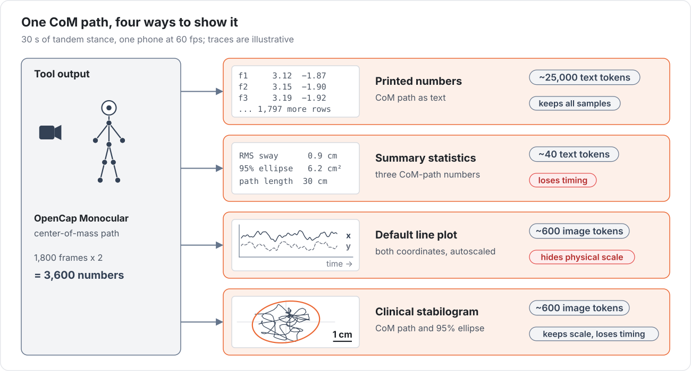
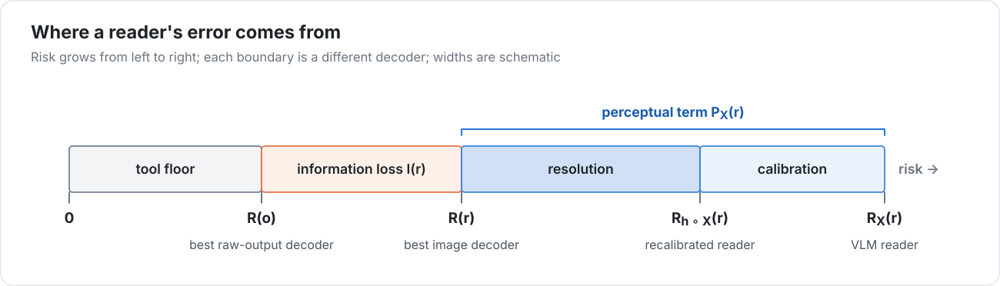
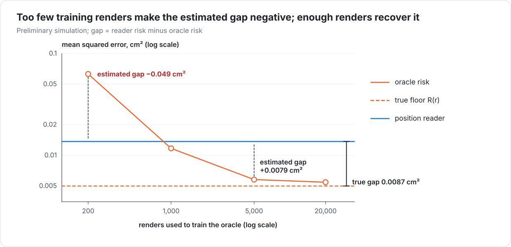
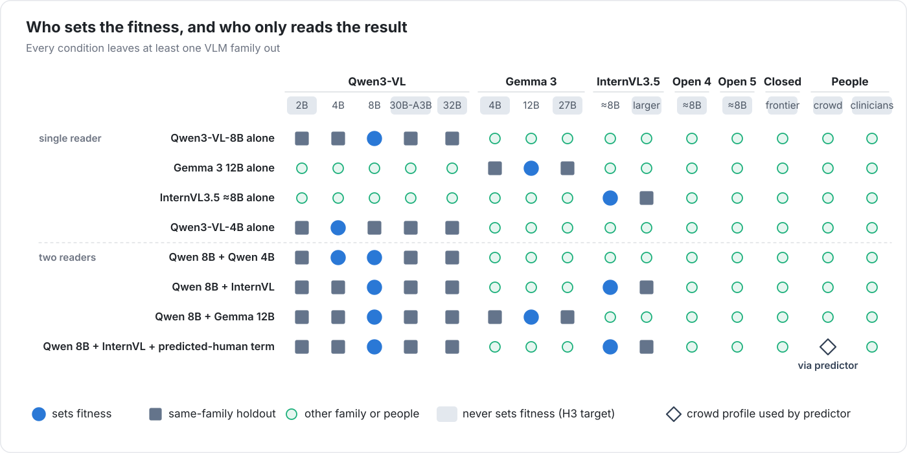
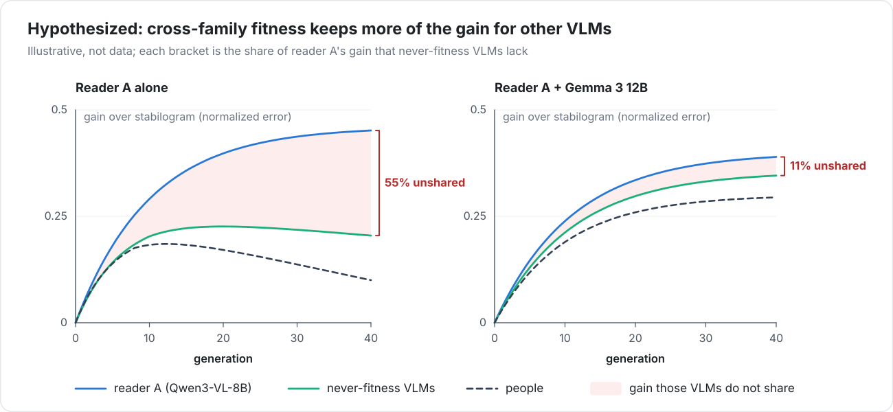
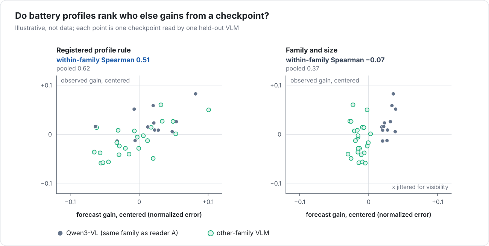
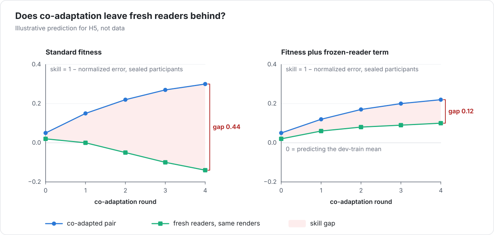

# Can a perception test predict who else can read an agent's plots?

> **Research question.** When an agent evolves the code that plots its tool outputs for one vision-language model, can a short perception test of each reader, run before the search, predict which other models and people also benefit?
>
> **Why it matters.** A plot tuned to one model may help only that model, so it can be neither reused with another model nor checked by the clinician who acts on it.
>
> **ML contribution.** A rule, registered before the search, that forecasts from perception profiles which readers gain from an evolved plot; a split of each gain into information, perception shared across readers (including computation the plot performs) and a part only the scoring model receives; and a secondary test for a code only a co-adapted pair can read.
>
> **What would prove it wrong.** Profile-based forecasts rank held-out readers' gains no better than family and size or than the same forecast without profiles (primary), or plots barred from printing text gain nothing over a standard clinical sway plot on held-out participants.

## The problem, in one concrete case

In one StaBLE task [1](#ref-1), a participant stands heel to toe for about 30 seconds while a phone films at 60 frames per second. StaBLE scores 18 balance tasks for 180 people from OpenCap, which reconstructs 3D motion from several synchronized smartphones; a monocular agent sees one phone. It calls RTMPose [2](#ref-2) for keypoints (image positions of 17 body landmarks) and OpenCap Monocular [3](#ref-3) for a whole-body center-of-mass (CoM) path, and a vision-language model (VLM) must report how much the person sways and the trial's task score.

Figure 1 shows four ways to present the CoM path. Printed as text, its 1,800 frames cost about 25,000 tokens, and multimodal models reason worse over printed series than over plots [5](#ref-5), [7](#ref-7). Three summary statistics cost about 40 tokens and discard timing. A default 768 by 768 line plot costs about 600 visual tokens for Qwen3-VL, but autoscaling stretches every trace to the same height, so a 2 cm sway difference between two people can vanish. A clinical stabilogram draws the path at a fixed scale with a 95% prediction ellipse, expected to contain 95% of CoM positions [35](#ref-35), so sway area appears as an area.



*Figure 1. One CoM path in four forms, with approximate token cost and what each keeps. Traces are illustrative; printed rows give frame and two coordinates, and image costs assume Qwen3-VL's one token per 32 by 32 pixel block.*

In the lab pilot (an internal, unpublished account), frozen Qwen3-VL-8B prompted on video had a task-averaged mean absolute error (MAE) of 0.238 on the task score, worse than predicting each task's training mean (0.120); prompted for StaBLE features scored in code, it reached 0.179. Both runs use StaBLE's all-180 normalization, which leaks the test scale, and differ in more than the encoding, so they motivate the question without answering it.

Once the agent writes its own rendering code and keeps whatever lowers one reader's error, the gain can come from four places: restored information (a fixed physical scale), computation done for the reader (the 95% ellipse), a display most readers decode well (position on a common axis), or a quirk only Qwen3-VL-8B's vision encoder resolves (a particular line width). The first three should also help other models and the clinician; the last should not. We ask whether a short perception test of each reader, run before any search, predicts how much of an evolved renderer's gain carries over to other readers. This is unknown because perception tests of VLMs have only described readers, and no study we found has evolved a renderer for one model and measured who else can read it. The decisive experiment evolves renderers against one model, forecasts each held-out reader's gain before scoring it, and checks the forecasts on sealed participants (E3 and E4). The idea fails if the forecasts rank readers no better than model family and size or than the same forecast without profiles.

The same problem appears outside biomechanics. Rendered repository graphs cut a coding agent's input tokens by up to 26% at equal or better accuracy [9](#ref-9). An agent that evolved such views against one model would need to know whether they also help another model and the engineer who reviews its trace.

## Key ideas in plain terms

**Decision, reader and renderer.** The tool output $o$ is what the tools return for one trial, and a decision is one of the quantities Q1 to Q5 (Data and splits) that a reader reports, with label $y$. A reader maps an input to a decision: a VLM, a trained network, a crowd worker or a clinician. A renderer is plotting code, editable by the agent, that turns tool output into an image; we write $r$ for renderers and text encodings alike, $r_{\text{def}}$ for the default plot and $r_{\text{stab}}$ for the stabilogram.

**Channels and profiles.** A channel is the visual property that carries a value: position, length, slope, angle, area or color. Cleveland and McGill [10](#ref-10) measured how accurately people make elementary judgments on each channel. A battery is a set of such judgments on controlled stimuli, and a reader's profile is its error on each channel as a function of how much of the panel the judged difference spans.

**Oracle.** An oracle is a small convolutional network trained to recover the label from the pixels the VLM receives. Its error estimates the image's Bayes risk, the lowest error any decoder can reach from it, and overstates it when undertrained.

**Where errors and gains come from.** A reader's error is the tool floor left by the raw tool output, plus an information term for what the image discards, plus a perceptual term, the reader's excess over the best possible decoder of the image. The perceptual term splits into resolution, a failure to tell nearby values apart, and calibration, a systematic misreading that a fitted correction map removes (Figure 2). The four sources of a gain map onto them:

| Source of a gain | Term | Separated by |
|---|---|---|
| Information the default plot discarded | information gain $\Delta I$ | oracle floors |
| Computation done for the reader | shared perceptual gain | E5, derived quantities on or off |
| A display most readers decode well | shared perceptual gain | E5, marks against printed text |
| A quirk of the scoring model | gain specific to $A$ | transfer to held-out readers |



*Figure 2. A reader's risk on one decision. Each boundary is the risk of a different decoder on the same items, and a trained oracle estimates the encoding floor $R(r)$.*

**Transfer.** The transfer ratio from a source reader $A$ to reader $B$ is $B$'s gain from a renderer tuned on $A$ divided by $A$'s gain; cutting Qwen3-VL-8B's normalized error by 0.04 and Gemma 3 12B's by 0.01 gives 0.25.

**Normalized error and skill.** For each decision, normalized error is a reader's MAE divided by the MAE of predicting the dev-train mean, so 1 means no better than that mean and 0 means perfect; skill is one minus normalized error. Fitness averages normalized error over sway amplitude (Q1) and task score (Q5), and every gain is a drop in normalized error.

**Participants.** The 171 StaBLE participants with usable first-phone video are split by person:

| Group | People | Used for | Never used for |
|---|---|---|---|
| dev-train | 52 | mutator feedback, oracle training, reader fine-tuning | fitness, choosing a best renderer |
| dev-select | 52 | fitness, every choice of a best renderer, the frozen-reader term | mutator feedback, training |
| calibration | 24 | calibration maps, battery stimuli, oracle validation, the decision scale | search |
| sealed test | 43 | one scoring of each checkpoint after its run ends | everything else |

**Readers and search terms.** $X$ is any reader and $A$ the source reader whose error is a run's fitness (Qwen3-VL-8B unless stated, and in every pair); held-out readers $\mathcal H$ do not set that run's fitness, and never-fitness readers set it in no condition (the H3 targets). The mutator is the code model that edits renderers, and a checkpoint is a run's fittest renderer at one of eight fixed generations; only checkpoints meet sealed people.

**Private dialect.** Co-adaptation alternates tuning the renderer to the reader with fine-tuning the reader on the renderer's output. Partners in emergent-communication games trained only on joint success settle on codes outsiders read poorly [21](#ref-21), [22](#ref-22), a private dialect, tested here by a matched-pair advantage: the co-adapted reader reads its own renderer better than renderers co-adapted with independent copies of it.

## What is known and what is missing

Plots beat printed numbers for multimodal time-series reasoning [5](#ref-5) to [8](#ref-8), and VLMs read charts unlike people and fail simple geometric judgments [12](#ref-12) to [16](#ref-16).

| Work | What it showed | What it leaves open here |
|---|---|---|
| Daswani et al. [5](#ref-5) | Plots beat text for time series by up to 150% at up to 90% lower cost | The best plotted form and its automation |
| VL-Time [7](#ref-7); Zhou and Yu [8](#ref-8) | About 140% average gain with 99% fewer tokens; models differ | Hand-designed plots; differences not predicted |
| By My Eyes [6](#ref-6); AutoV [18](#ref-18); MatPlotAgent [19](#ref-19) | A model picks the best of its renders from 16 plotting functions (about 10% gain); reader-loss ranking of visual prompts; VLM feedback improves plotting code | No labelled fitness or transfer test |
| Nguyen et al. [12](#ref-12); Guo et al. [13](#ref-13); EncQA [14](#ref-14) | Cleveland-McGill style batteries for VLMs | None forecasts a downstream gain |
| Verma et al. [15](#ref-15) | VLMs and people differ item by item | Whether tuning to a model loses people |
| Dubey et al. [20](#ref-20) | Evolving the program around a frozen VLM raised average chart accuracy from 16.6% to 41.3% | The chart is fixed |
| Schaeffer et al. [23](#ref-23) | Images optimized against one VLM rarely transfer beyond near-identical models; similar-model ensembles help similar targets | Tested pixel attacks only |
| Mihai and Hare [21](#ref-21); Lee et al. [22](#ref-22) | Sketches trained on a partner's success were hard for people to read until an inductive bias was added; language drifts without grounding | Toy games; no pretrained VLM or forecast |

Drawing channels learned for a partner's success have already been tested on people [21](#ref-21), so the gap is narrow: no study we found evolves an executable renderer against a labelled decision for a pretrained VLM and forecasts, before held-out scores are seen, who else can read it. We do not claim that plots beat numbers or that our battery is the first for VLMs, and a position paper already poses the machine-reader question without experiments [17](#ref-17).

## Hypotheses

**H1 (primary). Profiles predict who else gains:** registered forecasts from battery profiles rank held-out readers' gains from each renderer better than model family and size and than the same forecast without profiles.

**H2. Single-reader search drifts toward $A$'s strong channels,** where it resolves differences better than the crowd, and people fall behind $A$ as the profiles predict.

**H3. Cross-family fitness keeps gains readable:** at equal reader calls, a cross-family pair keeps more of the gain for never-fitness readers than a same-family pair of matched skill, at small cost to $A$.

**H4. Gains survive a ban on printed text:** with in-image text limited to axis ticks, an evolved renderer beats the stabilogram, and its marks beat the same values printed in the image.

**H5 (secondary). Co-adaptation creates a private dialect:** the pair's skill rises while fresh readers' skill falls on the same renders, a matched-pair advantage appears, and a frozen-reader term prevents the drift.

| | Experiment and measurement | Supported if (otherwise falsified) |
|---|---|---|
| H1 | E3, E4: checkpoint-centered forecast and observed gains, every held-out VLM | Spearman at least 0.5 and permutation $p<0.05$; advantages over family and size and over the profile-free forecast, each with paired-bootstrap lower bound above 0 |
| H2 | E3: advantage $\delta$ of $A$ over the crowd by generation; people's observed against forecast shortfall | $\delta$ rises with generation; the shortfall slope's 95% interval excludes 0 and includes 1 |
| H3 | E3: transfer ratio to never-fitness VLMs, overall and by family, at generation 40, stabilogram as reference | lower 95% bound above 0.8; $A$ keeps at least 80% of its single-reader gain; cross-family ratio above the matched same-family pair's |
| H4 | E5: person-level error of $A$ on sealed people | the best no-glyph renderer beats the stabilogram, and its marks beat the same values printed in the image (M1 against M2) |
| H5 | E6: drift gap $D_t$; cross-seed matched-pair effect | the gap opens, the own-seed effect is positive (the decisive part), and the frozen-reader term closes at least half the gap by raising fresh readers' skill |

## Method

The method has four parts. We split each reader's error into what the image omits and what the reader misreads, and apply the split to a renderer's gain. A battery turns misreadings into profiles that forecast gains. The renderer search (Figure 4), a self-improvement loop over the agent's plotting code, and the co-adaptation arm produce the renderers whose gains are forecast.

### Splitting a reader's risk

Let $\ell$ be absolute error and $X(r(o))$ reader $X$'s prediction from renderer $r$'s output (the search fixes one canvas size, so token cost matters only in E1). The tool floor, encoding floor and reader risk are

$$R(o)=\inf_g\mathbb{E}\,\ell(g(o),y),\qquad R(r)=\inf_g\mathbb{E}\,\ell(g(r(o)),y),\qquad R_X(r)=\mathbb{E}\,\ell(X(r(o)),y),$$

where every decoder $g$, the oracle included, also receives the task and decision named in the prompt. Then

$$R_X(r)=R(o)+\underbrace{R(r)-R(o)}_{I(r)}+\underbrace{R_X(r)-R(r)}_{P_X(r)}.$$

The identity holds by construction; it is useful because both added terms are non-negative: $I(r)\ge0$ because $r(o)$ is computed from $o$, so any decoder of the image also decodes $o$, and $P_X(r)\ge0$ because the reader is one decoder of the image, provided it receives nothing else. Under log loss they become a mutual information and an expected KL divergence, or usable information for a restricted oracle family [26](#ref-26). With post-hoc maps $h$ (affine or monotone) fitted on calibration people,

$$P_X(r)=\underbrace{\big[R_{h\circ X}(r)-R(r)\big]}_{\text{resolution}}+\underbrace{\big[R_X(r)-R_{h\circ X}(r)\big]}_{\text{calibration}}.$$

Profiles use resolution, because calibration is cheap to repair for any one reader.

The split holds under conditions the design enforces: the oracle reads the pixels the VLM receives after its resizing, the prompt carries nothing about $y$, parse failures receive the dev-train mean, and oracles train on development people only. Readers resize differently, so floors are always computed per processor family and never pooled, since two oracles can agree while missing the same cue. A negative measured perceptual term flags an undertrained oracle or prompt leakage for audit.

A preliminary simulation shows why the oracle must be checked. Sway amplitude was drawn as a bar at most 20 pixels tall and read by a position reader with 3% multiplicative noise. A k-nearest-neighbour oracle trained on 200 renders had risk 0.063 against a true floor of 0.005, so the reader appeared to beat Bayes (measured gap $-0.049$); with 5,000 renders the gap was 0.0079 against a true 0.0087 (Figure 3). For an area reader with Stevens-type compression, quadratic recalibration removed 0.192 of a 0.345 perceptual term. Neither result tests transfer forecasts.



*Figure 3. Preliminary simulation on a toy bar plot 20 pixels tall. With too few training renders the k-nearest-neighbour oracle's risk lies above the position reader's, making the estimated gap negative.*

Dev-train holds only about 750 trials, so each oracle is pretrained on synthetic CoM traces drawn by the same renderer and then fit on dev-train. The procedure is validated on synthetic encodings with closed-form floors, and the real learning curve must flatten. An oracle's risk bounds only its own image's floor from above, so a difference of two oracle risks, such as $\Delta I$, has no guaranteed sign and is reported as an empirical contrast. H1 is rerun with each $\Delta I_B$ shifted by the oracle error measured on synthetic encodings, a check against plausible floor errors.

### Splitting a gain

Reader $X$'s gain from renderer $r$ over the default plot, the mean perceptual gain over held-out readers, and the three-way split of $A$'s gain are

$$G_X(r)=R_X(r_{\text{def}})-R_X(r)=\underbrace{I(r_{\text{def}})-I(r)}_{\Delta I}+\underbrace{P_X(r_{\text{def}})-P_X(r)}_{\Delta P_X},\qquad \overline{\Delta P}=\frac{1}{|\mathcal H|}\sum_{B\in\mathcal H}\Delta P_B,$$

$$G_A=\underbrace{\Delta I}_{\text{information}}+\underbrace{\overline{\Delta P}}_{\text{shared perception}}+\underbrace{\Delta P_A-\overline{\Delta P}}_{\text{specific to }A},\qquad T(B\mid A)=\frac{G_B}{G_A},\qquad S_A=1-\frac{1}{|\mathcal H|}\sum_{B\in\mathcal H}T(B\mid A).$$

When every held-out floor matches $A$'s, the mean held-out gain is $\Delta I+\overline{\Delta P}$, so $S_A=(\Delta P_A-\overline{\Delta P})/G_A$, the fraction of $A$'s gain that only $A$ receives. Ratios are reported only where the lower 95% bound of $G_A$ exceeds the registered smallest effect, and the primary analysis uses signed gains $G_B$. H3 uses the same quantities with $r_{\text{stab}}$ in place of $r_{\text{def}}$, so restoring the physical scale earns no transfer.

### Profiles and the forecast

The battery crosses eight channels $k$ (position on common and on non-aligned scales, length, slope, angle, area, color saturation, position in time) with judgments drawn from the decisions (proportions, amplitude comparisons, event locations) on CoM traces from calibration people and matched synthetic signals. For each reader and channel we fit a calibration map on half of the items and, on the other half, a resolution curve for squared relative error after recalibration,

$$\sigma^2_{Xk}(m)=a_{Xk}+b_{Xk}\,m^{-2},$$

where $m$ is the fraction of the panel the judged difference spans, $a_{Xk}$ a proportional (Weber-like) error and $b_{Xk}$ a fixed absolute error, fitted by least squares on log error.

Renderers are written in a grammar in which each mark declares which data field drives which channel. For renderer $r$ and decision $d$, the channel signature gives each channel a magnitude $m_{rk}$ and a weight $w_{rk}$. The magnitude is the panel fraction spanned by the interquartile difference of the decision variable among calibration people (on a 25 cm stabilogram, a 2 cm difference spans 8%); the weight comes from knockout oracles retrained with one mark removed or only one mark kept. A mark's importance is the rise in oracle risk when it is removed plus the fall from a blank render to one showing only that mark, each clipped at zero, so duplicated marks still count. A mark using several channels (an ellipse uses position and area) splits its importance equally, weights sum to one, and if every importance is zero the marks declared for the decision field share it equally. Synthetic single-mark, redundant and uninformative renders test the rule before evolution. The forecasts are

$$\hat P_X(r)=c_d\sum_k w_{rk}\,\sigma^2_{Xk}(m_{rk}),\qquad \hat G_B(r)=\Delta I_B(r)+\hat P_B(r_{\text{def}})-\hat P_B(r),\qquad \delta(r)=\sum_k w_{rk}\big[\sigma^2_{\text{crowd},k}(m_{rk})-\sigma^2_{Ak}(m_{rk})\big],$$

where $\Delta I_B$ is reader $B$'s information gain and $\delta$ is the advantage of $A$ over the crowd that H2 tracks. The decision scale $c_d$ converts battery error into decision error and is fitted once per decision, through the origin, on $A$'s perceptual terms for the default plot and the stabilogram on calibration people, so no held-out reader's decision data enter a forecast.

We register the battery, curves, signature procedure and formulas before any evolution. Forecasts need the renderer and its knockout oracles, so they are computed after each search from development and calibration people only, then hashed and time-stamped before any held-out reader or sealed person is scored; the rule has no reader-specific parameter to refit. Five comparators are scored on the same cells: (1) family and size, a linear model on shared-family indicators, log parameter count and a closed-model indicator; (2) the profile-free forecast $\Delta I_B(r)$, which keeps processor differences in the floors; (3) cosine similarity of $B$'s and $A$'s resolution profiles; (4) $B$'s battery error on the most heavily weighted channel; and (5) a reference benchmark using $B$'s own scores, its mean gain on checkpoints of all other runs that hold it out. Comparator (1) is fitted on raw gains in leave-one-reader-out folds and centered only after prediction, so an excluded reader's gains never enter a training target.

### Renderer space and search

A renderer is a Python function over matplotlib that receives cached tool outputs for one trial, with no labels, person identifiers or task scores, and returns one 768 by 768 image built from transforms (windowing, filtering, fixed physical scales, derived quantities such as a prediction ellipse), marks (lines, points, areas, ellipses) and short labels. An arm is one search condition. Three arms differ only in text rules: no-glyph (tick labels only), standard (labels of at most three words, no numerals beyond ticks) and annotated (computed statistics may be printed). A text-summarizer arm uses the same transforms and emits text capped at the image's token count.

**Mutator.** The optimizer combines AlphaEvolve-style evolution of code [27](#ref-27) with GEPA-style reflective mutation [28](#ref-28). The mutator, Qwen3-Coder-480B-A35B-Instruct in every arm, reads the parent's code and tables of per-trial errors on 250 fixed dev-train trials from the fitness reader and from a probe. The probe, a ridge regression on the reader's frozen vision features cross-fitted across people, shows what the image holds that the reader misses. The mutator never receives an image.

**Selection.** Fitness, the score the search minimizes, is the mean normalized error on dev-select people; a two-reader fitness scores each child with each reader on a different half of them, so every condition makes the same reader calls per child. The archive is a MAP-Elites grid keeping up to four elites per value of a descriptor, the channel the grammar declares for the mark carrying the decision field, which needs no oracle. Tournament selection breeds the fittest of four renderers drawn at random. Runs use mutator sampling temperature 0.8 and 5 seeds, on the schedule below.

```text
archive <- {default line plot, clinical stabilogram, sway-path plot}
for g in 1..40:
    for j in 1..16:
        parent   <- tournament(archive, size=4)
        feedback <- per-trial errors of fitness reader(s) and probe, 250 dev-train trials
        child    <- mutator(parent.code, feedback, grammar rules)   # receives no images
        if child breaks the grammar or touches labels: discard
        child.fitness <- mean normalized error of fitness reader(s), dev-select people
        insert child into the cell of its declared channel; keep that cell's best four
    if g is a multiple of 5: save the fittest renderer as a checkpoint
# sealed people, held-out tasks and held-out readers score checkpoints only after the loop ends
```


*Figure 4. The renderer search loop. Orange boxes are what the search edits or uses to edit, blue boxes are reader $A$ and its outputs, and the dashed red frame scores checkpoints after the search.*

### Co-adaptation (secondary)

The arm starts from the frozen reader $A_0$ (Qwen3-VL-8B) and $r_{\text{stab}}$. In round $t=1,\dots,4$ the renderer is evolved for 10 generations against $A_{t-1}$, giving $r_t$. Then $A_{t-1}$ is fine-tuned on renders of dev-train people with LoRA adapters (rank 16, learning rate $10^{-4}$), first by supervised training and then by GRPO, giving $A_t$. GRPO, a policy-gradient method that scores each sampled answer against its group, uses reward $-|\hat y-y|$, group size 8 and a KL penalty of 0.01 on divergence from the round-start reader. Each pair is scored on sealed people after its reader update, and the drift gap is

$$D_t=\mathrm{skill}(A_t,r_t)-\frac{1}{|\mathcal F|}\sum_{B\in\mathcal F}\mathrm{skill}(B,r_t),$$

where the fresh readers $\mathcal F$ are every VLM except Qwen3-VL-8B and Gemma 3 12B, plus the crowd at rounds 0 and 4. $D_t$ is reported separately for Qwen3-VL and other families, and frozen $A_0$ on its own. The frozen-reader variant adds to fitness the frozen-reader term, $\mu$ (0.5 or 1) times the normalized error of frozen $A_0$ and frozen Gemma 3 12B on 250 dev-select trials, like the grounding that counters language drift [22](#ref-22).

A gap can also open because fine-tuning helps $A_t$ on every render while renderer search drops a cue fresh readers used. Two controls separate this from a private dialect. E3 single-reader runs, rescored by $\mathcal F$ at generations 10 to 40, give what renderer search alone costs fresh readers. A cross-seed matrix scores each round-$t$ reader on the round-$t$ renderers of all five seeds; a private dialect predicts a positive own-seed effect beyond reader and renderer main effects.

## Experiments

### Data and splits

The data are split by participant before any cache or archive is built, keeping a person's tasks and phones together; the 171 participants hold 2,968 task examples [1](#ref-1). The 43 sealed people are the pilot's test set, so every earlier use of their data is registered and the result is labelled a first test on previously measured people. Normalization bounds are recomputed on development people, since StaBLE's bounds use all 180. Three tasks, drawn at random from the 17 other than tandem stance (draw registered), are excluded from every development use, and results are reported with and without the seven participants in StaBLE's public exemplar video. BioCV [4](#ref-4) adds 15 adults filmed by nine synchronized cameras with markers and force plates; only after the search does it test timing (Q4), with oracle floors cross-fitted by person.

Each decision depends mainly on one perceptual type, so a channel profile can speak to it:

| Decision | Reference | Main perceptual type |
|---|---|---|
| Q1 sway amplitude (RMS CoM displacement) | three-phone OpenCap | position on a common scale |
| Q2 CoM drift over the trial | three-phone OpenCap | slope |
| Q3 sway area (95% prediction ellipse) | three-phone OpenCap | area |
| Q4 time of stepping out of the stance; BioCV foot contact | OpenCap; BioCV force plates | position in time |
| Q5 task score, and a flag for the lowest 10% of development scores | StaBLE scores, development bounds | composite |

### Models and tools

Readers are Qwen3-VL at 2B, 4B, 8B, 30B-A3B and 32B [29](#ref-29), Gemma 3 at 4B, 12B and 27B [30](#ref-30), InternVL3.5 near 8B plus one larger checkpoint [31](#ref-31), two further open families near 8B and one closed frontier VLM, all pinned by identifier and date, plus crowd and clinician panels; a Qwen3-VL-8B run thus has 12 held-out VLMs in six families. Readers are served with vLLM, fine-tuning uses the verl reinforcement-learning library, and prompts name the task and decision with no referral or diagnosis text. In Figure 5, a same-family pair separates reader diversity from averaging two scores. Its partner, also run alone, is whichever of Qwen3-VL-4B (shown) and 30B-A3B has dev-select error on the default plot and stabilogram closer to the cross-family partners' mean, fixed before search so partner skill does not stand in for family. H3 is claimed only for these named pairs, with partner skill as a covariate and absolute held-out gains beside the ratios. The last condition adds a predicted-human term $\nu\,\hat P_{\text{crowd}}(r)$, $\nu=1$, computed from the crowd profile with equal weights over declared channels because knockout weights exist only for checkpoints.



*Figure 5. Fitness conditions (rows) against readers (columns). Shaded headers mark readers that never set fitness, the H3 targets; Open 4 and Open 5 are the two further families. The crowd profile (diamond) enters one fitness only through the predictor, so the crowd leaves that condition's H3 set.*

### Baselines

- Printed numbers in LLMTime-style serialization [32](#ref-32) (fixed precision, digits separated by spaces, values by commas), also rendered as an image of text to separate modality from graphical encoding.
- Fixed plots: default line plots as in Daswani et al. [5](#ref-5) and VL-Time [7](#ref-7), the stabilogram and a sway-path plot.
- Agent-chosen views: menu selection by the reader (By My Eyes [6](#ref-6)), visual-feedback refinement (MatPlotAgent [19](#ref-19)) and reader-loss retrieval (AutoV [18](#ref-18)).
- Overlays and self-drawing: Set-of-Mark keypoint labels [25](#ref-25) and Visual Sketchpad sketching [24](#ref-24).
- Equal-budget search elsewhere: evolving the inference program around a fixed plot (Dubey et al. [20](#ref-20)), GEPA over the reader's prompt [28](#ref-28), random search over the grammar, and TimeMaster-style reader reinforcement learning on fixed plots [33](#ref-33).

### Metrics

Decision error is normalized error for Q1 to Q5, with the flag's area under the ROC curve and Q4's error in milliseconds beside it, each also per thousand input tokens. The decomposition reports oracle risk, both terms with their parts, and the OCR fraction, the share of decision-relevant numbers that text recognition reads from each image. People judge which of two trials sways more (a pairwise form of Q1), and their gains, $A$'s gain and their forecasts use these judgments.

### Core experiments

**E1, encodings and the error-token front:** every baseline and reader runs on Q1 to Q5 across image sizes from 256 to 1024 pixels and text budgets up to the full series, with oracle floors computed first. The Pareto front holds the encodings that no alternative beats on both error and token cost.

**E2, profiles before search:** before any evolution, the battery runs on every VLM, on 120 crowd workers (40 items each, as in Heer and Bostock [11](#ref-11)) and on 10 clinicians, whose coarse profiles are descriptive only; crowd raters after the search are recruited separately.

**E3, renderer evolution:** every condition of Figure 5 runs with 5 seeds. Every open VLM scores every checkpoint on sealed people, the closed VLM those at generations 10, 25 and 40, and people rate generations 0, 20 and 40 of one seed per condition; gain against generation (Figure 6) tests H2 and H3.



*Figure 6. Illustrative trajectories of the kind H2 and H3 predict, not data. Gain is the drop in normalized error from the stabilogram, a seed renderer; brackets give the share of reader $A$'s gain that never-fitness VLMs lack.*

**E4, prediction test:** forecast against observed signed gain for every held-out (checkpoint, VLM) cell from E3, regressions included, against the five comparators (Figure 7), tests H1; human cells are a registered secondary analysis on the pairwise judgment.



*Figure 7. Illustrative pattern of the kind H1 predicts, not data, with both gains centered on each checkpoint's mean. The rule (left) must rank readers better than family and size (right, jittered sideways); the within-family correlation shows what group separation cannot supply.*

**E5, computation against perception:** the four arms are compared with the stabilogram on sealed people. The transforms of the best no-glyph renderer (chosen on dev-select) are then fixed and its values shown at one token budget:

| Transforms of the best no-glyph renderer | Marks | Values printed in the image | Values as text |
|---|---|---|---|
| with derived quantities (such as the ellipse) | M1 | M2 | M3 |
| without derived quantities | N1 | N2 | N3 |

M1 against M2 (marks against printed text in one image) is the presentation effect that tests H4; M3 also changes the input modality and is reported apart. Each M cell against its N cell is the computation effect at a fixed display, the only contrast that attributes a gain to computation.

**E6 (secondary), co-adaptation:** four rounds with and without the frozen-reader term are compared with reader-only fine-tuning on stabilograms at equal compute, plus the two controls (Figure 8), to test H5.



*Figure 8. Illustrative pattern of the kind H5 predicts, not data. Fresh readers are the VLMs outside the frozen-reader term, scored on the same renders; a gap alone does not show a private dialect without the matched-pair test.*

### Ablations and controls

One ablation gives the mutator the renders. Evolved renderers are perturbed in line width, color and jitter to measure fragility, and Qwen3-VL from 2B to 32B tests whether exploitation shrinks with size. One single-reader run is repeated with dev-select labels permuted across people, and any sealed-person gain flags a leak.

### Statistical analysis

The selected renderer's dev-select score is optimistic, a winner's curse [34](#ref-34), so every reported gain is rescored on sealed participants, and five seeds estimate run-to-run variance. Intervals are person-clustered bootstraps, and equivalence tests make nulls informative.

The primary analysis (H1) uses every (checkpoint, held-out VLM) cell, so cells where $B$ gets worse cannot drop out. Gains and forecasts are centered on each checkpoint's mean over its held-out VLMs after any fitting, and the statistic is the pooled Spearman correlation of forecast and observed gains; a forecast constant within every checkpoint scores 0. The pass rule's permutation test shuffles profiles among readers, and its bootstrap resamples readers. Because family-level separation alone can raise a pooled correlation, the correlation within families is reported beside it. A mixed model of observed on forecast gain, with $G_A$ as covariate and crossed reader and run intercepts, supports it.

Readers, not runs, limit power. Treating the 12 held-out VLMs of a Qwen-sourced run as independent units, Fisher's $z$ gives 80% power at two-sided $\alpha=0.05$ only for a correlation of about 0.73, since

$$n=\big((1.96+0.84)/\tanh^{-1}0.73\big)^2+3\approx12,$$

and a true correlation of 0.5 would be detected with about 38% power. This is conservative: each reader contributes cells from up to 320 E3 checkpoints. A registered simulation of the reader, family, run and checkpoint design sets the final numbers before evolution; if it gives under 80% power at 0.6, open readers are added. The estimand is conditional on this reader set.

H2 to H5 are Holm-corrected as a family. For H4, paired person-level differences on 43 sealed people detect, at 80% power, a standardized effect of $2.80/\sqrt{43}\approx0.43$ at $\alpha=0.05$ and $3.34/\sqrt{43}\approx0.51$ at the strictest Holm level of 0.0125, in standard deviations of person-level differences on calibration people. A ratio near 1 is claimed by two one-sided tests with margin 0.15. Battery data use per-reader mixed-effects models of log error, with channel and judgment fixed and stimulus random.

### Second domain

The central result is replicated on TimerBed [7](#ref-7), public real-world time-series reasoning tasks also used for reader reinforcement learning [33](#ref-33), and on the synthetic anomaly suite of Zhou and Yu [8](#ref-8), whose known generating process gives exact tool floors. E3 to E5 are rerun with one source reader, one cross-family pair, 3 seeds of 20 generations and the same readers, profiles and formula, split by recording subject where known and by series otherwise.

## How to read the results

| Outcome | What it would mean | What we would do next |
|---|---|---|
| H1 holds | Transfer can be forecast from a cheap reader test | Choose fitness ensembles by profile |
| H1 falsified | Transfer depends on judgments the battery misses | Report the negative; probe what it misses |
| H2 falsified | Search does not exploit the measured strengths | Look outside the battery, such as texture |
| H3 holds | Dissimilar readers limit exploitation of the scoring reader | Recommend cross-family fitness |
| H3 falsified: the same-family pair transfers as well | Similar readers suffice, as Schaeffer et al. found for similar targets [23](#ref-23) | Pick ensembles by profile distance |
| Transfer near 1 by equivalence test; fresh readers unchanged | No private dialect arises here | Report the null against [21](#ref-21), [23](#ref-23) |
| H4 falsified, M cells beat N cells | The gain is computation | Recast as feature search |
| No E5 contrast is positive | Evolution adds nothing over the stabilogram | Report the negative |
| H5 holds | Co-adaptation produces a private dialect that a frozen-reader term prevents | Use frozen-reader terms in joint training |
| H5 falsified | Fresh readers' loss is single-reader exploitation | Use cross-family fitness |

## Compute, data and scope

GPU costs are H100-hours on Stanford HAIC; throughputs are planning assumptions until a one-day benchmark of one generation. One child costs 1,500 fitness calls (750 dev-select trials, Q1 and Q5) and 500 feedback calls of about 750 tokens, 1.5 million tokens or about 150 seconds at an assumed 10,000 tokens per second for an 8B reader, so a run of 640 children takes about 27 hours.

| Item | Count | Unit cost or assumption | H100-hours |
|---|---|---|---|
| E3 search | 40 runs | 27 h per run | 1,080 |
| E5 arms and free-code arm | 23 runs | 27 h per run | 620 |
| Mutator, Qwen3-Coder-480B-A35B in FP8 on 8 H100s | 40,320 mutations; 480M input, 81M output tokens | 20,000 input, 2,000 output tokens/s per node | 140 |
| Held-out scoring | 504 checkpoints, 12 open VLMs, 1,500 calls of 750 tokens; final checkpoints also on Q2 to Q4 | 5,000 tokens/s per H100 | 450 |
| E6 co-adaptation | 2 conditions, 5 seeds, 4 rounds; reader-only control; cross-seed matrix | 23 h per round, 26 with the frozen-reader term | 1,315 |
| Oracles | about 12,400 fits: every checkpoint per processor family and decision; about 20 knockout fits per E3 checkpoint; Q2 to Q4 for final checkpoints | 0.05 h per fit with pretraining | 620 |
| Baselines, ablation, permuted-label run | 21 runs | 27 h per run | 600 |
| E1 and E2 | | | 130 |
| Second domain | 2 suites of 6 runs | 63 h per suite | 125 |
| OpenCap Monocular, once | 2,968 clips | 7 min per 30-second trial (lab pilot: 3.8 min per 17-second clip) | 350 |
| **Total** | | | **about 5,430** |

The closed VLM adds about 280,000 calls and 210 million input tokens, RTMPose-m and rendering about 1,950 CPU-hours, and the human studies 240 crowd sessions of 45 minutes and 10 clinician sessions of 60 minutes, under IRB approval. StaBLE videos are held by the lab (the public Zenodo release has features and scores only), BioCV is available on request, and TimerBed and the Zhou and Yu suite are public. Only the encoding varies, so feature choice, task framing and tool variability are out of scope.

## Risks and limitations

- **Composite reading.** A stabilogram is read as a whole shape, so the battery adds composite items and H1 is reported for both profile types.
- **Power and a reused cohort.** H4 detects only effects of 0.43 to 0.51 standard deviations, on people who supplied the pilot numbers, so confirmation needs new participants.
- **A video-derived reference.** Q1 to Q3 labels come from three-phone OpenCap, which has its own error, and BioCV force plates check only timing.
- **A restricted search space.** Grammar-bound findings may not hold for free plotting code, so one exploratory arm allows free matplotlib code under the same text rules.

## Where to learn more

1. usaaio.guide 3.1 PS4, ["Information Theory for AI"](https://usaaio.guide/module/?id=information-theory-core): mutual information and KL divergence, the split's terms under log loss.
2. usaaio.guide 3.8 TF7, ["Vision-Language Models"](https://usaaio.guide/module/?id=cross-attention-multimodal-attention): how an image becomes patch tokens.
3. CS329A, ["Open-Ended Evolution of Self-Improving Agents"](https://cs329a.stanford.edu/#schedule) (Mon Oct 13): archive-based code evolution as in AlphaEvolve.
4. CS329Z Lecture 9, ["Optimization"](https://web.stanford.edu/class/cs329z/slides/lecture09.pdf): GEPA's reflective mutation of programs from traces.
5. usaaio.guide 4.18 RF4, ["RLHF and Preference Optimization"](https://usaaio.guide/module/?id=preference-optimization-rlhf-and-dpo): PPO with a KL penalty and GRPO's group-relative baseline.

## References

<a id="ref-1"></a>[1] Heigold H, Ruth PS, Muccini J, et al. "StaBLE: digital metrics capture balance performance across a wide spectrum of balance tasks and abilities." bioRxiv, 2026. https://doi.org/10.64898/2026.09.16.750744

<a id="ref-2"></a>[2] Jiang T, Lu P, Zhang L, et al. "RTMPose: Real-Time Multi-Person Pose Estimation based on MMPose." arXiv:2303.07399, 2023. https://arxiv.org/abs/2303.07399

<a id="ref-3"></a>[3] Gilon S, Miller EY, Uhlrich SD. "OpenCap Monocular: 3D Human Kinematics and Musculoskeletal Dynamics from a Single Smartphone Video." arXiv:2603.24733, 2026. https://arxiv.org/abs/2603.24733

<a id="ref-4"></a>[4] Evans M, Needham L, Wade L, et al. "Synchronised Video, Motion Capture and Force Plate Dataset for Validating Markerless Human Movement Analysis." Scientific Data 11:1300, 2024. https://doi.org/10.1038/s41597-024-04077-3

<a id="ref-5"></a>[5] Daswani M, Bellaiche MMJ, Wilson M, et al. "Plots Unlock Time-Series Understanding in Multimodal Models." arXiv:2410.02637, 2024. https://arxiv.org/abs/2410.02637

<a id="ref-6"></a>[6] Yoon H, Tolera BA, Gong T, Lee K, Lee S-J. "By My Eyes: Grounding Multimodal Large Language Models with Sensor Data via Visual Prompting." EMNLP, 2024. https://aclanthology.org/2024.emnlp-main.133/

<a id="ref-7"></a>[7] Liu H, Liu C, Prakash BA. "A Picture is Worth A Thousand Numbers: Enabling LLMs Reason about Time Series via Visualization." NAACL, 2025. https://aclanthology.org/2025.naacl-long.383/

<a id="ref-8"></a>[8] Zhou Z, Yu R. "Can LLMs Understand Time Series Anomalies?" ICLR, 2025. https://proceedings.iclr.cc/paper_files/paper/2025/hash/05774fb74e863308c4b460c9f49f6918-Abstract-Conference.html

<a id="ref-9"></a>[9] Ma D, Chen S, Yang Y, et al. "LLM Agents Can See Code Repositories." arXiv:2606.14061 (ASE), 2026. https://arxiv.org/abs/2606.14061

<a id="ref-10"></a>[10] Cleveland WS, McGill R. "Graphical Perception: Theory, Experimentation, and Application to the Development of Graphical Methods." Journal of the American Statistical Association 79(387):531-554, 1984. https://doi.org/10.1080/01621459.1984.10478080

<a id="ref-11"></a>[11] Heer J, Bostock M. "Crowdsourcing Graphical Perception: Using Mechanical Turk to Assess Visualization Design." CHI, 2010. https://doi.org/10.1145/1753326.1753357

<a id="ref-12"></a>[12] Nguyen RH, Maeda K, Geshvadi M, Haehn D. "Evaluating Graphical Perception with Multimodal LLMs." IEEE PacificVis, 2025. https://arxiv.org/abs/2504.04221

<a id="ref-13"></a>[13] Guo et al. "Understanding Graphical Perception in Data Visualization through Zero-shot Prompting of Vision-Language Models." arXiv:2411.00257, 2024. https://arxiv.org/abs/2411.00257

<a id="ref-14"></a>[14] Mukherjee K, Ren D, Moritz D, Assogba Y. "EncQA: Benchmarking Vision-Language Models on Visual Encodings for Charts." IEEE TVCG 32(1), 2026. https://arxiv.org/abs/2508.04650

<a id="ref-15"></a>[15] Verma A, Mukherjee K, Potts C, et al. "Human-centered evaluation of data visualization understanding in vision-language models." arXiv:2505.17202; Scientific Reports, 2026. https://arxiv.org/abs/2505.17202

<a id="ref-16"></a>[16] Rahmanzadehgervi P, Bolton L, Taesiri MR, Nguyen AT. "Vision language models are blind: Failing to translate detailed visual features into words." arXiv:2407.06581, 2024. https://arxiv.org/abs/2407.06581

<a id="ref-17"></a>[17] Keith-Norambuena B. "Toward a Machine Bertin: Why Visualization Needs Design Principles for Machine Cognition." arXiv:2602.01527, 2026. https://arxiv.org/abs/2602.01527

<a id="ref-18"></a>[18] Zhang Y, et al. "AutoV: Loss-Oriented Ranking for Visual Prompt Retrieval in LVLMs." ECCV, 2026. https://arxiv.org/abs/2506.16112

<a id="ref-19"></a>[19] Yang Z, Zhou Z, Wang S, et al. "MatPlotAgent: Method and Evaluation for LLM-Based Agentic Scientific Data Visualization." Findings of ACL, 2024. https://aclanthology.org/2024.findings-acl.701/

<a id="ref-20"></a>[20] Dubey AS, Goel V, Rana K, et al. "Improving VLMs on Scientific Chart Analysis via Autonomous Evolution." arXiv:2610.35077, 2026. https://arxiv.org/abs/2610.35077

<a id="ref-21"></a>[21] Mihai D, Hare J. "Learning to Draw: Emergent Communication through Sketching." NeurIPS, 2021. https://proceedings.neurips.cc/paper_files/paper/2021/hash/39d0a8908fbe6c18039ea8227f827023-Abstract.html

<a id="ref-22"></a>[22] Lee J, Cho K, Kiela D. "Countering Language Drift via Visual Grounding." EMNLP, 2019. https://arxiv.org/abs/1909.04499

<a id="ref-23"></a>[23] Schaeffer R, et al. "Failures to Find Transferable Image Jailbreaks Between Vision-Language Models." ICLR, 2025. https://arxiv.org/abs/2407.15211

<a id="ref-24"></a>[24] Hu Y, Shi W, Fu X, et al. "Visual Sketchpad: Sketching as a Visual Chain of Thought for Multimodal Language Models." NeurIPS, 2024. https://proceedings.neurips.cc/paper_files/paper/2024/hash/fb82011040977c7712409fbdb5456647-Abstract-Conference.html

<a id="ref-25"></a>[25] Yang J, et al. "Set-of-Mark Prompting Unleashes Extraordinary Visual Grounding in GPT-4V." arXiv:2310.11441, 2023. https://arxiv.org/abs/2310.11441

<a id="ref-26"></a>[26] Xu Y, Zhao S, Song J, Stewart R, Ermon S. "A Theory of Usable Information Under Computational Constraints." ICLR, 2020. https://arxiv.org/abs/2002.10689

<a id="ref-27"></a>[27] Novikov A, et al. "AlphaEvolve: A coding agent for scientific and algorithmic discovery." arXiv:2506.13131, 2025. https://arxiv.org/abs/2506.13131

<a id="ref-28"></a>[28] Agrawal LA, et al. "GEPA: Reflective Prompt Evolution Can Outperform Reinforcement Learning." ICLR, 2026. https://arxiv.org/abs/2507.19457

<a id="ref-29"></a>[29] Bai S, Cai Y, Chen R, et al. "Qwen3-VL Technical Report." arXiv:2511.21631, 2025. https://arxiv.org/abs/2511.21631

<a id="ref-30"></a>[30] Gemma Team (Kamath A, Ferret J, Pathak S, et al.). "Gemma 3 Technical Report." arXiv:2503.19786, 2025. https://arxiv.org/abs/2503.19786

<a id="ref-31"></a>[31] Wang W, Gao Z, Gu L, et al. "InternVL3.5: Advancing Open-Source Multimodal Models in Versatility, Reasoning, and Efficiency." arXiv:2508.18265, 2025. https://arxiv.org/abs/2508.18265

<a id="ref-32"></a>[32] Gruver N, Finzi M, Qiu S, Wilson AG. "Large Language Models Are Zero-Shot Time Series Forecasters." NeurIPS, 2023. https://arxiv.org/abs/2310.07820

<a id="ref-33"></a>[33] Zhang J, Feng L, Guo X, et al. "TimeMaster: Training Time-Series Multimodal LLMs to Reason via Reinforcement Learning." arXiv:2506.13705, 2025. https://arxiv.org/abs/2506.13705

<a id="ref-34"></a>[34] Hu L, Tang Y. "The Winner's Curse in LLM Self-Improvement Loops: Selection Noise, Lock-in, and Acceptance Rules." arXiv:2610.09239, 2026. https://arxiv.org/abs/2610.09239

<a id="ref-35"></a>[35] Schubert P, Kirchner M. "Ellipse area calculations and their applicability in posturography." Gait and Posture 39(1):518-522, 2014. https://doi.org/10.1016/j.gaitpost.2013.09.001
