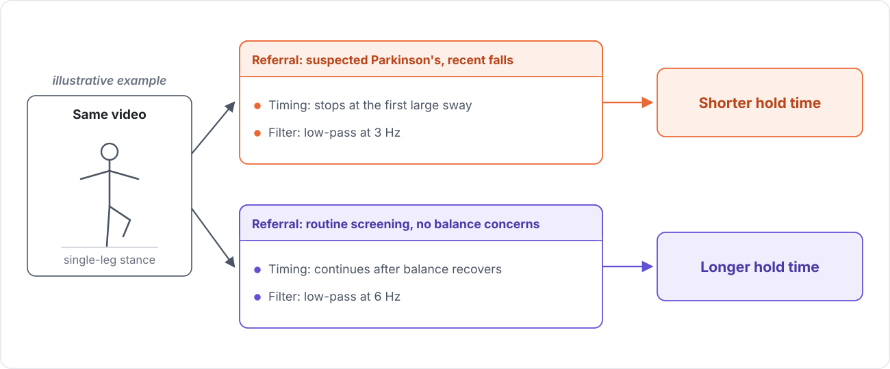
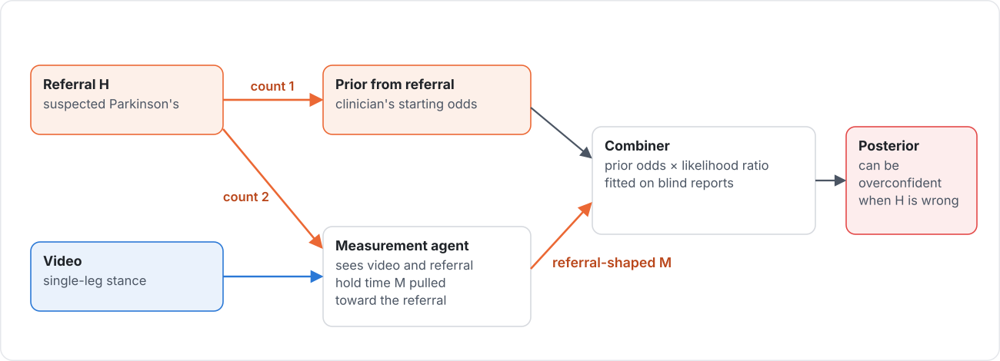
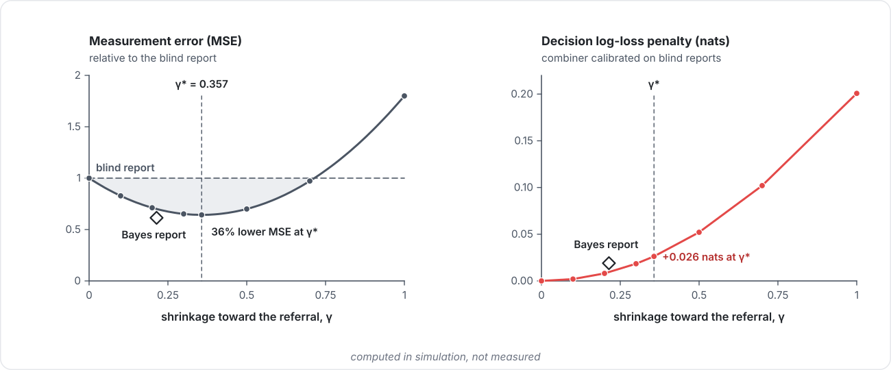
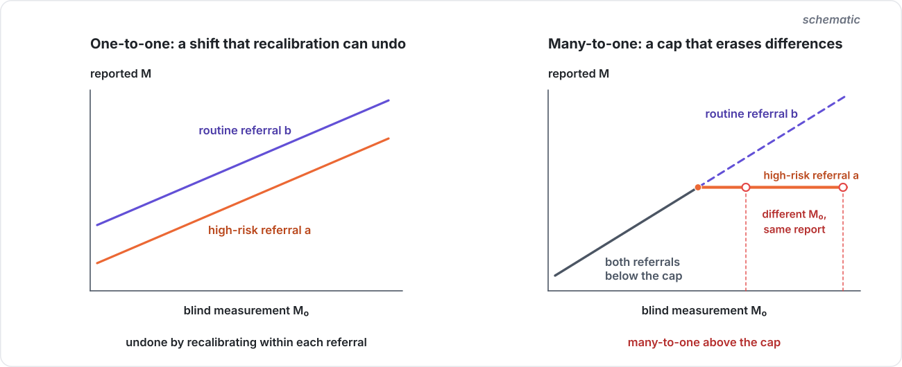
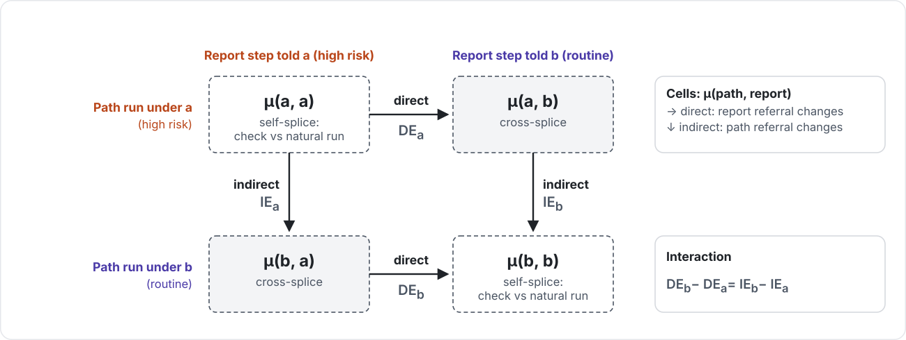
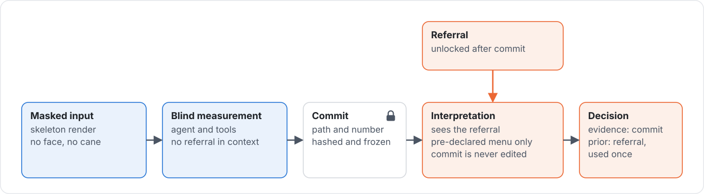
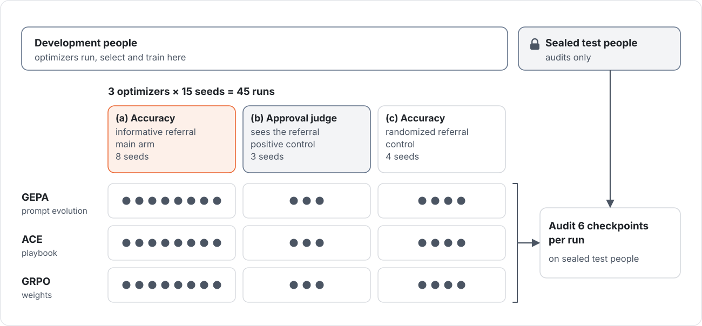
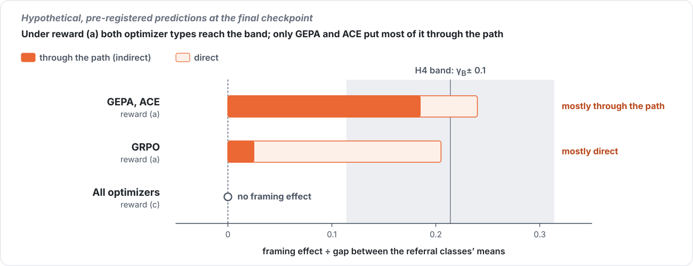

# Can a clinician undo what the referral did to an agent's measurement?

> **Research question.** When a tool-using measurement agent is told the referral, how far does its number move, and can a clinician undo the shift by recalibrating? We also ask whether the shift enters through the tool calls or the final report, and whether self-improvement moves it.
>
> **Why it matters.** The clinician already holds the referral, so a number pulled toward it counts the referral twice, and an agent can lower its measurement error while worsening the decision.
>
> **ML contribution.** Path splicing, which replays an agent's recorded tool calls and outputs into a report step told another referral, to split the effect by route; a test of which shifts a combiner can repair; a pre-registered prediction of where optimizers put learned context; and a blind-then-interpret harness scored on decision loss.
>
> **What would prove it wrong.** Framing effects within 0.2 between-person standard deviations (SD) for every agent whose blind reports track the reference; no effect through the tool calls; or, where there is one, a blind harness no better than per-referral recalibration.

## The problem, in one concrete case

A clinician refers a patient for balance assessment with the note "suspected Parkinson's disease, recent falls". A measurement agent, a vision-language model that calls tools, receives the note and a smartphone clip of the patient's single-leg stance trial and must report the hold time. Its tools are RTMPose, a 2D keypoint detector [2](#ref-2), OpenCap Monocular, which estimates 3D kinematics from one video [3](#ref-3), a low-pass filter, a trim tool, a touchdown detector and the StaBLE feature code, each with several defensible settings. StaBLE recorded 180 people aged 18 to 87 on 18 balance tasks, with a three-camera reconstruction by OpenCap, a smartphone motion-capture system, as reference [1](#ref-1).

Suppose the same clip arrives with "routine screening, no balance concerns" instead. Under the first note one defensible analysis stops timing at the first large sway and filters at 3 Hz, giving a short hold. Under the second another keeps timing because balance recovers, filters at 6 Hz and gives a long hold (Figure 1).



*Figure 1. Illustrative, not a measured result. Only the referral line differs between the two cards, and stopping at the first sway (top) shortens the hold.*

The clinician, or a risk model, then combines the number with the same referral, which sets the prior odds of high fall risk, so a hold time that leans toward the referral counts it twice. Take a person whose blind hold time is typical of low-risk people but who carries the Parkinson's referral. In the Gaussian model of Proposition 1 the blind number gives a 60% probability of high fall risk, and a number pulled toward the referral by the error-minimizing amount gives 75%. Clinical information also tends to make test reading more accurate [5](#ref-5), so our subject is the combination step, and whether its harm can be undone depends on whether distinct trials keep distinct numbers (Recoverability, below).

Outside biomechanics, a data-analysis agent asked whether a new onboarding flow raised retention is told "we expect it helped". The expectation can act through the agent's covariates and outlier rules or through the estimate, which the product team then combines with the same expectation. What remains open is which route a hypothesis takes and what that route costs the decision.

## Key ideas in plain terms

**Harness.** The code around a model that defines its tools, formats their outputs, logs calls and controls its context.

**Path, transcript and report.** The path $P$ is the sequence of tool calls with their arguments, and the transcript $Z=(P,O)$ adds the tool outputs $O$. The report step is the final model call, which reads the transcript and outputs the number $M$; $M_0$ is the blind report.

**Referral and framing effect.** The referral $H$ is the line of clinical context, randomized in every audit so that its effect is causal; its main values are Figure 1's high-risk referral $a$ and routine referral $b$. The framing effect TE is the mean report under $b$ minus that under $a$ in between-person SD (the SD of the reference value across development people), positive when reports move toward their referral's typical value.

**Combiner and log loss.** The combiner models the clinician: it multiplies the referral's prior odds by the report's likelihood ratio and outputs $p$, its probability of high fall risk, scored by log loss ($-\log p$ for a high-risk person, $-\log(1-p)$ otherwise) in nats (natural-log units).

**Route.** Through the path route the referral changes the agent's tool calls (a trim, a cutoff, an exclusion) and so what the report step reads. Through the direct route it changes the report step's output with the transcript held fixed.

**Recoverability.** The context-aware report may be one-to-one in the blind report within each referral (a shift or shrinkage), which within-referral recalibration, a combiner refitted per referral, undoes. Or it may be many-to-one (a cap, or a trim that reports a 5 s and a 25 s hold both as 5 s), which loses information. Either route can produce either map, but trimming and exclusion discard data, so we expect the path route to be lossy more often.

**Path splicing.** Path splicing replays the recorded transcript of a run under one referral into the report step under the other. Crossing path and report referrals gives a two-by-two factorial whose contrasts are interventional direct and indirect effects [9](#ref-9) [10](#ref-10), averages over the paths an agent produces. The tool-calls-only splice replays calls and outputs without the agent's reasoning text.

**Measurement gate.** An agent is gated, admitted to the splicing, self-improvement and harness experiments, only if the lower 95% bound on the slope of its blind report on the reference exceeds 0.3 on development people.

**Sealed, calibration and development people.** Sealed test people are read by no optimizer, search or training run; calibration people fix prompts and variance components, then are set aside; development people host all fitting and optimization.

**Scripted controls.** Hand-written agents with a known route and map: shrinkage (direct, one-to-one), a cap (direct, many-to-one), a referral-dependent offset passed to the feature code (path, one-to-one) and a referral-dependent trim (path, many-to-one).

**Self-improvement and rewards.** GEPA rewrites the system prompt after reading traces [13](#ref-13), ACE grows a playbook of rules [14](#ref-14), and GRPO, a reinforcement-learning method, updates weights from rewards normalized within a group of samples [15](#ref-15). Rewards are (a) accuracy with referrals correct for 80% of people, (b) approval from a judge that sees the referral, and (c) accuracy with randomized referrals.

**Effective shrinkage.** $\hat\gamma$ rescales TE so that 0 means the referral is ignored and 1 means the named class's mean is reported.

**Blinding.** Blind analysis fixes the analysis before the result is visible [16](#ref-16); data blinding develops it on data whose key variable is hidden or perturbed [17](#ref-17).

## What is known and what is missing

Physics adopted blind analysis because analysts stop hunting for errors once a result matches expectation [16](#ref-16). Diagnostic-accuracy research calls a test read with knowledge of other findings review or incorporation bias and rates it with the QUADAS-2 checklist [4](#ref-4). Nonblinded assessors of subjective scales exaggerated pooled effects by 68% (95% CI 14% to 230%) [19](#ref-19). A rational analysis showed that hypothesis-shaped evidence inflates confidence without improving accuracy, with no separate combiner [20](#ref-20).

| Work | What it showed | What it leaves open for this question |
|---|---|---|
| Miao et al.; Bertran et al. 2026 [12](#ref-12) [21](#ref-21) | Personas and model choice steer agent analysts; defines the m-value | No ground truth, path split or remedy |
| Asher et al. 2026 [8](#ref-8) | Claude Code and Codex stable on four null-result papers, even given a directional hypothesis | Weakly specified steps, perceptual input |
| Gunsilius et al. 2026 [6](#ref-6) | Four frontier agents: 54% to 98% false significance when asked for a compelling finding; reset-and-replay | Test validity only; no measurement |
| Liu 2026 [7](#ref-7) | One sentence changes verdicts; neutral brief and sealed holdout | No route split or decision account |
| Brown et al. 2026 [23](#ref-23) | A false note flips up to 40% of a tool-using judge's correct verdicts | Prompt fixes only blunt it |
| Xiao and Yu 2026 [24](#ref-24) | Wrong hypotheses change search-agent retrieval and answers, by stage | Observational stage split; exploratory interventions only |
| Cuccarese 2026 [25](#ref-25) | Blinding entity identity changed 16% of top-20 predictions without changing recovery of validated targets | Entity identity, not a case hypothesis; no decision scoring |
| Restrepo et al. 2026 [26](#ref-26) | Clinical VLMs follow text over the image | No tools or continuous measurement |
| Gao and Xiao 2026 [27](#ref-27) | Showing top exemplars collapses analyst disagreement by imitation | No framing |

We found no study that splits a hypothesis effect on a continuous measurement into path and direct parts by intervention or tests whether self-improvement learns case context and by which route. Nor did we find one that asks which shifts a combiner can repair, or scores a blind-then-interpret harness on the decision. In video the frames themselves show age, build and walking aids, so deleting the referral line does not remove all context.

## Hypotheses

**H1 (framing moves the measurement where evidence is weak).** For gated agents, TE averaged over clips exceeds 0.2 SD and is larger on ambiguous clips, whose defensible paths disagree most. Given stable frontier coding agents [8](#ref-8) and framing effects mainly under ambiguous evidence [22](#ref-22), we expect small effects on clear clips and for the frontier API model.

**H2 (part of the effect passes through the path).** In the tool-calls-only splice the indirect effect is positive under both orderings ($\mathrm{IE}_a$ and $\mathrm{IE}_b$).

**H3 (path effects are harder to repair).** The decision penalty left after within-referral recalibration grows with the tool-calls-only indirect effect and is near zero for direct-route agents, with the scripted controls as calibration points. Route classes are fixed from the splices before any E5 log loss is computed: path-route if the indirect effect excludes zero and exceeds half of TE, direct-route if TE excludes zero and the indirect effect lies inside its 0.1 SD margin. A residual shows only that the pre-specified combiners did not recover the information.

**H4 (accuracy reward teaches the predicted shrinkage).** Under reward (a) the final $\hat\gamma$ lies within 0.1 of $\gamma_B$, the effective shrinkage of the squared-error-optimal report (Method), while MSE falls and log loss rises. Under reward (c) TE stays inside the margin.

**H5 (the optimizer sets the route).** GEPA and ACE write conditional text rules ("for high-risk referrals, trim at the first large excursion"). They should therefore put more of the learned effect in the path than GRPO, whose scalar reward on the final number favors direct shrinkage. H5 also needs GRPO's direct effect to exceed prompt evolution's (secondary). This compares the configurations as tested, without isolating feedback type; GEPA and ACE are reported separately.

**H6 (measure blind, then interpret).** For path-route agents the blind harness has lower decision log loss than every baseline, within-referral recalibration included. For direct-route agents it is within 0.01 nats of the best, and its MAE stays within 0.2 SD of the context-visible agent's.

| Hypothesis | Experiment | Outcome | Falsified if |
|---|---|---|---|
| H1 the referral moves the number | E1 | P1: TE | TE within ±0.2 SD for every gated agent |
| H2 part passes through the path | E2 | P2: tool-calls-only indirect effect | indirect effect within ±0.1 SD |
| H3 path effects resist recalibration | E2, then E5 | secondary: residual penalty against indirect effect | no residual for path-route agents while the lossy scripted controls show one |
| H4 accuracy reward learns shrinkage | E4 | secondary: $\hat\gamma$ against the run's $\gamma_B$ | $\hat\gamma$ outside $\gamma_B\pm0.1$ under reward (a) |
| H5 the optimizer sets the route | E4 | P3: gap in final indirect effect | gap within ±0.18 SD, or favoring GRPO |
| H6 measure blind, then interpret | E5 | P4: recalibrated minus blind log loss, path-route agents | within ±0.01 nats, or negative |

**The decisive test** is E2 followed by E5 on the same gated agents: measure how much of each framing effect passes through the tool calls, then ask whether within-referral recalibration removes the decision penalty. The idea survives if path-mediated agents keep a penalty while the scripted controls behave as built, and fails if recalibration repairs every agent.

## Method

Proposition 1 shows why a referral-shaped number harms the decision, Proposition 2 which harm a combiner can repair, and path splicing which route an agent uses; the rest defines secondary metrics, the harness and the loops.

### Setting and notation

For clip $v$, $T$ is the feature's reference value (three-camera StaBLE, or markers on the bridge tasks of Data and splits) and $C\in\{0,1\}$ the fall-risk class, with $C=1$ high risk. In the decision task $H=1$ for $a$ and $H=0$ for $b$, with prior $\pi_H=\Pr(C=1\mid H)$. $H$ depends on the person only through $C$, drawn from an assignment matrix $\Pr(H\mid C)$ solved from the development prevalence $\rho$ so that each referral is wrong with probability $q$. This is feasible for $q\le\rho\le1-q$; otherwise the decision set is reweighted.

### Proposition 1: a referral-shaped number counts the referral twice

In a Gaussian model the agent shrinks its blind measurement toward the referral's class mean, and the combiner's likelihood $f$ was fitted on blind measurements:

$$T\mid C\sim N(m_C,\tau^2),\quad M_0=T+e,\ e\sim N(0,s^2),\quad M_\gamma=(1-\gamma)M_0+\gamma\, m_H,\quad f(x\mid C)=N(x;\,m_C,\sigma^2),$$

with class means $m_C$, within-class SD $\tau$, noise SD $s$, $\sigma^2=\tau^2+s^2$ and shrinkage $\gamma$. Assume (A1) $M_0$ is independent of $H$ given $C$, (A2) the combiner uses the referral as its prior and does not know $\gamma$, and (A3) $0<q<1$. Write

$$\Delta=m_1-m_0,\qquad \mathrm{logit}\,p=\log\frac{p}{1-p},\qquad \mathrm{LLR}(x)=\log\frac{f(x\mid1)}{f(x\mid0)}$$

for the class gap, the log-odds and the blind log-likelihood ratio. The combiner's posterior is

$$\mathrm{logit}\,p_\gamma=\mathrm{logit}\,\pi_H+\gamma\,\frac{\Delta^2}{2\sigma^2}\,(2H-1)+(1-\gamma)\,\mathrm{LLR}(M_0),$$

where $2H-1$ is $+1$ for $a$ and $-1$ for $b$. Shrinkage adds to the prior log-odds in the referral's direction and scales the evidence down, so the referral is counted twice (Figure 2). Under (A1) the blind posterior $p_0$ is the true posterior, so the excess log loss, $\mathbb{E}[\mathrm{KL}(p_0\Vert p_\gamma)]$ between Bernoulli laws, is positive for every $\gamma\neq0$. Meanwhile

$$\mathrm{MSE}(\gamma)=(1-\gamma)^2s^2+\gamma^2(\tau^2+q\Delta^2),\qquad \gamma^*=\frac{s^2}{s^2+\tau^2+q\Delta^2},$$

and every $\gamma$ between 0 and $2\gamma^*$ beats the blind MSE. Quadrature over 36 parameter settings and ten values of $\gamma$ found the penalty positive in all 360 cases.



*Figure 2. Orange arrows trace the two counts; the second passes through the referral-shaped hold time $M$, which a likelihood fitted on blind measurements treats as independent evidence.*



*Figure 3. Computed in the model above for $\Delta=2\tau$, $s=\tau$, $q=0.2$. Left: MSE relative to the blind report, shaded where lower, minimal at $\gamma^*=0.357$. Right: extra log loss. The diamonds are the squared-error-optimal (Bayes) report, plotted at its effective shrinkage $\gamma_B=0.214$ with its own MSE and penalty: its error is below every fixed blend's and its penalty is 0.019 nats.*

The penalty falls on people with wrong referrals ($+0.353$ nats against $-0.056$ for correct ones in Figure 3's setting). A flat-prior combiner gains from context-aware measurement (0.492 to 0.439 nats at $\gamma=0.5$) but stays worse than prior plus blind measurement (0.365), so both are reported. Within-referral recalibration removes the penalty for $\gamma<1$, since $M_\gamma$ is then one-to-one in $M_0$ within each referral, while pooled recalibration left one in all 36 settings. That repair assumes a fixed $\gamma$, which a self-improvement loop changes (H4).

### Proposition 2: which harm a combiner can repair

Let $M_0$ be the blind report of clip $v$ and $M_H$ the report of the pipeline run under referral $H$. Under log loss the best combiner given its inputs attains their conditional entropy, written Ent because $H$ is the referral, so

$$\mathrm{Ent}(C\mid H,M_H)-\mathrm{Ent}(C\mid H,M_0)=I(C;M_0\mid H,M_H)-I(C;M_H\mid H,M_0).$$

The first term is information about $C$ that the context-aware pipeline discards; the second is information it adds. If $M_H=g_H(M_0)$ with each $g_h$ one-to-one, including shrinkage with $\gamma<1$, both terms vanish and within-referral recalibration repairs the harm. If $g_h$ is many-to-one where the posterior varies, as with the cap $\min(M_0,c_h)$ that stands in for trimming (Figure 4), only the first term remains and no combiner can repair it. For this cap it equals

$$\sum_h\Pr(H=h)\,\Pr(M_0>c_h\mid H=h)\,I(C;M_0\mid H=h,\,M_0>c_h).$$

When the context-aware path is not a function of $M_0$ the second term can be positive, as when clinical information improves reading [5](#ref-5), and the net effect is empirical.



*Figure 4. Schematic. Left: a one-to-one shift within each referral, which within-referral recalibration undoes. Right: a cap under the high-risk referral sends every blind value above it to one report (open circles). Either route can produce either map.*

### Path splicing

A run has a path phase, in which a policy $\kappa$ produces the transcript $Z$, and a report step. A splice takes $Z$ from a run under one referral and calls the report step under another with fresh randomness. With $h_{\mathrm{path}}$ and $h_{\mathrm{rep}}$ the referrals at the two stages, the cells, averaged over clips as $\mu$, give two decompositions of TE (Figure 5):

$$\mu_v(h_{\mathrm{path}},h_{\mathrm{rep}})=\int \mathbb{E}[M\mid v,h_{\mathrm{rep}},z]\,\kappa(dz\mid v,h_{\mathrm{path}}),$$

$$\mathrm{TE}=\mu(b,b)-\mu(a,a)=\underbrace{\mu(a,b)-\mu(a,a)}_{\mathrm{DE}_a}+\underbrace{\mu(b,b)-\mu(a,b)}_{\mathrm{IE}_b}=\underbrace{\mu(b,a)-\mu(a,a)}_{\mathrm{IE}_a}+\underbrace{\mu(b,b)-\mu(b,a)}_{\mathrm{DE}_b}.$$

Subscripts name the referral held fixed: $\mathrm{DE}_a$ holds the path at $a$ and $\mathrm{IE}_b$ the report at $b$. The orderings differ by the interaction $\mu(b,b)-\mu(b,a)-\mu(a,b)+\mu(a,a)$, and effects are signed $b$ minus $a$. Unless an ordering is named, the indirect effect is $(\mathrm{IE}_a+\mathrm{IE}_b)/2$ and the direct effect is TE minus it.

The agent always runs in this two-stage form, so natural runs and all four cells share one stateless report call, and route labels describe the agent in this harness. Each self-splice (diagonal cell) must match its natural run within 0.05 SD under both referrals by two one-sided tests, half the smallest indirect effect of interest. The path share (indirect over total) is reported only when $|\mathrm{TE}|>0.2$ SD.

The cells are identified under four conditions: (S1) the report step is stateless and depends on the path phase only through its context; (S2) spliced and natural contexts share one format; (S3) the transcript encodes the referral only through the agent's choices; (S4) tool outputs are cached per clip and call. A toy-agent simulation recovered every quantity under S1 to S4 and exposed one failure mode: reasoning that restates the referral moves the placebo if stripped ($-0.25$) and inflates the indirect effect if carried ($+0.249$). We therefore run three arms: tool calls only, plus redacted reasoning, and plus full reasoning. An agent whose placebos fail, or whose cross-splices lie outside common support (paths seen under both referrals) on over 20% of clips, gets no route class and is left out of H3 and of P4's path-route set; P4 is also reported for all gated agents pooled. Scripted transcripts that conflict with the report's referral show how the report step treats conflict.

```python
for v in clips:                                    # tool outputs cached by (clip, call signature)
    for h in ("a", "b"):
        natural[v, h] = [run_agent(v, h, seed=s) for s in range(N_RUNS)]
for v in clips:
    for h_path, h_rep in [("a", "a"), ("a", "b"), ("b", "a"), ("b", "b")]:
        for arm in ("tools", "tools+redacted", "tools+full"):
            for k in range(N_RUNS):
                z = transcript(natural[v, h_path][k], arm)         # strip or redact reasoning
                cells[v, h_path, h_rep, arm].append(report_step(v, h_rep, z, seed=fresh()))
    for h in ("a", "b"):                           # self-splice placebo per clip, referral and arm
        for arm in ("tools", "tools+redacted", "tools+full"):
            placebo[v, h, arm] = mean(cells[v, h, h, arm]) - mean(r.report for r in natural[v, h])
```



*Figure 5. Rows fix the referral during the path phase and columns the referral at the report step. Rightward arrows are direct and downward arrows indirect effects, so $\mathrm{TE}=\mathrm{DE}_a+\mathrm{IE}_b=\mathrm{IE}_a+\mathrm{DE}_b$; subscripts name the referral held fixed. Diagonal self-splices are checked against natural runs.*

### Steering index

Each clip has 200 enumerated paths: pose source (RTMPose or OpenCap Monocular), cutoff (3, 4, 6, 8 or 10 Hz), trim rule (none; first excursion beyond 2, 4 or 6 cm; first touchdown) and four event thresholds. With $G_v$ the distribution function of their values and $\mathcal V$ the set of clips, the steering index

$$\mathrm{SI}=\frac{1}{|\mathcal V|}\sum_{v\in\mathcal V}\Big(\mathbb{E}[G_v(M)\mid v,b]-\mathbb{E}[G_v(M)\mid v,a]\Big)$$

is the referral-induced shift in the report's percentile within the clip's multiverse [11](#ref-11), minus the shift in the one-sided m-value $1-G_v(M)$ [12](#ref-12). It is a secondary predictor of the referral-induced change in error, and the interquartile range of the path values is H1's ambiguity score.

### Effective shrinkage and the predicted endpoint

With $m_h$ the mean reference value of development people in the class referral $h$ names, $\hat\gamma=\mathrm{TE}/(m_b-m_a)$. The best fixed blend, $\gamma^*=s^2/(s^2+\mathbb{E}[(m_H-T)^2])$ as in Proposition 1, is the scripted shrinkage agent's target. $\gamma_B$ is the effective shrinkage of $\mathbb{E}[T\mid M_0,H]$, the unrestricted squared-error optimum (0.214 in Figure 3's setting). Because $\gamma_B$ depends on blind noise, which a loop may also reduce, we pre-register its formula and refit it at each reward-(a) run's final checkpoint from that checkpoint's blind reports on development people; $\hat\gamma$ is tested against it, and the pre-loop value is secondary. H4's band assumes the context-visible run uses no evidence beyond its blind number; where its MSE is significantly below that of $\mathbb{E}[T\mid M_0,H]$, H4 is reported but not tested. TE, MSE and log loss are always tested separately. Under reward (c) only shrinkage toward the grand mean helps, and it produces no framing effect.

### The blind-analysis harness

The input stage shows raw frames (the text-blind variant) or skeleton renders (the appearance-blind variant). Blind measurement runs the agent and tools with no referral, and a commit hashes and freezes the transcript and value. Interpretation, a separate call, then sees the referral and may apply only pre-declared changes (flag for repeat, report a pre-specified alternative feature), never on the strength of a written justification, since explanations can omit what drove an answer [28](#ref-28). The decision uses the referral once, as the prior (Figure 6). Further variants are a pre-registered path (referral visible, tool plan committed before any output returns) and, for analysis agents, data blinding [17](#ref-17) [18](#ref-18).



*Figure 6. In the appearance-blind variant shown, blue stages never see the referral or the person's appearance. Orange stages see the referral only after the commit, which interpretation cannot edit.*

### Self-improvement loops

All loops optimize Qwen3-VL-8B with the tools above on development people, with 6,000 rollouts per run and an audited checkpoint every 1,000. GEPA reflects with the API model on minibatches of 32 clips and keeps every prompt that is best on at least one training clip [13](#ref-13). ACE uses generator, reflector and curator roles [14](#ref-14). GRPO trains LoRA adapters, low-rank weight updates (rank 64, learning rate $10^{-5}$, group size 8, KL coefficient 0.01) [15](#ref-15). Reward (a) is negative squared error against the StaBLE value under referrals with $q=0.2$. Reward (b), from a Qwen3-VL-32B judge, is a positive control for sycophancy [29](#ref-29), built to produce the effect so the audit can be shown to detect it.

## Experiments

E1 tests H1, E2 and E3 locate the route, E4 tests self-improvement, and E5 scores the remedies. E1, E2, E4 and E5 are core; E3, the steering index and the synthetic check are secondary.

### Data and splits

Splits are by participant before any cache is built, and StaBLE's normalization bounds, published from all 180 participants, are refit on development people. The lab pilot had usable clips from one phone for 171 people and held out 43; we keep that split, so the pilot's adapter, fit on the other 128 (checked against its manifest), has never seen the sealed people.

| Group | People | Used by |
|---|---|---|
| Sealed test | 43, the pilot's held-out set | confirmatory StaBLE audits; the only people for the pilot LoRA agent, E4 and E5 |
| Calibration | 20 | prompts and variance components, then set aside |
| Development | 108 | optimizers, combiners, the gate, $\gamma^*$ and $\gamma_B$ |
| Fixed-agent audit | 151, development plus sealed | E1 to E3 for agents with no StaBLE training, whose results no optimizer reads |

Tasks are single-leg stance and sit-to-stand, about 500 clips; results are shown with and without the seven people in StaBLE's public exemplar video. Physical-accuracy claims (agreement with markers) use bridge tasks: sit-to-stand and squat in OpenCap LabValidation (10 healthy adults) [30](#ref-30) and jumps in BioCV (15 healthy adults) [31](#ref-31). The decision task is StaBLE's fall-risk group, with a kernel-density likelihood fitted on development people's blind reports. In E5 every sealed clip runs under both referrals and each person's log loss averages the two, weighted by $\Pr(H\mid C)$, removing referral-draw variance.

### Models and tools

Agents are Qwen3-VL-8B frozen and with the pilot's LoRA adapter, Qwen3-VL-32B [32](#ref-32), InternVL3.5-8B [33](#ref-33) and the frontier API model Claude Opus 4.6 [8](#ref-8) on single-leg tasks only, all at temperature 0.7. The LoRA agent, fine-tuned to output task scores, runs in the same harness and reports the task score. Tools are RTMPose-m, OpenCap Monocular, a Butterworth filter (2 to 12 Hz), trim, touchdown detection, trial exclusion, the StaBLE feature code, plotting and cropping, all cached.

The lab pilot (an unpublished internal account) reports task-averaged MAE, not slopes, so it cannot say which agents pass the gate; its OpenCap Monocular plus StaBLE-rules pipeline scored 0.146 against 0.120 for a constant guess. An agent that reports its tool output faithfully inherits the pipeline's slope, so the scripted pipeline is gated first. If no agent passes, E2 to E5 are restricted to tasks where the pipeline passes, and failing that the loops start from the LoRA agent (pilot MAE 0.100) with tools.

### Baselines

The baselines are (1) the context-visible agent; (2) pooled recalibration of the combiner on context-aware reports; (3) within-referral recalibration, a kernel-density likelihood refitted per referral on development people with a learning curve at half and all of them; (4) referral masking in the style of Epistemic Blinding, which replaces the diagnosis with an anonymous code [25](#ref-25); (5) a guard instruction saying the referral may be wrong, which Brown et al. found reduced harmful verdict flips without removing them but also removed helpful corrections [23](#ref-23); (6) Liu's neutral brief with a decision rule fixed outside the agent [7](#ref-7); and (7) for analysis agents, reset-and-replay [6](#ref-6) and data blinding [18](#ref-18).

### Metrics

We also report MAE, MSE, AUC and error at threshold 1/2 for both combiners, and how often report steps remark on an inconsistency. Every assigned clip is scored. In P1 and P2 a failed, excluded or repeat-requested report takes the clip's referral-free median path value, with the paired coverage contrast beside TE and complete-case means secondary; the decision falls back to the prior, and accuracy metrics state coverage by referral.

### Core experiments

**E1, framing audit (H1).** Five referral lines (none; a neutral "referred for balance assessment"; $a$; $b$; an elite "collegiate gymnast") are crossed with raw and appearance-blind frames, randomized within clip, with eight runs per cell (four for the API model). P1 uses $a$ against $b$; the other lines test whether a referral slot alone, or a more extreme referral, moves the number.

**E2, path splicing (H2, H3).** For gated agents, $a$ and $b$ fill all four cells in three arms, with placebos and eight report draws per cell; route classes are fixed here, and the scripted controls check that splicing recovers their known routes.

**E3, which choices move (exploratory).** Logistic mixed models estimate referral effects on each discrete decision, and prefix splices, which replay only the first $k$ steps, locate where the referral acts.

**E4, self-improvement (H4, H5).** Each optimizer runs 15 seeds, 8 under reward (a), 3 under (b) and 4 under (c): 45 runs (Figure 7). Each checkpoint is audited on sealed people with four runs per referral and four report draws per splice cell; Figure 8 states the predictions.



*Figure 7. Optimizers run, select and train on development people; reward (b) is a positive control and (c) a null control.*



*Figure 8. Hypothetical predictions of H4 and H5 at each run's final checkpoint, on the $\hat\gamma$ scale: dark bar segments are the indirect effect (averaged over orderings), light ones the direct effect. Under reward (a) both optimizer types reach the H4 band, each run's own $\gamma_B\pm0.1$ (drawn at Figure 3's 0.214), and only the route split is predicted to differ; reward (c) predicts no effect.*

**E5, harness comparison (H3, H6).** The 24 final reward-(a) checkpoints and up to four gated fixed agents run under each baseline and harness variant on sealed people; recalibration reuses the context-visible outputs. Because 43 people cannot power the decision contrast, P4 is confirmed on EchoNet and StaBLE gives an estimate.

### Ablations and controls

Appearance-blind against raw frames separates stated from inferred context. Because OpenCap Monocular's scaled model can carry body size, that arm also strips segment dimensions from tool outputs, and any accuracy cost is charged to it. On a 10% subset, tools are re-executed instead of read from cache, separating tool nondeterminism from agent variability.

### Statistical analysis

Four primary outcomes are pre-registered once the calibration people are used, with Holm correction: P1, TE for each gated agent (E1), Bonferroni-split across agents within its Holm level; P2, the mean tool-calls-only indirect effect (E2); P3, the final gap in signed indirect effect between prompt evolution (GEPA and ACE pooled) and GRPO under reward (a) (E4); and P4, within-referral recalibration minus blind-harness log loss for path-route agents (E5, confirmatory on EchoNet). The E1 model, with person $i$, clip $j$, referral $h$ and run $r$, is

$$M_{ijhr}=\alpha+\theta_h+u_i+w_{ij}+u^{H}_{ih}+w^{H}_{ijh}+\varepsilon_{ijhr},$$

with fixed referral effects $\theta_h$, person and clip intercepts, person-by-referral and clip-by-referral effects, and run error. Splice contrasts use a person-clustered bootstrap (2,000 resamples), loop outcomes treat the seed as the unit, and null claims use two one-sided tests (TOST) with margins of 0.2 SD for TE, 0.1 SD for the indirect effect and 0.01 nats for log loss. The TE margin is on the measurement scale: in Figure 3's setting a direct shift of 0.2 SD ($\gamma\approx0.14$) costs about 0.004 nats, so lossy paths are left to P4.

Power is planning arithmetic with assumed variance components that the calibration people will replace: run-to-run SD 0.5, and person-level and clip-level SDs of the $a$-minus-$b$ contrast 0.2 and 0.3, in between-person SD. With eight runs and three clips per person, a person's contrast has variance $0.2^2+(0.3^2+2\cdot0.5^2/8)/3\approx0.091$, so $d_z\approx0.66$ for a 0.2 SD effect. At P1's worst per-agent level (0.0125 split over five agents), 90% power needs $((3.02+1.28)/0.66)^2\approx42$ people. If 0.2 and 0.3 are per-referral components, the variance is 0.161 and 75 people are needed, within the 151-person audit but beyond the LoRA agent's 43. A 0.1 SD indirect effect on 151 people then has power 0.94 (0.71), and on 43 sealed people a true zero TE passes equivalence with probability 0.99 (0.90). With a seed-to-seed SD of 0.15 SD, 16 prompt-evolution seeds against 8 GRPO seeds detect a gap of $2.8\times0.15\times\sqrt{1/16+1/8}\approx0.18$ SD at 80% power and $\alpha=0.05$, or 0.22 SD at Holm's strictest level.

For P4, take Proposition 1's setting with an agent that caps the hold time under the high-risk referral at the midpoint of the class means. With both referrals weighted, the per-person log-loss difference has mean 0.014 nats and SD 0.107 (Monte Carlo), so 80% power at $\alpha=0.0125$ needs about 630 people; a milder cap, three quarters of the way to the routine mean, needs about 1,200. StaBLE's 43 sealed people give power near 0.05, so P4's confirmatory test uses 1,000 sealed EchoNet videos (power 0.96 and 0.71 if effects there are similar). P4 supports H6 if the difference exceeds zero at its Holm level and falsifies it if it is negative or TOST places it within ±0.01 nats, which 1,000 videos achieve with probability 0.81 at a true zero.

### Second domain: echocardiography video

EchoNet-Dynamic holds 10,030 apical four-chamber echocardiography videos with ejection fraction (EF), volumes and expert left-ventricle tracings [34](#ref-34). EF has forking paths like hold time (segmentation, end-diastolic and end-systolic frame choice, beat averaging, exclusion of foreshortened views). The agent is Qwen3-VL-8B calling the released EchoNet-Dynamic segmentation model, with 48 paths per video, and the decision is EF below 50% under referrals $a$ ("suspected heart failure") and $b$ ("baseline before chemotherapy") assigned at $q=0.2$.

The 1,000 sealed videos come from the original test split, on which the released segmentation model was neither trained nor selected. From the rest, split by patient, 2,000 videos host audits, splices, route classes and combiner fits, and a disjoint pool hosts GEPA and GRPO under rewards (a) and (c) with five seeds. P4 is tested on the sealed videos for the ten final reward-(a) checkpoints and the gated fixed agents, each video run blind twice and under each referral twice.

A third check, for generality only since the setting is crowded [8](#ref-8) [7](#ref-7), runs Qwen3-VL-32B and the API model on 200 generated retention datasets (half null) under neutral, positive and negative expectations, comparing splicing with reset-and-replay [6](#ref-6) and data blinding [18](#ref-18).

## How to read the results

| Outcome | What it would mean | What we would do next |
|---|---|---|
| No agent passes the gate | These agents do not measure the feature | Report E1 and the scripted controls |
| TE inside the 0.2 SD margin for all gated agents | No steering at a scale that matters (falsifies H1) | Publish the equivalence result |
| TE positive, indirect effect inside its margin | A direct-route effect (falsifies H2) | Recalibrate per referral, monitoring $\hat\gamma$ |
| Indirect effect positive, penalty survives recalibration, controls recovered | The tested combiners cannot recover what the path removes (supports H2, H3, H6) | Make blind measurement the default |
| Recalibration also repairs path-route agents | The tested combiners recover path effects (falsifies H3, H6) | Recalibrate; keep splicing as an audit |
| Self-splice placebo fails | A channel outside the transcript drives the report | Fix harness state; report natural effects only |
| $\hat\gamma$ reaches the $\gamma_B$ band as MSE falls and log loss rises | Accuracy bought with decision quality (supports H4) | Score loops on decision loss, or blind them |
| $\hat\gamma$ near zero under reward (a) | Loops do not learn context at this budget (falsifies H4) | Check reward and budget |
| Indirect effect larger for GEPA and ACE than GRPO | The optimizer configuration sets the route (supports H5) | Blind prompt-evolution loops |
| Equal indirect effects across optimizers | Task or model sets the route (falsifies H5) | Use E3 to find what does |

## Compute, data and scope

We assume about 22,000 processed tokens per agent run with prefix caching, 15,000 per report call, and 5,000 tokens per second per H100 for 8B-class models and 1,500 for 32B; OpenCap Monocular takes 3.8 minutes per 17 s clip (lab pilot, unpublished). Throughput is measured on one complete E4 checkpoint before the loops are sized.

| Item | Arithmetic | H100-hours |
|---|---|---|
| OpenCap Monocular, StaBLE | 500 clips × 3.8 min | 32 |
| OpenCap Monocular, bridge sets | about 250 clips × 3.8 min | 16 |
| E1, three 8B-class agents | 500 clips × 5 lines × 2 arms × 8 runs = 40,000 runs × 22k = 0.88B tokens each | 3 × 49 = 147 |
| E1, Qwen3-VL-32B | 0.88B tokens at 1,500 tokens/s | 163 |
| E2 splices | 500 clips × 96 calls × 15k = 0.72B tokens per agent; two 8B-class, one 32B | 80 + 133 = 213 |
| E4 loops | 45 runs × (6,000 rollouts × 22k + 6,192 audit runs × 22k + 12,384 splice calls × 15k) ≈ 20.4B tokens | 1,135 |
| E4, $\gamma_B$ refits | 24 runs × 324 development clips × 2 blind runs × 22k = 0.34B tokens | 19 |
| E4 extras | GRPO updates, 15 runs × 5 h; approval judge, 9 runs × 6,000 calls × 5k tokens at 1,500 tokens/s | 75 + 50 = 125 |
| E5, StaBLE | 28 agents × 129 clips × 30 runs (10 condition-referral cells × 3) × 22k = 2.38B tokens, one agent at 32B | about 145 |
| EchoNet-Dynamic | audits 0.53B, splices 0.48B, 20 loops × 0.38B tokens, 10 GRPO updates; P4 test, 12 agents × 1,000 videos × 6 runs × 22k = 1.58B | about 620 |
| Synthetic analysis | 6,000 runs × 20k = 0.12B tokens at 1,500 tokens/s | 22 |
| Total | | about 2,640, or 3,170 with a 20% margin |

API tokens total about 0.96B, mostly cached input: 0.30B for the E1 API agent (340 clips × 5 lines × 2 arms × 4 runs × 22k), 0.48B for GEPA and ACE reflection, and 0.18B for E5 and the synthetic check. CPU time is about 92 hours, 42 of them for multiverse evaluation (500 clips × 200 paths × 1.5 s). Data access requires the lab's StaBLE videos, the public LabValidation release, a BioCV request and the Stanford AIMI research use agreement for EchoNet; no new human data are collected.

## Risks and limitations

H1 may fail, as Asher et al. found for coding agents even under a directional hypothesis; an equivalence result with a validated audit is still useful.

EchoNet's sonographers probably saw clinical context, which threatens accuracy estimates only. StaBLE's reference is video-derived, and the bridge sets hold 25 healthy adults without single-leg stance, so physical-accuracy claims for balance rest on a small base. Constructed referrals are cleaner than real ones (Loy and Irwig found smaller gains with real clinical information [5](#ref-5)), so decision results describe a stylized clinician.

Selected loop candidates inherit a winner's curse (the best of many noisy candidates looks better on the data that selected it than it is), which seeds and sealed audits limit. A narrow interpretation menu would make blinding look costly, so the menu is pre-registered and an empty menu is reported as well.

## Where to learn more

1. Stanford CS329Z Assignment 1, ["Building an Agent Harness"](https://github.com/cs329z/assignment1-harness): a cached model-call wrapper, the basis of splicing.
2. Stanford CS329Z Lecture 9, ["Optimization"](https://web.stanford.edu/class/cs329z/slides/lecture09.pdf): GEPA and other reflective prompt optimizers.
3. Stanford CS329A, Fri Oct 10, ["Train Time Scaling/Scaling RL"](https://cs329a.stanford.edu/#schedule): GRPO readings.
4. usaaio.guide 3.1 PS4, ["Information Theory for AI"](https://usaaio.guide/module/?id=information-theory-core): entropy, mutual information and KL divergence.
5. usaaio.guide worked problem ["A Test Set with Five Scans per Patient"](https://usaaio.guide/theory/?id=ej-grouped-test-set): why repeated clips of one person need clustered intervals.

## References

<a id="ref-1"></a>[1] Heigold H, Ruth PS, Muccini J, et al. StaBLE: digital metrics capture balance performance across a wide spectrum of balance tasks and abilities. bioRxiv, 2026. [doi:10.64898/2026.09.16.750744](https://doi.org/10.64898/2026.09.16.750744); data release [doi:10.5281/zenodo.22286165](https://doi.org/10.5281/zenodo.22286165)

<a id="ref-2"></a>[2] Jiang T, Lu P, Zhang L, et al. RTMPose: Real-Time Multi-Person Pose Estimation based on MMPose. arXiv 2303.07399, 2023. [arxiv.org/abs/2303.07399](https://arxiv.org/abs/2303.07399)

<a id="ref-3"></a>[3] Gilon S, Miller EY, Uhlrich SD. OpenCap Monocular: 3D Human Kinematics and Musculoskeletal Dynamics from a Single Smartphone Video. arXiv 2603.24733, 2026. [arxiv.org/abs/2603.24733](https://arxiv.org/abs/2603.24733)

<a id="ref-4"></a>[4] Whiting PF, Rutjes AWS, Westwood ME, et al. QUADAS-2: a revised tool for the quality assessment of diagnostic accuracy studies. Annals of Internal Medicine 155(8):529 to 536, 2011. [doi:10.7326/0003-4819-155-8-201110180-00009](https://doi.org/10.7326/0003-4819-155-8-201110180-00009)

<a id="ref-5"></a>[5] Loy CT, Irwig L. Accuracy of diagnostic tests read with and without clinical information: a systematic review. JAMA 292(13):1602 to 1609, 2004. [doi:10.1001/jama.292.13.1602](https://doi.org/10.1001/jama.292.13.1602)

<a id="ref-6"></a>[6] Gunsilius F, Van Dijcke D, Wuthrich K. Inference after coding agents. arXiv 2611.23174, 2026. [arxiv.org/abs/2611.23174](https://arxiv.org/abs/2611.23174)

<a id="ref-7"></a>[7] Liu C. Evaluating LLM Research Agents as Tests of Return Predictability. arXiv 2611.04070, 2026. [arxiv.org/abs/2611.04070](https://arxiv.org/abs/2611.04070)

<a id="ref-8"></a>[8] Asher SGZ, et al. Do Claude Code and Codex P-Hack? Sycophancy and Statistical Analysis in Large Language Models. Working paper, 2026. [PDF](https://www.andrewbenjaminhall.com/pdfs/asher_et_al_LLM_sycophancy.pdf); replication archive [github.com/janetmalzahn/llm-phacking](https://github.com/janetmalzahn/llm-phacking)

<a id="ref-9"></a>[9] Pearl J. Direct and indirect effects. UAI 2001, pp. 411 to 420; arXiv 1301.2300. [arxiv.org/abs/1301.2300](https://arxiv.org/abs/1301.2300)

<a id="ref-10"></a>[10] VanderWeele TJ, Vansteelandt S, Robins JM. Effect decomposition in the presence of an exposure-induced mediator-outcome confounder. Epidemiology 25(2):300 to 306, 2014. [doi:10.1097/EDE.0000000000000034](https://doi.org/10.1097/EDE.0000000000000034)

<a id="ref-11"></a>[11] Steegen S, et al. Increasing transparency through a multiverse analysis. Perspectives on Psychological Science 11(5):702 to 712, 2016. [doi:10.1177/1745691616658637](https://doi.org/10.1177/1745691616658637)

<a id="ref-12"></a>[12] Miao J, Pritchard JK, Zou J. The Agentic Garden of Forking Paths. arXiv 2607.01507, 2026. [arxiv.org/abs/2607.01507](https://arxiv.org/abs/2607.01507)

<a id="ref-13"></a>[13] Agrawal LA, et al. GEPA: Reflective Prompt Evolution Can Outperform Reinforcement Learning. ICLR 2026; arXiv 2507.19457. [arxiv.org/abs/2507.19457](https://arxiv.org/abs/2507.19457)

<a id="ref-14"></a>[14] Zhang Q, et al. Agentic Context Engineering: Evolving Contexts for Self-Improving Language Models. ICLR 2026; arXiv 2510.04618. [arxiv.org/abs/2510.04618](https://arxiv.org/abs/2510.04618)

<a id="ref-15"></a>[15] Shao Z, et al. DeepSeekMath: Pushing the Limits of Mathematical Reasoning in Open Language Models (introduces GRPO). arXiv 2402.03300, 2024. [arxiv.org/abs/2402.03300](https://arxiv.org/abs/2402.03300)

<a id="ref-16"></a>[16] Klein JR, Roodman A. Blind analysis in nuclear and particle physics. Annual Review of Nuclear and Particle Science 55:141 to 163, 2005. [doi:10.1146/annurev.nucl.55.090704.151521](https://doi.org/10.1146/annurev.nucl.55.090704.151521)

<a id="ref-17"></a>[17] MacCoun R, Perlmutter S. Blind analysis: Hide results to seek the truth. Nature 526:187 to 189, 2015. [doi:10.1038/526187a](https://doi.org/10.1038/526187a)

<a id="ref-18"></a>[18] Dutilh G, Sarafoglou A, Wagenmakers E-J. Flexible yet fair: blinding analyses in experimental psychology. Synthese 198(S23):5745 to 5772, 2021. [doi:10.1007/s11229-019-02456-7](https://doi.org/10.1007/s11229-019-02456-7)

<a id="ref-19"></a>[19] Hróbjartsson A, et al. Observer bias in randomized clinical trials with measurement scale outcomes: a systematic review of trials with both blinded and nonblinded assessors. CMAJ 185(4):E201 to E211, 2013. [doi:10.1503/cmaj.120744](https://doi.org/10.1503/cmaj.120744)

<a id="ref-20"></a>[20] Batista RM, Griffiths TL. A Rational Analysis of the Effects of Sycophantic AI. arXiv 2602.14270, 2026. [arxiv.org/abs/2602.14270](https://arxiv.org/abs/2602.14270)

<a id="ref-21"></a>[21] Bertran M, Fogliato R, Wu ZS. Many AI Analysts, One Dataset: Navigating the Agentic Data Science Multiverse. arXiv 2602.18710, 2026. [arxiv.org/abs/2602.18710](https://arxiv.org/abs/2602.18710)

<a id="ref-22"></a>[22] Balani P, Panda S. Reporting Under Pressure: Separating Factual and Tonal Sycophancy in LLM Statistical Analysis. arXiv 2609.27756, 2026. [arxiv.org/abs/2609.27756](https://arxiv.org/abs/2609.27756)

<a id="ref-23"></a>[23] Brown DB, et al. Grounded but Not Immune: Confirmation Bias in Agent-as-a-judge. arXiv 2611.05662, 2026. [arxiv.org/abs/2611.05662](https://arxiv.org/abs/2611.05662)

<a id="ref-24"></a>[24] Xiao Y, Yu Y. Cognitive Bias Signatures in Search-Equipped LLM Agents: A Stage-Resolved Analysis. arXiv 2611.05720, 2026. [arxiv.org/abs/2611.05720](https://arxiv.org/abs/2611.05720)

<a id="ref-25"></a>[25] Cuccarese M. Epistemic Blinding: An Inference-Time Protocol for Auditing Prior Contamination in LLM-Assisted Analysis. arXiv 2604.06013, 2026. [arxiv.org/abs/2604.06013](https://arxiv.org/abs/2604.06013)

<a id="ref-26"></a>[26] Restrepo D, et al. Medical Context Distorts Decisions in Clinical Vision Language Models. arXiv 2605.17436, 2026. [arxiv.org/abs/2605.17436](https://arxiv.org/abs/2605.17436)

<a id="ref-27"></a>[27] Gao and Xiao. When AI Analysts Disagree: Agentic Multiverse Analysis and the Robustness of Empirical Research. arXiv 2611.25198, 2026. [arxiv.org/abs/2611.25198](https://arxiv.org/abs/2611.25198)

<a id="ref-28"></a>[28] Turpin M, et al. Language Models Don't Always Say What They Think: Unfaithful Explanations in Chain-of-Thought Prompting. NeurIPS 2023; arXiv 2305.04388. [arxiv.org/abs/2305.04388](https://arxiv.org/abs/2305.04388)

<a id="ref-29"></a>[29] Sharma M, et al. Towards Understanding Sycophancy in Language Models. arXiv 2310.13548, 2023. [arxiv.org/abs/2310.13548](https://arxiv.org/abs/2310.13548)

<a id="ref-30"></a>[30] Uhlrich SD, et al. OpenCap: Human movement dynamics from smartphone videos. PLOS Computational Biology 19(10):e1011462, 2023. [doi:10.1371/journal.pcbi.1011462](https://doi.org/10.1371/journal.pcbi.1011462); LabValidation data [simtk.org/projects/opencap](https://simtk.org/projects/opencap)

<a id="ref-31"></a>[31] Evans M, Needham L, Wade L, et al. Synchronised Video, Motion Capture and Force Plate Dataset for Validating Markerless Human Movement Analysis (BioCV). Scientific Data 11:1300, 2024. [doi:10.1038/s41597-024-04077-3](https://doi.org/10.1038/s41597-024-04077-3); data [doi:10.15125/BATH-01258](https://doi.org/10.15125/BATH-01258)

<a id="ref-32"></a>[32] Bai S, et al. Qwen3-VL Technical Report. arXiv 2511.21631, 2025. [arxiv.org/abs/2511.21631](https://arxiv.org/abs/2511.21631)

<a id="ref-33"></a>[33] Wang W, et al. InternVL3.5: Advancing Open-Source Multimodal Models in Versatility, Reasoning, and Efficiency. arXiv 2508.18265, 2025. [arxiv.org/abs/2508.18265](https://arxiv.org/abs/2508.18265)

<a id="ref-34"></a>[34] Ouyang D, et al. Video-based AI for beat-to-beat assessment of cardiac function. Nature 580:252 to 256, 2020. [doi:10.1038/s41586-020-2145-8](https://doi.org/10.1038/s41586-020-2145-8); dataset [echonet.github.io/dynamic](https://echonet.github.io/dynamic/)
