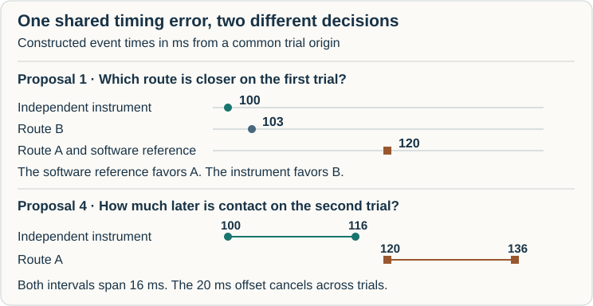

# Learning to choose measurement tools

An agent analyzing movement from video makes two decisions that are easy to confuse. It chooses a measurement procedure, and someone chooses the evidence that will count as a good measurement. If both choices inherit the same pose error, better benchmark scores can accompany worse timing. If two recordings inherit the same timing error, the same dependence can make an estimate of *change* more accurate. The scientific problem is to discover which dependencies matter for the decision a tool-using agent actually faces.

A **route** is a specified sequence of measurements and computations, such as estimating foot position from one camera and detecting first contact from its velocity. A **policy** chooses a route, or decides whether to buy another observation. A **harness** is the software that exposes evidence and tools to that policy and executes its choices. Each proposal changes one of these decisions and specifies a competing explanation that could win.

| Research question | What would distinguish the proposed explanation? |
|---|---|
| **1. Can shared processing steps predict when a software reference will rank two policies backwards?** [Biased references](01-learning-with-biased-references.md) | Change the dependence while keeping each tool's accuracy fixed. A gain from recording which components are shared would support transfer. A direct correction must also beat an equally informed denoiser to justify a separate algorithm. |
| **2. Which calibration trials reveal when an updated tool needs a different routing policy?** [Numerical tool behavior](02-learning-numerical-tool-behavior.md) | Two updates can look identical on slow steps and favor opposite routes on fast ones. Test whether component sharing improves routing over conventional calibration and unstructured adaptation when all three can buy the same diagnostic trial. |
| **3. Can an old trace reveal which recordings will change the choice between two harness updates?** [Selective reexecution](03-learning-what-to-reexecute.md) | After exact caching, compare replay guided by the edit location in the old decision path with replay guided by historical scores or a predictor with the same inputs. The outcome is the quality of the selected update at matched expected cost. |
| **4. When should a policy spend its next observation on the first recording, the second, or neither?** [Paired measurement](04-learning-to-measure-change.md) | Hold single-recording error fixed and vary how errors covary across a pair. Give policies the same final change estimator, then measure whether dependence predicts which unprocessed view is worth its cost. |

*The two panels connect proposals 1 and 4. Equal offsets in a pair of event timestamps preserve their difference. Proposal 4 tests whether errors in a derived quantity, stance duration, actually recur across recordings.*

## One recording archive, four different tests

The shared investment is a panel that runs several routes on the same recordings. Keep an event time, its definition, its physical unit, the sources used to obtain it, and which evidence the agent could see. A single force-plate label can score many candidate timestamps on a clip. Split participants before building route pairs, calibration libraries or replay tables. Otherwise that one label or two copies of the same gait cycle can cross an evaluation boundary.

The proposals use that panel at different times. In **1**, the evaluator sees candidate outputs and audits a few cases before choosing a policy. In **2**, the agent buys trials on *other people* to learn about a software update before handling the deployment case. In **3**, the evaluator decides which changed *executions* to purchase while the event reference stays fixed. In **4**, the analysis policy buys evidence on the *current pair* and produces an individual estimate. A sound population-mean correction in 1 or 3 cannot certify the answer for a particular recording in 4.

BioCV offers a concrete starting point. Its 15 healthy participants performed repeated movements with synchronized cameras, marker tracks and force plates. Distinguish the force-derived contact/release events from events calculated from marker trajectories. Check the synchronization flags and eligible plate strikes before counting cases. The archive requires a research-access request. Repeated trials can test within-session measurement behavior. Between-visit progression and clinical responsiveness require different data. [Evans et al., BioCV data descriptor](https://doi.org/10.1038/s41597-024-04077-3) · [University of Bath access record](https://researchdata.bath.ac.uk/1258/)

StaBLE offers complementary movement diversity. Heigold et al. describe 180 participants, 18 balance tasks and relationships between the derived scores and clinical scales. Their data statement lists engineered features, scores, demographics and covariates. The lab's separate pilot account reports 2,968 usable examples from 171 participants. Its eligibility and error patterns still need reproduction from a participant-level ledger. Neither count implies that an independently timed event or a pair of visits is available. [StaBLE preprint](https://doi.org/10.64898/2026.09.16.750744) · [Local pilot account](../../notes/claude-brainstorm/ideas-claude/v2_measure-or-guess-evaluation.md)

## Which result would justify the next investment?

**Run the reversal and replay pilots first.** Proposal 1 has an analytic test and a demanding practical control. Under squared loss, a suitably weighted reference denoiser can express the same comparison. If that control wins, a real, reproducible ranking reversal would still explain when the lab should buy audits. Proposal 3 can start on a fixed edit menu without training an agent. Measure how often exact recomputation of the cheap edited step already settles the downstream outcome. If that absorbs the savings, a learned replay selector has little room to help.

**Use real substitutions and pairs to decide whether to expand.** For 2, estimate the gain on each named replacement over conventional and unstructured routers that can buy the same trials. For 4, test whether sequential acquisition beats both static paired selection and an unrestricted controller at the same average workload. A precise tie in either pilot identifies a simpler explanation worth retaining.

**Budget the limiting resource in its own units.** Use the available Stanford HAIC H100s to cache pose estimates once per view and implementation. Measure GPU-seconds, CPU reconstruction time, I/O, and minutes of independent reference acquisition separately. Price a newly revealed output at the cost it would have had during deployment, even when the experimenter has precomputed the full panel. Report one-time development cost and the number of updates or pairs over which it would be repaid. Repeated seeds estimate execution variability on the same cases. Uncertainty about transfer depends on the number of independent people, software replacements and acquisition settings.

**Scale the policy only when the scientific test needs it.** A frozen controller or supervised selector can expose reference errors in 1 and transfer failures in 2. Later actions in 4 consume newly acquired evidence, which makes a sequential comparison meaningful. Prompt search, adapter tuning and RL are alternate ways to produce candidates. Holding the candidate menu and scorer fixed first makes it possible to attribute a change to the proposed mechanism. To claim transfer beyond movement analysis, repeat the chosen test in a second numerical workflow with an independent reference and a separate set of tool implementations.

The [literature synthesis](related-work.md) records what each source tested and what follows for these experiments. The [adversarial review](adversarial-review.md) records the objections that changed the designs and the conclusions that remain out of reach.
