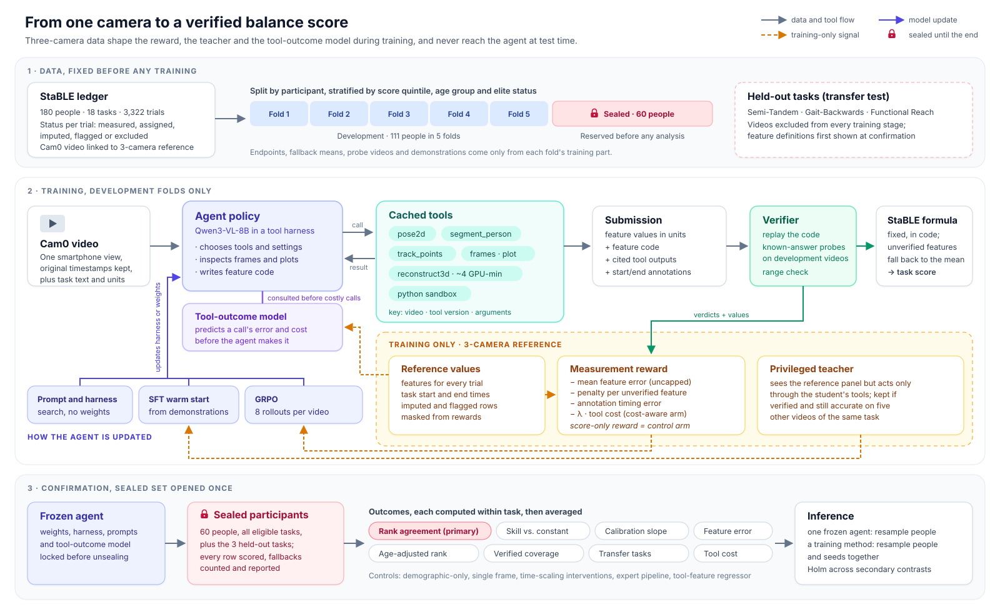

# Privileged, Verified Supervision for Tool-Calling Video Agents: Learning to Measure Balance from One Camera

*Version 5. Changes from v4: verification now runs the agent's code on development videos with known answers, and a suite of deliberate shortcut programs must fail it; the reward bound is repaired; a tool-outcome world model predicts what each tool call will deliver, supports cost-aware tool choice and supplies calibrated uncertainty; three tasks are held out to test transfer; time-scaling interventions check that outputs respond to movement and not to appearance; the sealed set is enlarged to 60 participants reserved before any analysis; and the confirmatory comparisons are trimmed to a short, replicated list.*

*Figure 1. The pipeline. The data are frozen before training (top). During training (middle), the agent works only from the single-camera video and cached tool outputs; the three-camera reference, shown in amber, reaches the agent only through rewards, teacher demonstrations and the tool-outcome model's training labels. The sealed participants and held-out tasks are opened once, after every component is frozen (bottom).*

## Abstract

A balance score computed from one smartphone video is useful only if it reflects how the person moved. On the StaBLE balance dataset, a constant guess comes close to the best learned model and age alone predicts much of the score, so accuracy figures can hide methods that measure little. We study a vision-language agent that calls pose, segmentation and reconstruction tools, writes code for each task's defined features, and passes them to a fixed scoring formula. Training uses a three-camera reconstruction that the agent never sees at test time: it rewards each feature separately, credits a feature only when the agent's code reproduces known answers on other videos, guides a teacher whose demonstrations the single-camera student can follow, and trains a model that predicts each tool's error and cost before the call is made. On participants sealed until the end and on tasks withheld from training, we test whether this supervision yields agents that order people more accurately than outcome-only reinforcement learning, whether their outputs respond to controlled changes in movement as physics predicts, and whether they keep that accuracy at lower compute.

## 1. Motivation

A video-based balance measurement has four stages: find body landmarks in each frame; reconstruct a 3D skeleton whose joint angles and **center of mass** (the average position of the body's mass) change over time; reduce those curves to the quantities a task asks for (in "rise to toes", the peak upward speed of the center of mass, the peak ankle angle, and the time spent high); and rescale and average those features into a task score. StaBLE ([Heigold et al., 2026](https://doi.org/10.64898/2026.09.16.750744)) defines 76 features across 18 tasks recorded from 180 adults, from people with vestibular disorders to professional dancers.

The lab's single-camera pilot exposed two failure modes. Rebuilding the skeleton with OpenCap Monocular and applying StaBLE's rules produced valid scores for 567 of 729 test cases and took about four GPU-minutes per 17-second clip. Learned predictors always answered, but the best (a fine-tuned Qwen3-VL-8B, task-averaged error 0.100) improved on predicting each task's average (0.120) by about a sixth, and the untrained model (0.238) did worse than the average.

Error alone can hide a method that ignores the video. For five people with true scores 0.4 to 0.8, a constant 0.6 has error 0.120, a predictor that keeps the order but shrinks differences to a fifth has 0.096, and a noisy predictor that measures has 0.080. We therefore also report **rank agreement** (within-task Spearman correlation), **skill** (one minus the ratio of a method's error to the constant's), and the **calibration slope** (near one when differences between people survive). Appearance is a second trap: the StaBLE score correlates −0.76 with age, so a model could rank people by how old they look.

## 2. Concepts

**Vision-language model (VLM), tool call, harness, agent.** A VLM takes images or video frames with text and produces text; here Qwen3-VL-8B ([report](https://arxiv.org/abs/2511.21631)). A tool call is a structured request in its output that software executes and answers. The harness is that software (tool descriptions, the loop that runs calls, the record of earlier steps, the stopping rule). Model plus harness acting over several steps is an agent; one run from video to answer is a trajectory.

**Supervised fine-tuning (SFT) and reinforcement learning (RL).** SFT makes example trajectories more probable and cannot improve on them. RL lets the model generate trajectories, scores them with a reward, and shifts the model toward higher-reward ones. GRPO ([Shao et al., 2024](https://arxiv.org/abs/2402.03300)) samples several trajectories per video and compares each with the group's average.

**Shortcuts under outcome rewards.** When only the final number is rewarded, a trajectory that outputs a typical value without measuring can score well. Outcome-only RL can make video models stop using the video ([Xu, 2026](https://arxiv.org/abs/2606.22043)), and RL-trained tool agents skip verification more often ([Thaman, 2026](https://arxiv.org/abs/2605.02964)).

**Privileged information.** Information present in training but absent at test time; here the three-camera reconstruction. A student that imitates a teacher whose choices depend on that information may learn moves it cannot justify from what it sees ([Penaloza et al., 2026](https://arxiv.org/abs/2602.04942)).

**World model.** A model of how the environment responds to actions. Our environment is the tool set, so the world model predicts, before a call is made, how accurate the resulting feature is likely to be and how much the call costs. This narrows a general idea in agent research, using a learned simulator to predict the outcome of a call before committing to it ([survey](https://arxiv.org/abs/2604.22748); [Qwen-AgentWorld](https://arxiv.org/abs/2606.24597)), to a setting where the predictions can be checked against a reference.

**Known-answer probe.** A development video whose reference feature value is known. If the agent's feature code is run on a probe's tool outputs, it should return roughly the known value. Code that returns a typical number regardless of input fails.

## 3. Research question

**Primary question.** By the ICML 2027 submission deadline (expected late January 2027), does GRPO with a *verified per-feature reward* produce a Qwen3-VL-8B tool-calling agent with higher mean within-task rank agreement on 60 sealed participants than GRPO with a *final-score reward*, when both start from the same warm-started model and use the same number of rollouts?

**Confirmatory secondary contrasts** (one family, Holm-corrected): (S1) verified per-feature reward against the same reward without verification; (S2) privileged-teacher against plain-teacher warm start, measured after SFT; (S3–S5) the final agent against the fine-tuned direct predictor, the tool-feature regressor and the expert pipeline; (S6) the trained agent against the frozen agent on three held-out tasks; (S7) the final agent against the fine-tuned direct predictor on response to time-scaling interventions.

**Exploratory**: cost-aware training with the world model; prompt and harness search across budgets; conformal uncertainty.

| ID | Hypothesis | Refuted if |
|---|---|---|
| H1 | Final-score RL shrinks predictions toward the average | Development calibration slope stays within 0.1 of the warm start's |
| H2 | Verified per-feature rewards beat final-score rewards (primary) | 95% crossed-bootstrap interval for the difference includes zero |
| H3 | Verification is necessary (S1) | The S1 interval includes zero |
| H4 | The privileged teacher gives a better warm start (S2) | The S2 interval includes zero |
| H5 | The agent measures movement (S7) | Its intervention response accuracy is no better than the direct predictor's |
| H6 | Learned tool use transfers to unseen tasks (S6) | No gain over the frozen agent on held-out tasks |
| H7 | The world model cuts tool cost at little loss (exploratory) | Rank agreement drops by more than 0.02 at half the tool GPU time |

## 4. Related work

**Movement VLMs and agents.** Knowledge-augmented gait VLMs ([Wang et al., 2024](https://arxiv.org/abs/2403.13756)), [BioGait-VLM](https://arxiv.org/abs/2603.08564) and [MyoMechanix](https://arxiv.org/abs/2608.26094) learn direct mappings; [BiomechAgent](https://arxiv.org/abs/2602.06975) writes analysis code over processed data and benefits from validated event tools; [Biomni](https://doi.org/10.1101/2025.05.30.656746) shows that broad tool sets help biomedical agents. None trains a model to use measurement tools.

**RL for tool use.** [DeepEyes](https://arxiv.org/abs/2505.14362), [LongVT](https://arxiv.org/abs/2511.20785) and [VITAL](https://arxiv.org/abs/2508.04416) learn visual tool use from outcome rewards; [ToolRL](https://arxiv.org/abs/2504.13958) refines rewards on tool names and arguments.

**Privileged supervision and world models.** π-Distill and on-policy self-distillation ([Penaloza et al., 2026](https://arxiv.org/abs/2602.04942)) distill privileged teachers into agents; language world models simulate environments for agent training ([Qwen-AgentWorld](https://arxiv.org/abs/2606.24597)).

**Prompt and harness optimization.** [GEPA](https://arxiv.org/abs/2507.19457), [Meta-Harness](https://arxiv.org/abs/2603.28052) and [VidHarness](https://arxiv.org/abs/2609.38413) improve prompts or harness code without changing weights; [Wang et al. (2026)](https://arxiv.org/abs/2607.12227) find these gains often fail to beat matched test-time scaling and transfer poorly.

## 5. Method

### 5.1 Agent, harness and cache

The agent receives the Cam0 video, the task description and the feature definitions with units. Tools: timestamped frames and crops; 2D landmarks (two pose models); person segmentation (SAM 2.1); point tracks (CoTracker3) for 16 predefined body regions; 3D joint angles and center of mass (OpenCap Monocular, two settings); plotting; a Python sandbox; and `predict_outcome` (the world model, Section 5.5). Large arrays stay in the sandbox and the model sees summaries or plots, with all times in seconds from the original video. Every reachable call is cached under (video, tool version, full arguments); a request outside the menu returns an error message.

### 5.2 Submissions and verification

Each feature is submitted as a value plus a function `feature(outputs, ann)` of cached tool outputs and named time annotations (such as `task_start`), the cited outputs, and the agent's own annotations. The harness checks:

1. **Replay.** The function, run on the cited outputs and annotations, reproduces the value.
2. **Known-answer probes.** Four development videos of the same task are drawn from the current training folds: two with reference values near the feature's 25th percentile and two near its 75th, chosen among videos where the expert pipeline's start and end times agree with the three-camera segmentation within 0.2 s. The function is run on each probe's cached outputs with the expert annotations. It passes if its mean error on the probes, in score units, is at most `max(0.15, 1.5 ×` the expert pipeline's error on the same probes`)`, and if both low probes fall on the correct side of both high probes.
3. **Range.** The value lies within the training range widened by half its width on each side.

A feature passing all three is **verified**. Because probes come from development folds, verification uses no reference value from the video under analysis and runs identically on sealed participants.

**Verifier validation (pre-registered, before any RL).** We run a fixed suite of shortcut programs through the verifier on development folds: the training mean, the training mean plus a tiny multiple of the input's mean, the mean plus noise, the right computation on the wrong body part, the right computation in the wrong units, a hard-coded time window, a function of clip duration only, and a function of the person's pixel height (an appearance proxy). Each must fail on at least 95% of features, and the expert pipeline's own functions must pass on at least 90%. If either threshold is missed, tolerances are revised on development folds and the suite is rerun before training begins.

### 5.3 Rewards

Let task `t` have `k` unmasked features, with endpoints `L_f`, `U_f` fitted on training folds and rescaling `n_f(x) = (x − L_f)/(U_f − L_f)` (reversed when lower is better). The value used for scoring is `x̃_f = x̂_f` if verified and the training-fold mean `m_f` otherwise, and the task score is `Ŝ = (1/k) Σ_f n_f(x̃_f)`. With reference `x*_f`, define the uncapped error `e_f = |n_f(x̃_f) − n_f(x*_f)|`.

- **Verified per-feature reward:** `R = −(1/k) Σ_f [e_f + c · 1(f unverified)] − α · (annotation timing error in seconds)`, with `c = 0.5` and `α = 0.1`.
- **Per-feature reward without verification (S1 control):** the same with `x̃_f = x̂_f` for every feature and `c = 0`.
- **Final-score reward (primary control):** `R = −|Ŝ − S*|`, computed from the submitted values.
- **Format penalty:** −2 for an unparseable submission.
- **Cost (exploratory arm only):** `−λ ×` tool GPU-seconds divided by clip duration.

By the triangle inequality `|Ŝ − S*| ≤ (1/k) Σ_f e_f ≤ −R`, so the score error can never exceed the penalty, while cancelling feature errors are still penalized. The bound covers unmasked features; features whose reference was imputed or flagged are excluded from both sides.

### 5.4 Privileged teacher

A larger frozen model (Qwen3-VL-235B-A22B) runs the same harness with a read-only **reference panel** showing the three-camera joint-angle and center-of-mass curves and the reference features of the training video. It may use the panel to see where the monocular tools went wrong, but it acts only through the student's tools and its submission is verified, so reference numbers cannot be copied into the answer. Demonstrations are kept only if (a) every feature is verified, (b) the teacher's functions, run on five other training videos of the task with expert annotations, are no less accurate than the expert pipeline there, and (c) after the panel is removed, no remaining text refers to panel content (checked by string matching on panel values and a fixed list of panel terms). The **plain teacher** is the same model without the panel, with identical filters and attempts.

### 5.5 Tool-outcome world model

For every development video and every cached tool configuration, we apply the expert pipeline's feature functions and record the resulting feature error against the reference and whether the call failed. A gradient-boosted model learns to predict that error and failure from signals that are cheap to obtain before an expensive call: the 2D pose pass (per-landmark confidence, fraction of frames with both feet visible, person height in pixels), clip duration, overall motion energy, the task, and the candidate configuration. It is trained on training folds only and has three uses:

1. **A tool for the agent.** `predict_outcome(tool, args)` returns the predicted error, failure probability and GPU cost, so the agent can skip a four-minute reconstruction when 2D pose is expected to do as well.
2. **A routing baseline.** A fixed rule that calls the 3D reconstruction only when its predicted error is lower than the 2D route's by a margin set on development folds.
3. **Uncertainty.** Predicted errors of the final features are calibrated with split conformal prediction on one development fold to give 90% intervals for each task score; coverage and a selective-prediction curve are reported on the sealed set.

### 5.6 Training loop and data shape

1. Teacher generation: eight attempts per training video for each teacher; at most 40 kept demonstrations per task.
2. SFT of Qwen3-VL-8B with low-rank adapters on each teacher's demonstrations (three seeds each); the better warm start on development folds is used for all RL arms.
3. GRPO: eight trajectories per video, advantages normalized within groups, groups with identical rewards skipped as in [DAPO](https://arxiv.org/abs/2503.14476); equal rollouts for every arm.

Samplers draw eligible trials (Section 6.1) from training folds with equal probability, so task, age and ability mixtures match the data. Teacher filtering and skipped groups can tilt this mix, so we log update shares per task and ability quintile and reweight any task whose share drifts more than 25% (relative) from its ledger share.

## 6. Data, splits and leakage control

### 6.1 Eligibility by status

The ledger has one row per recorded trial (3,322), linked to its Cam0 video, reference features and participant–task slot; StaBLE's released code defines how repeated or bilateral trials aggregate.

| Status | Count (StaBLE paper) | Training input | Endpoint fitting | Reward | Evaluation |
|---|---|---|---|---|---|
| Measured | Most trials | Yes | Yes | Yes | Primary |
| Flagged (reconstruction error) | 30 | Yes | No | Masked | Sensitivity analysis |
| Imputed (OpenCap failed) | 3 | If video exists | No | Masked | Sensitivity analysis |
| Assigned zero (not attempted for safety) | 98 | No video | No | No | Composite StaBLE score only, as 0 |
| Held-out task (any status) | 3 tasks | No | No | No | Transfer test only |

### 6.2 Splits

From the 171 participants with usable video, 60 are reserved as the sealed set *before any development analysis*, drawn only from participants who were never in the lab pilot's test set and stratified by StaBLE quintile, age group and elite-athlete status. Their videos and references are stored separately. The other 111 form five stratified development folds, and each fold's task-score distributions are checked against the whole (Kolmogorov–Smirnov tests, standardized differences below 0.1). Because the reserved participants were used to train the pilot's models, the design is a retrospective re-split; an audit documents every prior use of their data, all baselines are retrained without them, and confirmation on newly recorded participants is proposed as follow-up.

**Held-out tasks.** Semi-Tandem, Gait-Backwards and Functional Reach are fixed now, before development. Their videos are excluded from every training stage, including teacher generation, prompt search and the world model, and their feature definitions are first shown to the agent at confirmation.

### 6.3 Other leaks

Normalization endpoints, fallback means, probes, teacher demonstrations, prompt examples and search feedback are fitted on each split's training folds only, and on all 111 development participants for final models. Seven participants appear in StaBLE's public exemplar video; results are reported with and without any of them in the sealed set. StaBLE's feature definitions were designed on all 180 participants, and we treat them as part of the instrument.

## 7. The research journey

| Stage | Question | Leakage guard | Gate |
|---|---|---|---|
| 0. Groundwork | Is the protocol sound and powered? | Sealed set reserved first; ledger, cache, expert pipeline, verifier validation | Simulated power below 60%: claims become estimates only; 60–80%: proceed and report power |
| 1. Re-baseline | What do existing methods achieve, and from what? | All baselines retrained per fold, plus demographic-only and single-frame | If the demographic baseline matches the direct predictor's rank agreement, age-adjusted rank agreement becomes co-primary |
| 2. Frozen agent | Do tools alone help? | Fixed harness; best-of-8 with label-free selection | Verified coverage below 30% sends us to harness fixes first |
| 3. Text-level levers | What do prompt and harness search add per H100-hour? | Feedback from training folds only | Best harness becomes the training harness |
| 4. Warm start | Does the privileged teacher help? | Both teachers, same filters and attempts | Better warm start feeds every RL arm |
| 5. RL | Does verified per-feature reward beat final-score reward, and is verification necessary? | Three arms, three seeds, equal rollouts | Freeze all components |
| 6. World model | Can the agent spend less? | World model trained on training folds; one cost-aware arm | Exploratory |
| 7. Confirmation | Do development findings hold on new people and new tasks? | Sealed set and held-out tasks opened once | Report all pre-registered contrasts |

## 8. Evaluation

**Estimators** (on sealed participants). Task-averaged error: mean absolute error within each task, then the equal-weight mean over tasks. Skill: `1 − MAE_t / MAE_t(constant)` per task, averaged (a task where the constant's error is zero is excluded from skill for every method). Rank agreement: Spearman within each task, averaged; ties use average ranks, constant predictions score 0, and a bootstrap replicate with constant references assigns 0 to every method for that task. Calibration slope: median over tasks. Verified coverage: share of rows whose features all pass verification. Feature error in score units.

**Does the output track movement?** Besides the demographic-only and single-frame baselines and an age-adjusted rank agreement, we apply **time-scaling interventions**: 100 sealed videos, stratified by task, are slowed to 0.8× speed by resampling frames with corrected timestamps, keeping appearance identical, and all tool outputs are recomputed for them. Each feature has a predicted response fixed in advance: durations should grow by 1.25×, speeds should shrink to 0.8×, and angles and distances should not change; features capped by the trial length are excluded. Response accuracy is the share of features whose observed ratio is within 10% of the prediction. For the direct predictor, which outputs only scores, the predicted change in score follows from the same feature ratios.

**Transfer.** On the three held-out tasks, the trained and frozen agents (with the same harness) are compared on rank agreement.

**Cost.** Tool GPU-seconds and model tokens per video, separated into first-use and cached costs.

## 9. Statistics

**Unit.** Participants. Each bootstrap replicate resamples participants with all their rows and recomputes every estimator.

**Method and artifact claims.** Claims about a training method use a crossed bootstrap over seeds and participants; claims about one frozen agent resample participants only.

**Decision rule.** The primary contrast succeeds if the 95% crossed-bootstrap interval for the rank-agreement difference lies above zero and the skill difference's interval has a lower end above −0.02. Secondary contrasts S1–S7 are Holm-corrected at family-wise 5%.

**Power.** Before training, we resample complete participant task vectors from cross-validated development predictions of two existing methods, add seed variability measured from repeated SFT runs, and apply the decision rule to estimate power for a 0.05 rank-agreement gain with 60 participants, against a target of 80%. The gate in Stage 0 applies.

## 10. Compute and timeline

All development compute is counted in H100-hours, including proposer models (run locally), teacher generation, training, cache misses and inference; the shared tool cache (about 400 H100-hours) is reported separately. The plan assumes roughly 4,000 H100-hours: about 500 for teacher generation, 150 for SFT, and 200 for each of the ten RL runs (three arms with three seeds, plus the cost-aware arm), measured on 50 videos in week 1. Each RL arm is also compared with a continuation control that spends its budget on more harness search. **Minimum scope**: if the measured budget falls below 2,000 H100-hours, RL is restricted to six tasks spanning the main families, the primary contrast is evaluated on those six, and claims about the overall StaBLE score are dropped.

| Weeks from 26 Oct 2026 | Work |
|---|---|
| 1–2 | Stage 0 (scope decision dated 6 Nov) |
| 3 | Stage 1 |
| 4–5 | Stages 2–3; teacher generation |
| 6–9 | Stages 4–6 |
| 10 | Stage 7 |
| 11–13 | Analysis and writing |

## 11. Risks

If the verifier is too strict, learning stalls; its tolerances are fixed in Stage 0 against the shortcut suite and the expert functions. If every tool fails on some tasks, those tasks contribute fallbacks for all methods and are reported separately. If the expert pipeline or the tool-feature regressor matches the trained agent at lower cost, we report that result.
