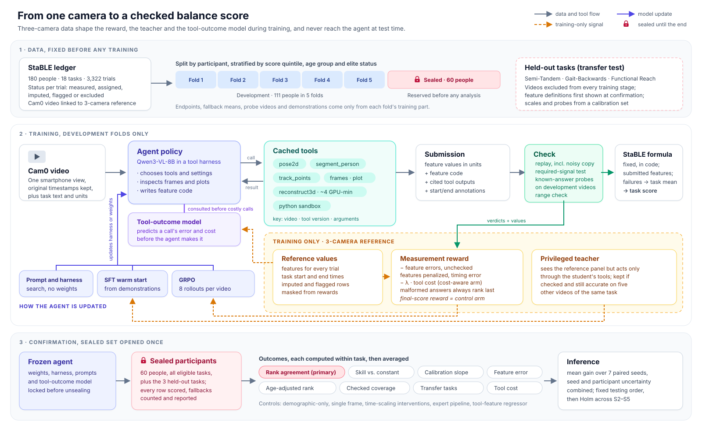

# Rewarding Only What Can Be Checked: Training Tool-Calling Video Agents to Measure Balance from One Camera

*Version 7 (final). Changes from v6: the primary evaluation scores every agent from its features as submitted, so the arm trained to pass the check gets no built-in advantage; the check now also requires each feature to respond to the signal it is defined on, which closes a loophole through the agent's own time annotations; a fixed-call ablation of the same model returns; harness search has a fixed validation budget; the tool-outcome model has its own evaluation; Codex's reviews of v5, v6 and v7 are addressed (see `output/research-claude/review_v7.md`); and the text has been audited for the stylistic patterns listed in the brief.*

**Title options**

1. Rewarding Only What Can Be Checked: Training Tool-Calling Video Agents to Measure Balance from One Camera *(recommended)*
2. Learning to Conduct Biomechanical Analysis: Privileged, Checked Supervision for Vision-Language Agents
3. Known Answers as Rewards: Reinforcement Learning for Tool-Using Video Agents in Movement Assessment
4. From Three Cameras to One: Distilling Biomechanical Measurement into a Tool-Calling Vision-Language Model
5. Privileged Sensors, Checked Measurements: Training Agents to Measure Human Movement from Smartphone Video
6. Do Video Agents Measure? Robust Training of Tool-Calling Vision-Language Models for Balance Assessment
7. When a Better Instrument Exists Only in Training: Checked Rewards for Tool-Calling Agents in Clinical Movement Analysis

*Figure 1. Data are frozen before training (top). In training (middle), the agent works from one camera and cached tool outputs; the three-camera reference (amber) reaches it only through rewards, teacher demonstrations and the tool-outcome model's labels. Sealed participants and held-out tasks are opened once, at the end (bottom).*

## Abstract

Smartphone video could make balance assessment routine, but a score computed from one camera is worth trusting only if it reflects how the person moved. On a large balance dataset, predicting the average score is nearly as accurate as the best learned model, and age alone explains much of the score, so accuracy figures can hide models that measure little. We propose to train a vision-language model to carry out the measurement itself, calling pose, segmentation and 3D reconstruction tools and writing the code that turns their outputs into each task's defined features, and to reward it only for what can be checked. During training, a three-camera reconstruction provides a reference for every feature. A feature earns credit only when the agent's code responds to the right body signal and reproduces known answers on other videos, a teacher that can see the reference writes demonstrations using only the student's tools, and a learned model of the tools predicts what each call will cost and how accurate it will be. Evaluated on people and tasks held back until the end, the study asks whether this supervision teaches an agent to measure movement, whether that skill carries over to unfamiliar tasks, and what it costs. The recipe applies wherever a better instrument is available during training but not in deployment.

## 1. The problem, through one example

In the StaBLE "rise to toes" task ([Heigold et al., 2026](https://doi.org/10.64898/2026.09.16.750744)), a person rises onto their toes as quickly and as high as they can and holds for five seconds. Three numbers describe how well they did: the peak upward speed of their **center of mass** (the average position of the body's mass), the peak ankle angle, and how long the center of mass stays high. Each of these numbers, called a **feature**, is rescaled to a 0-to-1 range using the lowest and highest values in the data, and the rescaled values are averaged into a **task score**. StaBLE has 18 such tasks with 76 features, recorded from 180 adults ranging from people with vestibular disorders to professional dancers, and it averages the 18 task scores into one balance score.

StaBLE was recorded with three smartphones, whose combined views give an accurate 3D reconstruction of the body. The practical goal is to obtain the same numbers from a single phone. The lab's pilot tried two routes. Rebuilding the skeleton from one camera with OpenCap Monocular and then applying StaBLE's rules produced a valid score for only about three quarters of test cases and took around four GPU-minutes per clip. Models that map video straight to a score always answered, but the best of them, a fine-tuned Qwen3-VL-8B, beat a constant guess (each task's average) by only about a sixth, and the same model without fine-tuning did worse than the constant.

A low error can hide a model that ignores the video. Suppose five people have true scores 0.4, 0.5, 0.6, 0.7 and 0.8. Guessing 0.6 for everyone gives a mean absolute error of 0.12. A model that keeps the right order but shrinks every difference to a fifth of its size does slightly better, 0.096, while saying almost nothing about who balances better. We therefore judge methods mainly by **rank agreement**, the correlation between predicted and true orderings of people within a task, and we also report **skill** (how much a method improves on the constant guess) and the **calibration slope** (whether differences between people survive or collapse toward the average). Appearance is a second trap: the balance score falls steeply with age, so a model could rank people well from how old they look.

## 2. Why an agent

A **vision-language model (VLM)** takes images or video frames together with text and produces text. In **tool calling**, part of that text is a structured request, such as "run the pose detector on this video", which surrounding software carries out before returning the result to the model. That software is the **harness**: the list of tools and their descriptions, the loop that executes calls, the record of what has happened, and the rule for stopping. A model and its harness, acting over several steps, form an **agent**, and one complete run from video to answer is a **trajectory**.

The agent route divides the work by what each part does well. Specialist tools handle geometry — locating ankles in each frame, reconstructing a skeleton, following a point through time — and most of them have already been validated against laboratory motion capture. The VLM handles the parts that call for judgment and language, such as reading the task description, choosing which tools fit, looking at a plot to see when the person started rising, noticing that a tool returned nonsense, and writing the few lines of code that turn a center-of-mass curve into a peak speed. A fixed formula then turns features into a score, so every score traces back to measurements a clinician could inspect. Prior work supports both halves of this division. A code-writing biomechanics agent improved when given a validated gait-event tool ([BiomechAgent](https://arxiv.org/abs/2602.06975)), and reinforcement learning taught a VLM when to use a visual tool ([DeepEyes](https://arxiv.org/abs/2505.14362)).

## 3. The thesis and its four parts

**Thesis: reward the measurements, and only those that can be checked.**

**Reinforcement learning (RL)** lets a model produce its own trajectories, scores each one with a **reward**, and shifts the model toward the higher-scoring ones. We use group relative policy optimization ([GRPO](https://arxiv.org/abs/2402.03300)), which samples several trajectories for the same video and compares each with the group's average. The obvious reward, closeness of the final score to the true score, has two weaknesses. A trajectory can land near the right score without measuring anything, and rewarding final answers alone has been shown to lead video models to stop using the video ([Xu, 2026](https://arxiv.org/abs/2606.22043)). And because the score is an average, overestimating the ankle angle while underestimating hold time can yield the right score from two wrong measurements. Four design choices respond to these weaknesses.

**1. Reward each feature separately.** During training, the three-camera reconstruction supplies a reference for each of the three rise-to-toes features, and the reward adds up the error of each submitted value. Because the score is an average of features, its error can never exceed this sum (Appendix B), so a high reward implies an accurate score, and errors in opposite directions no longer cancel.

**2. Credit only features that pass a check.** With each number the agent submits the short function that computed it from tool outputs and from the start and end times it marked on the video. A feature is **checked** when it passes four tests, none of which needs a reference for the video being analyzed, so the same check runs unchanged on new people:

- *replay*: re-running the function on the cited tool outputs gives the submitted value, and re-running it on a copy of those outputs with noise far below measurement precision gives nearly the same value (a function that recognizes this particular video and returns a memorized number takes a different path on the noisy copy and fails);
- *required signal*: each feature comes with perturbations of the signal it is defined on whose correct effect is known, because StaBLE's released feature code is run on the same perturbation of the reference curves. For peak speed, steepening the center-of-mass rise must raise the output; for hold time, shifting the moment the center of mass drops must change it, while rescaling its height, which leaves threshold crossings in place, must not. The agent's function must respond as the released code does, which rules out functions built only from the agent's own time marks or from constants;
- *known answers*: run on four development videos of the same task whose correct values are known (two slow risers, two fast risers), the function lands close to those values and orders them correctly;
- *range*: the value is physically plausible.

Feature functions are also restricted to array operations from a fixed library, with no branching on array identity and no numeric literals beyond a short list of physical constants. A feature that fails is penalized in the reward. Passing the check is tested behavior on known cases, which is weaker than a proof of measurement, and it certifies the computation given the agent's time marks. Whether the agent marked the right moments is a separate question: during training the marks are scored against the three-camera timing, and at evaluation we report timing error both on the sealed videos and on probe videos, where the frozen agent marks start and end without seeing their answers (Section 9).

**3. Start from a privileged teacher.** RL improves slowly from a weak start, so the agent first learns from demonstrations (**supervised fine-tuning**, SFT). The demonstrations come from a larger model given a **reference panel** with the three-camera curves for the training video, which shows it, for instance, that the one-camera reconstruction missed the start of the rise. The teacher acts only through the student's tools and its numbers must pass the same check, including the noisy-copy replay that defeats functions which memorize the current video's answer. A demonstration is kept only if the teacher's functions also work on five other videos of the task, which removes solutions tuned with hindsight to one video. A teacher whose choices depend on information the student lacks is a known hazard in distillation ([Penaloza et al., 2026](https://arxiv.org/abs/2602.04942)), and these restrictions aim to keep the teacher's choices learnable.

**4. Predict what a tool will do before calling it.** The one-camera 3D reconstruction takes minutes per clip, while 2D pose takes seconds. A small **tool-outcome model** — in effect a world model of the tool environment — predicts from cheap signals (pose confidence, whether the feet are visible, clip length) how accurate each tool route will be for each feature and what it will cost. The agent can query it before an expensive call, and its predicted errors flag scores that are likely to be wrong. This is a narrow and checkable case of a broader idea in agent research, predicting the outcome of an action before committing to it ([survey](https://arxiv.org/abs/2604.22748)).

## 4. A worked trajectory

The steps below show the shape of one training trajectory for rise to toes; the numbers are illustrative.

1. The agent reads the task and the three feature definitions.
2. It calls the 2D pose tool. The harness replies with a summary: 26 landmarks per frame at 60 frames per second, ankles visible in 98% of frames.
3. It requests a plot of heel height over time, sees the rise begin near 4.1 s and the return near 10.3 s, and records `task_start = 3.9` and `task_end = 10.6`.
4. It asks the tool-outcome model whether the 3D reconstruction is worth four minutes on this clip. The predicted error for peak center-of-mass speed is much lower with 3D than with 2D, so it makes the call.
5. It writes three functions, for instance `peak_speed(out, ann)`, which differentiates the vertical center-of-mass position over time and takes the maximum between `ann.start` and `ann.end`.
6. It submits the three values with their functions and time marks.

The harness re-runs each function on the cited outputs and on a slightly noisy copy of them (the values match), perturbs the center-of-mass curve (the peak speed changes), runs the function on four probe videos with known answers (errors are small, and the slow risers come out below the fast ones), and checks plausibility. All three features are checked, the formula computes the task score, and the reward is minus the average feature error against the three-camera reference, minus a small penalty for timing error in the marks. Had the agent written `return 0.18` for peak speed, the function would have ignored the perturbed curve and returned the same number for slow and fast risers, the feature would have failed the check, and the reward would have dropped.

## 5. Research question and hypotheses

**Primary question.** By the ICML 2027 submission deadline (expected late January 2027), does GRPO with the checked per-feature reward produce a Qwen3-VL-8B tool-calling agent with higher mean within-task rank agreement, on 60 participants sealed until the end, than GRPO with a final-score reward, when both start from the same fine-tuned model and use the same number of trajectories?

The question is specific (one model, one change, one dataset), measurable (rank agreement with the decision rule in Section 9), achievable (the data, tools and baselines exist, and Section 10 defines a reduced scope if compute falls short), relevant (it tests whether rewarding checked measurements teaches an agent to measure), and time-bound (thirteen weeks).

**Confirmatory secondary comparisons.** Testing follows a fixed order that controls the overall false-positive rate at 5%: the primary comparison first; if it succeeds, S1 at the full 5% level, because it tests the mechanism behind the primary result; if S1 also succeeds, S2 to S5 as one Holm-corrected family.

| | Comparison | What it tells us |
|---|---|---|
| S1 | Checked per-feature reward against the same per-feature reward without the check | Whether the check is needed |
| S2 | Privileged teacher against a plain teacher, after fine-tuning | Whether the reference panel improves the starting point |
| S3 | Final agent against the strongest non-agent method, chosen on development data from three candidates: the fine-tuned direct predictor, an expert-written pipeline using the same tools, and a regressor trained on the same tool outputs and feature labels | Whether the trained agent adds anything beyond the tools and labels; it does not on its own show that adaptive tool choice is the reason |
| S4 | Final agent against the direct predictor on time-scaling interventions, using the same score-change statistic for both | Whether outputs respond to movement as physics predicts |
| S5 | Trained agent against the frozen agent with the same harness, on three held-out tasks | Whether the learned skill transfers to tasks never trained on |

**Exploratory analyses**, reported without confirmatory claims:

- a fixed-call ablation, in which the final agent's weights receive a fixed set of default tool outputs and may make no further calls; because it is not retrained, it hints at the value of adaptive tool choice without isolating it;
- cost-aware RL, where the reward also charges for tool GPU time and the agent can consult the tool-outcome model;
- prompt and harness search at several budgets, including a continuation control that spends the RL budget on more search;
- uncertainty flags from the tool-outcome model.

## 6. Related work

**Movement-analysis VLMs.** Knowledge-augmented gait VLMs ([Wang et al., 2024](https://arxiv.org/abs/2403.13756)), [BioGait-VLM](https://arxiv.org/abs/2603.08564) and [MyoMechanix](https://arxiv.org/abs/2608.26094) map video, skeletons or movement phases to labels or coaching feedback without calling measurement tools.

**Biomedical agents.** [Biomni](https://doi.org/10.1101/2025.05.30.656746) and [BiomechAgent](https://arxiv.org/abs/2602.06975) show that domain tools help agents, but neither trains the model to use them.

**RL for tool use.** [DeepEyes](https://arxiv.org/abs/2505.14362), [LongVT](https://arxiv.org/abs/2511.20785) and [VITAL](https://arxiv.org/abs/2508.04416) train VLMs to crop, zoom or resample video from rewards on final answers, and [ToolRL](https://arxiv.org/abs/2504.13958) adds finer rewards on tool names and arguments. Our rewards score the physical quantities the tools are used to measure and credit only checked ones. Evidence that tool agents learn to skip verification under RL ([Thaman, 2026](https://arxiv.org/abs/2605.02964)) motivates the check.

**Privileged teachers and world models.** π-Distill and on-policy self-distillation ([Penaloza et al., 2026](https://arxiv.org/abs/2602.04942)) train students from teachers that see extra information; language world models simulate agent environments for training ([Qwen-AgentWorld](https://arxiv.org/abs/2606.24597)). Our teacher's extra information is a physical measurement, and our world model predicts tool outcomes that can be checked against a reference.

**Prompt and harness optimization.** [GEPA](https://arxiv.org/abs/2507.19457), [Meta-Harness](https://arxiv.org/abs/2603.28052) and [VidHarness](https://arxiv.org/abs/2609.38413) improve an agent without changing its weights. A recent re-evaluation found such gains often vanish against equally budgeted repeated sampling and on new tasks ([Wang et al., 2026](https://arxiv.org/abs/2607.12227)), so both appear here as budget-matched baselines.

## 7. Data, splits and leakage

**The ledger.** One row per recorded trial (3,322 in StaBLE) links the single-camera video to its three-camera reference features, its participant and its task, with StaBLE's released code deciding how repeated or two-sided trials combine. Each row has a status. *Measured* rows are used everywhere. Thirty trials flagged for reconstruction error and three whose features were imputed from age are kept as inputs but excluded from rewards and from the primary evaluation. Ninety-eight tasks not attempted for safety have no video and enter only the overall balance score, as zeros, exactly as StaBLE defines it. Counts of participants and trials are reported after every exclusion.

**Sealed participants.** Of the 171 participants with usable video, 60 are set aside before any analysis, chosen from people who were never in the pilot's test set and stratified by balance score, age group and elite-athlete status. The remaining 111 form five development folds, stratified the same way and checked statistically against the whole. Because the pilot trained models on some of the sealed participants, this is a retrospective re-split: we document all prior use of their data, retrain every baseline without them, and propose confirmation on newly recorded participants as follow-up.

**Held-out tasks.** Semi-Tandem, Gait-Backwards and Functional Reach are fixed now. Their videos are excluded from every training stage, including the teacher, the tool-outcome model and harness search, and their feature definitions are first shown to the agent at the final evaluation. Scoring them still needs rescaling endpoints, fallback averages and probe videos, so the development participants' reference features for these three tasks form a **task-calibration set**. It is used only for those three purposes, never for training or prompting, and identically for every method. The transfer test is therefore transfer with labeled calibration but without any training on the task.

**Everything fitted inside folds.** The rescaling endpoints (StaBLE's published ones use all 180 people, future test participants included), fallback averages, probe videos, teacher demonstrations, prompt examples and search feedback all come from the training folds of each split, and from all 111 development participants for the final models. StaBLE's feature definitions were designed on all 180 people; we treat them as part of the measuring instrument and say so.

## 8. The research journey

The project moves through stages that each pose one question, answer it on development folds only, and end with a decision. A stage's outcome determines the next stage's starting point: a weak frozen agent sends us back to the harness before any training; a privileged teacher that does not beat the plain one still lets RL proceed, from the plain teacher's model; an RL arm that does not beat spending the same compute on more harness search is reported as such. The sealed set is opened once, at the end. The table states, for every stage, how the training data keep the dataset's shape and what blocks leakage.

| Stage | Question and change | Data used | How the data keep their shape | What blocks leakage | Decision |
|---|---|---|---|---|---|
| 0. Groundwork | Is the protocol sound and powered? Build ledger, cache tool outputs, write expert pipeline, fit the tool-outcome model per fold, validate the check and the inference rule | All 171 people; sealed set untouched | One row per trial with explicit status; no row dropped silently; the tool-outcome model sees every tool configuration of every training video | Sealed set reserved first; check tuned on development folds | Power below 60%: report estimates only; 60–80%: proceed and report power |
| 1. Re-baseline | What do existing methods achieve, and from what? | Development folds | Folds stratified by balance score, age and athlete status, and checked | Every baseline retrained inside folds, endpoints refitted per fold | If an age-and-sex model ranks people as well as the direct predictor, age-adjusted rank agreement becomes co-primary |
| 2. Frozen agent | Do tools alone help? | Development folds | Every eligible trial evaluated; failures scored as the training average | No training; prompt examples from training folds | Low checked coverage sends us back to the harness |
| 3. Prompt and harness search | How much do text-level changes add per GPU-hour? | Training folds for feedback; validation fold for selection | Feedback sampled evenly across tasks | At most 20 validation evaluations per search run, charged to its budget | The best harness becomes the training harness |
| 4. Warm start | Does the privileged teacher help? | Training folds | At most 40 demonstrations per task; per-task counts reported | Teacher sees references of training videos only | The better warm start feeds every RL arm |
| 5. RL | Do checked per-feature rewards beat final-score rewards, and is the check needed? | Training folds | Trials sampled with equal probability; a task whose share of updates drifts by more than a quarter is reweighted | References used only inside rewards | Freeze all components |
| 6. Cost-aware RL | Can the agent spend less? | Training folds | Same sampler as Stage 5 | Tool-outcome model fitted on training folds only | Exploratory |
| 7. Confirmation | Do the findings hold for new people and new tasks? | Sealed set and held-out tasks | Every eligible sealed trial scored | Opened once, after freezing | Report all pre-registered comparisons |

## 9. Evaluation and statistics

**One scoring policy for every method.** Every eligible sealed trial receives a score from every method. If a method produces no usable output for a trial (a timeout, a malformed answer, a missing feature), that task score is the training-fold average and is counted as a fallback. For the primary analysis, each agent's score is computed from its features *as submitted*, without applying the check, so the arm trained to pass the check gains nothing from the evaluation rule itself. A secondary **checked score** replaces each unchecked feature with its training-fold average, for every agent arm alike. **Checked coverage**, the share of trials whose features all pass, is reported separately, and fallbacks never count toward it.

| Arm | Training reward | Primary evaluation | Secondary evaluation |
|---|---|---|---|
| Final-score RL | Error of the final score | Features as submitted → formula | Checked score, coverage, feature error |
| Per-feature RL without the check | Sum of feature errors | Same | Same |
| Checked per-feature RL | Sum of feature errors of the submitted values, plus a fixed penalty for each unchecked feature | Same | Same |
| Non-agent methods | Their own training losses | Their score | Feature error where features exist |

**What is measured.** All measures are computed within each task and then averaged over tasks with equal weight: rank agreement (primary), skill, calibration slope, absolute error, checked coverage and per-feature error. The agent's time marks are compared with the three-camera segmentation and reported as timing error. The tool-outcome model is judged by the rank correlation between its predicted and realized feature errors and by a selective-prediction curve (how rank agreement improves when the most doubtful scores are set aside); no coverage guarantee is claimed, since every development participant is used in final fitting. Ties, constant predictions and other degenerate cases follow fixed rules (Appendix A).

**Is it measuring movement?** An age-and-sex model and a model given a single frame show how far appearance alone goes, and rank agreement is also reported after removing the effect of age. In **time-scaling interventions**, 100 sealed videos are slowed to 0.8× speed with corrected timestamps, so appearance is identical while movement is slower. Roughly, durations grow and speeds fall while angles and distances stay fixed, but StaBLE's definitions include caps and thresholds (hold time, for instance, is capped at five seconds), so expected values are never computed by hand. They come from slowing the three-camera reference trajectories by the same factor and rerunning StaBLE's released feature code, and features that should not change serve as negative controls. For S4, each method's change in task score is compared with the change produced this way, and the share of videos within a fixed tolerance is the statistic for both methods; feature-level responses are reported separately. A shortcut that reads only the clip's timestamps would also pass this test, so it is included as a control, and passing it is treated as necessary but not sufficient evidence of measurement.

**Inference.** The unit of analysis is the participant, because one person's tasks are correlated. Every confidence interval comes from resampling participants with all their trials and recomputing each measure from scratch. A lucky training run shifts every participant at once, and resampling participants cannot average that away. Claims about a training method (the primary comparison, S1 and S2) therefore target the **expected improvement over retraining**, the mean difference across independent runs. The arms involved use seven paired seeds for RL and five for fine-tuning (each pair shares a warm-start seed and data order). The interval for the mean difference combines two sources of uncertainty, the spread between paired seed differences and the participant-bootstrap spread of the seed-averaged difference, using a t-distribution with Satterthwaite degrees of freedom. The primary comparison succeeds if the lower 95% bound for the rank-agreement difference is above zero and the lower bound for the skill difference is above −0.02. Before any training, a simulation checks the coverage of this interval under symmetric, skewed and failed-run seed distributions; if coverage falls below 93% in any scenario, the interval is widened by the factor that restores 95% in the worst one. The same simulation estimates power from development predictions of existing methods. S3 to S5 compare one frozen agent with fixed baselines, so they are claims about the delivered agent and use participant-bootstrap p-values.

## 10. Feasibility

Cheap stages (baselines, the frozen agent, harness search, the tool-outcome model) run across all five development folds. Expensive stages do not: teacher demonstrations are generated once per development video and reused, and development decisions about fine-tuning and RL use a single split (folds 1–4 to train, fold 5 to validate) with one seed and half the rollouts. Only the final, confirmatory models are trained on all 111 development participants with replicated seeds. The estimates below, in H100-hours, will be replaced by measured throughput on 50 videos in the first week.

| Item | Runs | H100-hours |
|---|---|---|
| Tool cache (one-off) | — | 400 |
| Baselines across five folds | about 25 | 100 |
| Frozen agent, prompt and harness search | — | 300 |
| Teacher generation (both teachers, once) | — | 500 |
| Fine-tuning: development, then final | 2 + 10 | 300 |
| RL development (three rewards, one seed, half rollouts) | 3 | 300 |
| RL final (three rewards, seven paired seeds, about 150 each) | 21 | 3,150 |
| Cost-aware RL and continuation control | 2 | 400 |
| Interventions and sealed evaluation | — | 100 |
| **Total** | | **about 5,600** |

With 16 H100s the final RL runs take about eight days of wall-clock time. If less than 3,000 H100-hours is available, RL is limited to six tasks that span the main task families, the primary comparison is made on those, and claims about the overall balance score are dropped.

| Weeks from 26 Oct 2026 | Work |
|---|---|
| 1–2 | Stage 0; scope decision by 6 November |
| 3 | Stage 1 |
| 4–5 | Stages 2 and 3; teacher generation |
| 6–9 | Stages 4 to 6 |
| 10 | Stage 7 |
| 11–13 | Analysis and writing |

## 11. Risks, and what a negative result would teach

If the check is too strict, few trajectories earn credit and learning stalls, so its tolerances are fixed in Stage 0 against a suite of deliberate shortcut programs that must fail and expert functions that must pass. If some tasks defeat every tool, they produce fallbacks for every method and are reported separately. If an expert pipeline or a regressor on the same tool outputs matches the trained agent at lower cost, that is a useful finding about when learning pays off. If checked per-feature rewards do no better than final-score rewards, we will report no demonstrated advantage. That outcome cannot show that outcome rewards kept the agent measuring, since both arms might have stopped measuring or the study might lack power; the behavioral measures (time-scaling responses, checked coverage, feature error) will say which of these is more plausible.

## Appendix A. Settings fixed before training

| Setting | Value |
|---|---|
| Required-signal test | Two to four perturbations per feature, written before training (for example: steepen the rise, shift a threshold crossing, rescale height). The expected direction of change, or invariance, comes from running StaBLE's released feature code on the same perturbation of the reference curves; the agent's function must match it. Every feature's perturbations are validated on development videos with the expert pipeline before RL |
| Probe videos per feature | Four from training folds: two near the 25th and two near the 75th percentile of the reference, among videos where the expert pipeline's start and end agree with the three-camera segmentation within 0.2 s |
| Probe pass rule | Mean probe error at most max(0.15, 1.5 × the expert pipeline's probe error) in score units, and both low probes below both high probes |
| Range rule | Within the training range widened by half its width on each side |
| Replay on a noisy copy | Gaussian noise at 1% of each signal's frame-to-frame standard deviation; the value must stay within 1% of the feature's training range |
| Program restrictions | Array operations from a fixed library; no branching on array identity, hashes or shapes; numeric literals limited to listed physical constants and small integers |
| Shortcut suite | Training mean; mean plus a tiny multiple of the input; mean plus noise; a function of the agent's time marks only; a function that recognizes the current video and returns a memorized value; the right computation on the wrong body part; wrong units; a hard-coded window; a function of clip duration; a function of the person's pixel height. Each must fail at least 95% of the time; expert functions must pass at least 90% |
| Reward | Penalty `P = (1/k) Σ_f [e_f + 0.5 · unchecked_f] + 0.1 × timing error (s)`, with `e_f` computed from the submitted value; training reward `−min(P, 3)`; an unparseable submission gets −4, so it always ranks below every valid attempt |
| GRPO | Eight trajectories per video; groups with identical rewards skipped ([DAPO](https://arxiv.org/abs/2503.14476)) |
| Seeds | Seven paired seeds for the three RL arms; five for each fine-tuning arm; one for exploratory arms |
| Harness and prompt search | At most 20 validation evaluations per run, charged to the run's budget |
| Degenerate cases | Ties use average ranks; constant predictions get rank agreement 0; a bootstrap replicate with constant references gives 0 to every method; a task with zero constant-guess error is dropped from skill for all methods |
| Power target | 80% for a 0.05 gain in rank agreement with 60 participants |

## Appendix B. Why the per-feature reward bounds the score error

Let a task have `k` features with a usable reference and rescaled values `n_f`, so the task score is their average. For the submitted values `x̂_f`, which are also the values used in the primary evaluation, and reference values `x*_f`, define `e_f = |n_f(x̂_f) − n_f(x*_f)|`. Then `|Ŝ − S*| = |(1/k) Σ_f (n_f(x̂_f) − n_f(x*_f))| ≤ (1/k) Σ_f e_f ≤ P`, and the check penalty only adds to `P`, so an unchecked answer can never earn more than the same answer checked. The training reward `−min(P, 3)` is a capped, monotone transform of `P`, so it ranks trajectories the same way as `P`, except among trajectories already worse than the cap, and the bound itself is stated for the uncapped `P`. Features without a usable reference are left out of both sides.
