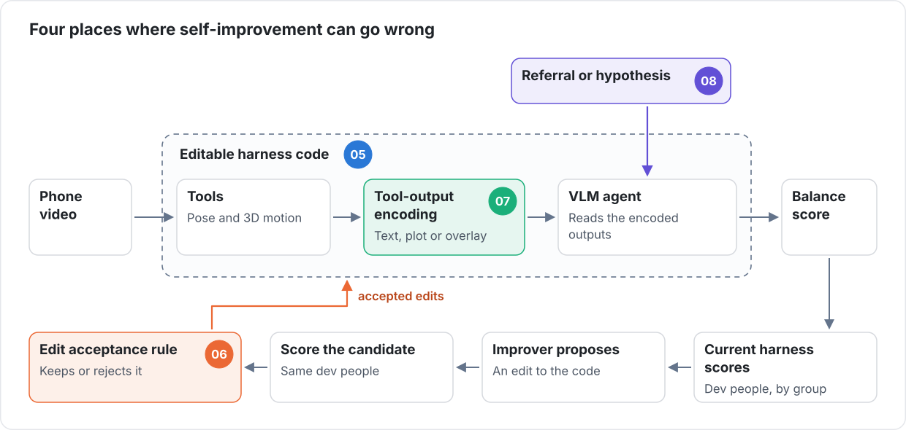
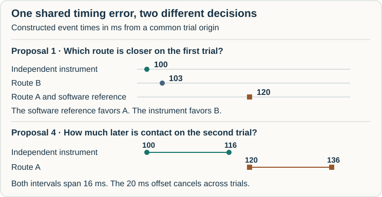

# Research proposals for tool-using measurement agents

This index links two collections of research proposals built around one test bed: an agent that watches a single smartphone video of a balance task, calls vision and biomechanics tools such as RTMPose and OpenCap Monocular, and reports a clinical score. Proposals 01 to 04 are concise [idea summaries](idea-summaries/README.md) about choosing and evaluating measurement tools. Proposals 05 to 08 are comprehensive [research plans](research-plans/README.md) about self-improving agents. Each proposal stands alone and can be read without the others; the numbering is preserved across both collections.

## Proposal index

| Proposal | Research question | Collection |
|---|---|---|
| [01. Learning with biased references](idea-summaries/01-learning-with-biased-references.md) | When does agreement with a reference reward the worse tool? | Idea summary |
| [02. Learning numerical tool behavior](idea-summaries/02-learning-numerical-tool-behavior.md) | Which calibration trials reveal when to switch measurement tools? | Idea summary |
| [03. Learning what to reexecute](idea-summaries/03-learning-what-to-reexecute.md) | Which recordings need another run after an agent changes? | Idea summary |
| [04. Learning to measure change](idea-summaries/04-learning-to-measure-change.md) | When should two recordings be measured together? | Idea summary |
| [05. What makes a harness improvable](research-plans/05-what-makes-a-harness-improvable.md) | What makes an agent harness easier to improve? | Research plan |
| [06. Who self-improvement leaves behind](research-plans/06-who-self-improvement-leaves-behind.md) | Who does self-improvement leave behind? | Research plan |
| [07. Learning how to display tool outputs](research-plans/07-learning-how-to-look-at-tool-outputs.md) | Can a perception test predict who else can read an agent's plots? | Research plan |
| [08. Blind analysis for agents](research-plans/08-blind-analysis-for-agents.md) | Can a clinician undo what the referral did to an agent's measurement? | Research plan |

The [quality assessment](quality-assessment.md) compares all eight proposals on novelty, significance, technical soundness and feasibility. Supporting reviews are kept with their collections: the [literature synthesis](idea-summaries/related-work.md) and [adversarial review](idea-summaries/adversarial-review.md) for 01 to 04, and the [review record](research-plans/review-record-05-08.md) for 05 to 08.

## Four places where self-improvement can go wrong (proposals 5 to 8)

A **harness** is the code around a model that decides which tools to call, how their outputs are shown to the model, and how the final number is computed. A **self-improvement loop** lets a language model propose edits to that harness, scores each edited version on development participants, and keeps the edits an **acceptance rule** approves. Loops of this kind (GEPA, Meta-Harness, the Darwin Gödel Machine and its successors) now produce many of the strongest agent results. Each proposal below intervenes at one place in such a loop while the harness holds everything else fixed, which turns a design question into a causal one.

*The four badges mark the place each proposal studies: the editable harness code (5), the acceptance rule that decides which edits survive (6), the encoding through which the agent sees its tool outputs (7), and the referral or hypothesis the agent is told (8).*

| Proposal | Research question | Intervention that makes it causal | Result that would prove it wrong |
|---|---|---|---|
| **5.** [What makes an agent harness easier to improve?](research-plans/05-what-makes-a-harness-improvable.md) | When two harnesses return identical outputs on every input, does the way their code is written change how far a self-improvement loop improves them at a fixed budget, and can a cheap one-step measurement predict it? | Behavior-preserving rewrites of 20 scoring harnesses (modularity, logged intermediates, exposed parameters, checks, naming), matched in length and verified by differential testing | Structural effects on one-step success and on loop gain stay inside pre-registered equivalence margins, or one-step profiles forecast loop gain no better than descendant counts |
| **6.** [Who does self-improvement leave behind?](research-plans/06-who-self-improvement-leaves-behind.md) | When a loop keeps only edits that lower average error, how does a small group fixed in advance (people at risk of falling) fare, and can the loop forecast this early from the candidates it scores? | Every candidate is scored on a sealed guard set, giving a held-out estimate of the covariance between an edit's effect on the group and the score that selects it | A generation-10 forecast that does no better than extrapolating the group's own curve, or tail drift that fails to change sign where the covariance crosses zero |
| **7.** [Can a perception test predict who else can read an agent's plots?](research-plans/07-learning-how-to-look-at-tool-outputs.md) | When an agent evolves the code that plots its tool outputs for one vision-language model, can a short perception test of each reader, run before the search, predict which other models and people also benefit? | Information-matched encodings with a pixel oracle, and perception profiles of each reader measured before evolution | Profile-based forecasts rank held-out readers' gains no better than family and size, or plots barred from printing text gain nothing over a standard clinical sway plot |
| **8.** [Can a clinician undo what the referral did to an agent's measurement?](research-plans/08-blind-analysis-for-agents.md) | When a measurement agent is told the referral, how far does its number move, can recalibration undo the shift, and does the shift enter through the tool calls or the final report? | Randomized referrals and path splicing, which replays recorded tool calls and outputs into a report step told a different referral | Framing effects within 0.2 between-person standard deviations, no effect through the tool calls, or a blind harness no better than per-referral recalibration |

### What each proposal adds to recent work

All four directions sit next to active 2025 and 2026 literature, and each document names its closest neighbors in a table. In brief:

- **5** asks a causal question that harness-evolution systems such as Agentic Harness Engineering assume without testing, and that observational code-health studies cannot answer because their programs differ in behavior. It also offers a structural prior for ranking newborn candidates, where the Huxley-Gödel Machine's descendant-based estimate carries no information.
- **6** starts from classical correlated-response selection theory, which it credits, and from 2026 work on item-level regressions and acceptance gates. Its contribution is a forecast of a pre-defined subgroup's fate that is registered before it is checked, a dose-response test in Global-MMLU where the tail's share is set by design, and a sample-size rule for protective gates.
- **7** builds on evidence that plots beat serialized numbers for multimodal models and that these models have measurable graphical perception. It adds a prediction, fixed before any search, of which readers a self-designed plot will transfer to, and a decomposition of each gain into information, shared perception and reader-specific exploitation.
- **8** builds on 2026 findings that stated beliefs steer analysis agents and on blinding protocols. It separates context that a downstream combiner can repair (a one-to-one shift of the reported number) from context that destroys information (a referral-dependent analysis path), measures each by intervention, and tests a blind-then-interpret harness on decision loss.

### One test bed and one evaluation protocol

All four proposals use StaBLE (180 people aged 18 to 87, 18 balance tasks, three phones) and the lab pilot's single-camera setup, and each replicates its central result in a public domain outside biomechanics.

| Proposal | Second domain |
|---|---|
| 5 | A self-improving coding agent on Aider Polyglot, with the DGM and SICA seed agents |
| 6 | Global-MMLU run as a tool-using QA agent, with low-resource languages as the tail |
| 7 | TimerBed time-series reasoning tasks and a synthetic anomaly suite with exact floors |
| 8 | EchoNet-Dynamic echocardiography videos, with ejection fraction as the measured quantity |

Every proposal applies the same rules, because self-improvement results on small clinical datasets are easy to overstate:

1. Split by participant before building any panel, cache or library, and keep a sealed set of test people that no search ever touches.
2. Recompute StaBLE's feature normalization on development people only, since the published scores use all 180 people and leak the test scale.
3. Run at least five seeds for every stochastic loop, and report effective sample size in people with person-clustered intervals.
4. Pre-register the primary outcome and the smallest effect of interest, and use equivalence tests where a null result would be informative.
5. Report compute as H100-hours, tokens and tool CPU time, with the arithmetic shown.

### Where to start

Each proposal begins with a step that needs no training and can settle whether the expensive part is worth running.

- **8:** a framing audit and path-splicing pilot on cached tool outputs tests whether referrals move the number at all and through which route.
- **7:** a perception battery on several VLMs and human readers tests whether profiles differ enough to predict transfer.
- **6:** edit-effect panels on the first generations test whether the covariance between subgroup effect and selection score can be estimated precisely enough to forecast.
- **5:** single-edit profiles on behavior-preserving variants test whether structure moves one-step success before any full loop is run.

Planned compute on Stanford HAIC H100s is about 710 H100-hours for proposal 5, about 2,030 for proposal 6, about 5,430 for proposal 7 and about 2,640 for proposal 8. Throughputs are planning assumptions that each proposal checks on a small pilot first. StaBLE videos require lab access; the other datasets are public or available under a research use agreement.

### How these proposals were developed

The [review record](research-plans/review-record-05-08.md) explains how the four directions were chosen, including two candidates that were dropped because 2026 papers already cover them. It also describes the simulation checks behind the theory, the Codex figure and adversarial reviews, the independent critical review, and the limitations that remain open. Figure scripts, research notes and every review are kept in [output/idea-summaries-build/](../output/idea-summaries-build/).

## Earlier collection: learning to choose measurement tools (proposals 1 to 4)
An agent analyzing movement from video makes two decisions that are easy to confuse. It chooses a measurement procedure, and someone chooses the evidence that will count as a good measurement. If both choices inherit the same pose error, better benchmark scores can accompany worse timing. If two recordings inherit the same timing error, the same dependence can make an estimate of *change* more accurate. The scientific problem is to discover which dependencies matter for the decision a tool-using agent faces.

A **route** is a specified sequence of measurements and computations, such as estimating foot position from one camera and detecting first contact from its velocity. A **policy** chooses a route, or decides whether to buy another observation. A **harness** is the software that exposes evidence and tools to that policy and executes its choices. Each proposal changes one of these decisions and specifies a competing explanation that could win.

| Research question | What would distinguish the proposed explanation? |
|---|---|
| **1. Can shared processing steps predict when a software reference will rank two policies backwards?** [Biased references](idea-summaries/01-learning-with-biased-references.md) | Change the dependence while keeping each tool's accuracy fixed. A gain from recording which components are shared would support transfer. A direct correction must also beat an equally informed denoiser to justify a separate algorithm. |
| **2. Which calibration trials reveal when an updated tool needs a different routing policy?** [Numerical tool behavior](idea-summaries/02-learning-numerical-tool-behavior.md) | Two updates can look identical on slow steps and favor opposite routes on fast ones. Test whether component sharing improves routing over conventional calibration and unstructured adaptation when all three can buy the same diagnostic trial. |
| **3. Can an old trace reveal which recordings will change the choice between two harness updates?** [Selective reexecution](idea-summaries/03-learning-what-to-reexecute.md) | After exact caching, compare replay guided by the edit location in the old decision path with replay guided by historical scores or a predictor with the same inputs. The outcome is the quality of the selected update at matched expected cost. |
| **4. When should a policy spend its next observation on the first recording, the second, or neither?** [Paired measurement](idea-summaries/04-learning-to-measure-change.md) | Hold single-recording error fixed and vary how errors covary across a pair. Give policies the same final change estimator, then measure whether dependence predicts which unprocessed view is worth its cost. |

*The two panels connect proposals 1 and 4. Equal offsets in a pair of event timestamps preserve their difference. Proposal 4 tests whether errors in a derived quantity, stance duration, recur across recordings.*

### One recording archive, four different tests

The shared investment is a panel that runs several routes on the same recordings. Keep an event time, its definition, its physical unit, the sources used to obtain it, and which evidence the agent could see. A single force-plate label can score many candidate timestamps on a clip. Split participants before building route pairs, calibration libraries or replay tables. Otherwise that one label or two copies of the same gait cycle can cross an evaluation boundary.

The proposals use that panel at different times. In **1**, the evaluator sees candidate outputs and audits a few cases before choosing a policy. In **2**, the agent buys trials on *other people* to learn about a software update before handling the deployment case. In **3**, the evaluator decides which changed *executions* to purchase while the event reference stays fixed. In **4**, the analysis policy buys evidence on the *current pair* and produces an individual estimate. A sound population-mean correction in 1 or 3 cannot certify the answer for a particular recording in 4.

BioCV offers a concrete starting point. Its 15 healthy participants performed repeated movements with synchronized cameras, marker tracks and force plates. Distinguish the force-derived contact/release events from events calculated from marker trajectories. Check the synchronization flags and eligible plate strikes before counting cases. The archive requires a research-access request. Repeated trials can test within-session measurement behavior. Between-visit progression and clinical responsiveness require different data. [Evans et al., BioCV data descriptor](https://doi.org/10.1038/s41597-024-04077-3) · [University of Bath access record](https://researchdata.bath.ac.uk/1258/)

StaBLE offers complementary movement diversity. Heigold et al. describe 180 participants, 18 balance tasks and relationships between the derived scores and clinical scales. Their data statement lists engineered features, scores, demographics and covariates. The lab's separate pilot account reports 2,968 usable examples from 171 participants. Its eligibility and error patterns still need reproduction from a participant-level ledger. Neither count implies that an independently timed event or a pair of visits is available. [StaBLE preprint](https://doi.org/10.64898/2026.09.16.750744) · [Local pilot account](../notes/claude-brainstorm/ideas-claude/v2_measure-or-guess-evaluation.md)

### Which result would justify the next investment?

**Run the reversal and replay pilots first.** Proposal 1 has an analytic test and a demanding practical control. Under squared loss, a suitably weighted reference denoiser can express the same comparison. If that control wins, a real, reproducible ranking reversal would still explain when the lab should buy audits. Proposal 3 can start on a fixed edit menu without training an agent. Measure how often exact recomputation of the cheap edited step already settles the downstream outcome. If that absorbs the savings, a learned replay selector has little room to help.

**Use real substitutions and pairs to decide whether to expand.** For 2, estimate the gain on each named replacement over conventional and unstructured routers that can buy the same trials. For 4, test whether sequential acquisition beats both static paired selection and an unrestricted controller at the same average workload. A precise tie in either pilot identifies a simpler explanation worth retaining.

**Budget the limiting resource in its own units.** Use the available Stanford HAIC H100s to cache pose estimates once per view and implementation. Measure GPU-seconds, CPU reconstruction time, I/O, and minutes of independent reference acquisition separately. Price a newly revealed output at the cost it would have had during deployment, even when the experimenter has precomputed the full panel. Report one-time development cost and the number of updates or pairs over which it would be repaid. Repeated seeds estimate execution variability on the same cases. Uncertainty about transfer depends on the number of independent people, software replacements and acquisition settings.

**Scale the policy only when the scientific test needs it.** A frozen controller or supervised selector can expose reference errors in 1 and transfer failures in 2. Later actions in 4 consume newly acquired evidence, which makes a sequential comparison meaningful. Prompt search, adapter tuning and RL are alternate ways to produce candidates. Holding the candidate menu and scorer fixed first makes it possible to attribute a change to the proposed mechanism. To claim transfer beyond movement analysis, repeat the chosen test in a second numerical workflow with an independent reference and a separate set of tool implementations.

The [literature synthesis](idea-summaries/related-work.md) records what each source tested and what follows for these experiments. The [adversarial review](idea-summaries/adversarial-review.md) records the objections that changed the designs and the conclusions that remain out of reach.
