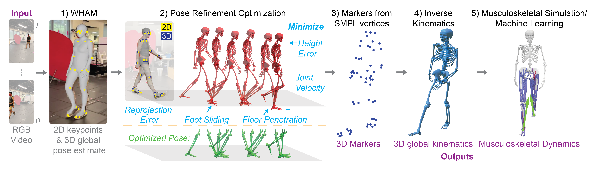
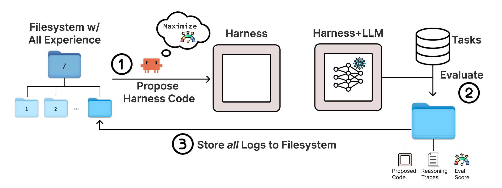

# Learning What to Preserve in Biomechanical Agents

## Abstract

A movement-analysis tool may detect when a foot touches the ground, yet an agent can lose that timing information when it summarizes the result. We propose a method for learning what information an analysis workflow must preserve to answer a given question. It records these requirements as evidence contracts, checks them against tool outputs, and reuses them when constructing new workflows. Using walking videos, we will compare this approach with direct code search given the same models, information, and computation limits. Independent foot-contact recordings will establish measurement accuracy on new participants and unfamiliar workflows. The study will test whether reusable requirements improve the accuracy achieved within a fixed budget, providing a basis for broader biomechanical analysis.

## 1. Problem and research question

**Biomechanics** studies body motion and the forces involved. A video-analysis workflow locates body parts or events, converts their positions or times into measurements, and uses those measurements to answer a question. Errors can arise within an operation or when information passes between operations.

Consider walking. A **stride** begins when one foot touches the ground and ends when that same foot touches down again. Subtracting those contact times gives its duration. Measuring how regularly strides occur requires their individual durations; an average alone hides differences between strides.

An **agent** uses a language model—a model that processes and generates text—to select tools and construct an analysis. Its **harness** is the software that makes tools available, stores their outputs, and controls how the analysis proceeds. An **evidence contract** specifies what measurement must remain recoverable and how to check it. We will use these contracts to improve the harness while keeping the language model and foot-contact detector unchanged.

**Research question:** Within a 12-week pilot, can learning and reusing evidence contracts increase the proportion of accurate stride-variability measurements on unseen participants and unfamiliar combinations of processing steps, compared with direct code search using the same information and computation limits?

The primary measurement is the **standard deviation of stride durations**, their spread around the average in seconds. A result succeeds when its absolute error—the distance from an independent reference—is within a tolerance fixed before comparing methods. Missing answers and timeouts count as failures. The comparison tests the starting assumption that contracts provide no improvement. The 12-week study begins once videos and independent foot-contact measurements recorded on a common clock are accessible.

The study is restricted to three questions: average stride duration, stride variability, and whether two consecutive strides fall below a supplied duration threshold. They share the detector but need different retained information. Variability is the primary outcome; the other questions test reuse across related tasks.

## 2. Related work and the proposed contribution

Research on agent interfaces establishes that the software around a model affects performance. [SWE-agent](https://arxiv.org/abs/2405.15793v3) demonstrates this in coding, while [BiomechAgent](https://arxiv.org/html/2602.06975v1) shows that adding a specialist foot-contact tool improves answers to movement-timing questions. [OpenCap Monocular](https://arxiv.org/abs/2603.24733v1) provides a more extensive route from smartphone video to estimated motion and forces, validated under a specific recording protocol. These results motivate checking both the tools and the measurements produced by their combination.

*Figure 1. A biomechanical measurement pipeline.* **Pose** describes body position; **kinematics** describes motion; **inverse kinematics** fits joint angles to body landmarks; and **musculoskeletal dynamics** concerns forces and their turning effects in muscles and bones. WHAM estimates motion, and SMPL represents the body's surface. Refinement reduces image mismatch (reprojection error), height error, foot sliding, movement below the floor, and excessive joint speed. RGB means color video; 2D and 3D mean two and three dimensions. Adapted from Gilon, Miller, and Uhlrich, [Figure 2](https://arxiv.org/html/2603.24733v1#S2.F2), [CC BY-NC-SA 4.0](https://creativecommons.org/licenses/by-nc-sa/4.0/); white background and margins added.

Automated workflow improvement also has precedents. [GEPA](https://arxiv.org/abs/2507.19457) improves instructions using execution feedback; [Meta-Harness](https://arxiv.org/abs/2603.28052v1) searches executable harness code using previous programs and results; and [VidHarness](https://arxiv.org/abs/2609.38413v1) applies harness search to video question answering. Preserving useful information is central to [WiCER](https://arxiv.org/abs/2605.07068), which repairs facts lost during document compression, and [DeMem](https://arxiv.org/abs/2605.10870), which preserves distinctions needed for later decisions. **Program synthesis**, the automatic construction of code to satisfy stated requirements, already addresses [relationships between programs](https://doi.org/10.1145/3276525) and [information flow between components](https://arxiv.org/abs/2205.12085).

The proposed contribution is learning which requirements help measurement tasks and reusing calculations checked against them. Direct code search proposes and evaluates programs using execution feedback. Our comparison will give it the same definitions, candidate requirements, and history to isolate the value of explicitly organizing and reusing those requirements.

*Figure 2. Code search provides the principal comparison.* Meta-Harness proposes programs, evaluates them, and saves their execution records. LLM means large language model; the snowflake indicates that its learned settings remain fixed. Adapted from Lee and colleagues, [Figure 2](https://arxiv.org/html/2603.28052v1#S1.F2), [CC BY 4.0](https://creativecommons.org/licenses/by/4.0/); panel backgrounds lightened and white margins added.

## 3. Method: learn and reuse evidence requirements

### A requirement tied to a question

Two constructed recordings show why the required information depends on the question:

| Measurement | Recording A | Recording B |
|---|---|---|
| Stride durations | 1, 1, 1, 1 seconds | 0.8, 1.2, 0.8, 1.2 seconds |
| Average duration | 1 second | 1 second |
| Standard deviation | 0 seconds | 0.2 seconds |

To calculate standard deviation, square each duration's distance from the average, average those four squares, and take the square root. Keeping only average duration makes the different variability values unrecoverable. Stretching each stride to the same length before averaging movement curves can similarly remove its original timing.

For variability, a contract requires a calculation that recovers standard deviation from stored data or an accessible original record, within a numerical tolerance and resource limit. It specifies the participant, foot, recording interval, time units, and detector version, and whether event order must be preserved.

A workflow could store standard deviation directly or retain the durations and calculate it later. Retaining their order also supports the consecutive-short-stride question. A contract allows either representation when it supports the requested answer.

### Learning and constructing workflows

The **optimizer** searches for better harness programs during development. Its operation library covers selecting fields, converting units, calculating time differences and summaries, and storing or retrieving records. Researchers supply definitions and contract templates; the learner estimates which requirements and recovery routes are useful.

1. **Locate a failure.** Compare intermediate outputs with the original detector record. Shared checks include changing time units with the correct label and restoring accessible contact times. A repair must use evidence available under the original recording conditions.
2. **Evaluate candidate requirements.** Record recovery success, change in task success, and cost for each question and condition. After equal initial trial allowances, prioritize larger observed improvements within budget, using lower cost to break ties.
3. **Build complete programs.** Combine compatible operations, including storage and retrieval. Reuse checks when their assumptions and versions still apply; an unsuccessful recovery route leaves other routes available.
4. **Validate and select.** On separate validation cases, select the highest primary success rate within the budget, breaking ties by lower cost. Fix this rule before search and freeze learned contracts and settings before final evaluation.

**Preservation** checks agreement with the detector's original output; **physical accuracy** checks agreement with an independent measurement. A perfectly preserved detection can still be wrong. Checks on recordings support claims only under the tested conditions. Preservation and physical accuracy use separate numerical tolerances.

## 4. Experiments and decision criteria

### Establish that information loss matters

Audit a prespecified sample of failures from existing workflows, distinguishing detection errors, processing errors, and unavailable information. Count a loss as recoverable only when restoring accessible evidence repairs it; added irrelevant fields provide a control. Constructed examples check the mechanism, while practical conclusions depend on failures in ordinary workflows. Full retention may prove sufficient and inexpensive.

### Compare methods under equal conditions

Give contract-guided search and a Meta-Harness-style code-search method identical diagnostic results, models, definitions, templates, editing access, and resource limits. Use development and validation results to guide search; keep final evaluation untouched. Repeated search on evaluation tasks can otherwise resemble general improvement, as discussed in [Rethinking the Evaluation of Harness Evolution](https://arxiv.org/abs/2607.12227v4).

| Comparison | Purpose |
|---|---|
| Contract-guided search versus direct code search | Test the value of explicit requirements under equal information and budgets. |
| Expert workflow and full retention with retrieval | Determine whether ordinary engineering already achieves the same result. |
| Learned ranking removed; previous-check reuse removed | Test each component separately using the same operation library and information access. |

Reserve predefined combinations of familiar operations, such as unit conversion followed by summarization and file retrieval, for final evaluation. With learned contracts and settings fixed, the optimizer may construct new workflows from interface definitions, without reference answers or test feedback; charge this construction to the search budget. Test new participants on familiar workflows and withheld combinations separately. The latter is the primary test of transfer, meaning reuse beyond the conditions encountered during learning.

### Measure accuracy without hiding failures

Use existing walking videos with independent contact measurements, such as an instrumented walkway recording footfalls on a common clock. Before comparing methods, fix the contact definition, eligible intervals, minimum reference stride count, and error tolerance in seconds. Base the tolerance on reference uncertainty and the intended measurement use.

Include all detected contacts within each independently selected interval. Average success rates within each participant, then across participants, giving people equal weight. Alongside the primary rate, report absolute errors, missed or extra contacts, and the fraction of cases receiving an answer.

Keep every recording and transformed copy from a participant in one development, validation, or test group. Cap how often the validation set can guide selection. Run each search method five times with matched budgets. Average the differences between methods across runs for each participant. Calculate a 95% uncertainty interval by repeatedly resampling people with their recordings kept together; this estimates uncertainty from participant sampling. Report variation between search runs separately.

Support requires the interval for the improvement to lie above zero under the common resource limits. In weeks 1–2, specify the smallest useful improvement and assess whether the participant count can resolve it; otherwise, treat the study as exploratory. Also report performance across predefined variability ranges to expose errors on uncommon cases.

**Search cost** covers diagnostics, candidate programs, model calls, and validation. **Deployment cost** covers the complete video-to-answer execution, including storage and retrieval. Report time on specified hardware and model usage in tokens, the text units a language model processes. Separate first-use costs from reuse of stored results. Final-test scores cannot change program selection or search limits.

## 5. Twelve-week work plan and expected contribution

| Period | Deliverable |
|---|---|
| Weeks 1–2 | Confirm reference-data suitability, audit information loss, and fix participant splits, tolerances, resource limits, and the analysis plan. |
| Weeks 3–5 | Implement the operation library, contract records, and comparison methods; check calculations using constructed examples. |
| Weeks 6–8 | Run matched development searches and component comparisons; freeze contracts and selection rules. |
| Weeks 9–10 | Evaluate unseen participants and withheld workflow combinations without feeding results back into search. |
| Weeks 11–12 | Analyze uncertainty, failures, and cost; release the reproducible methods and report the findings. |

Equal performance would limit the case for contract learning. Failed preservation would indicate a software problem; accurate preservation with poor physical measurements would direct attention to the detector and recording conditions.

A general biomechanical agent will need to select tools for different movements and people. This pilot tests whether reusable evidence requirements make that software easier to build without sacrificing measurement accuracy. Clinical applications will require independent outcome validation.
